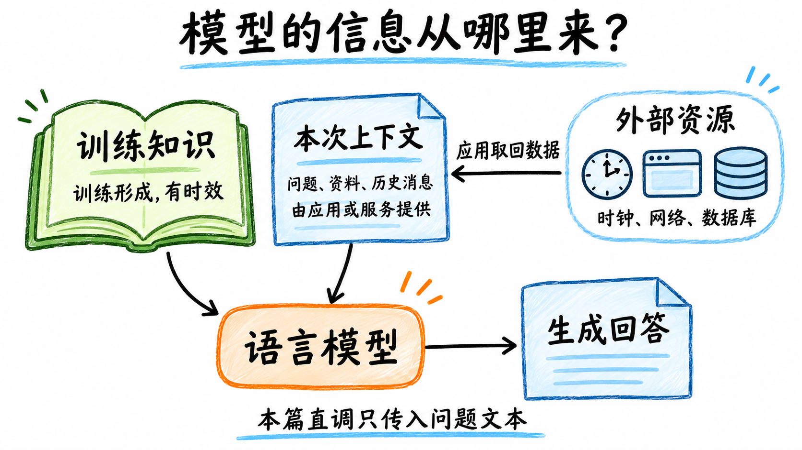
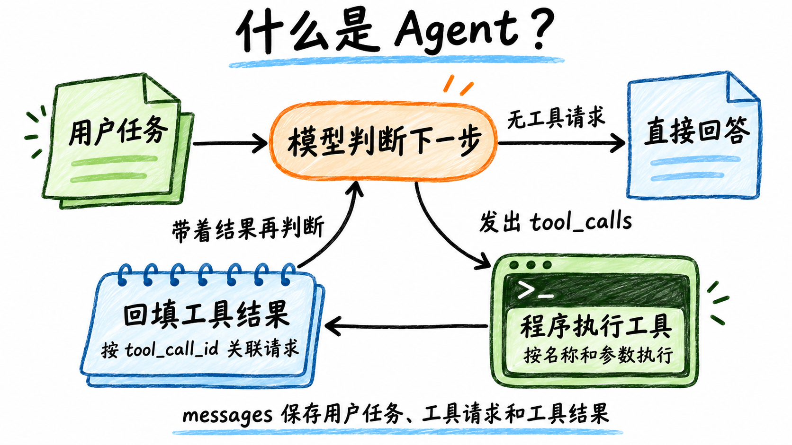
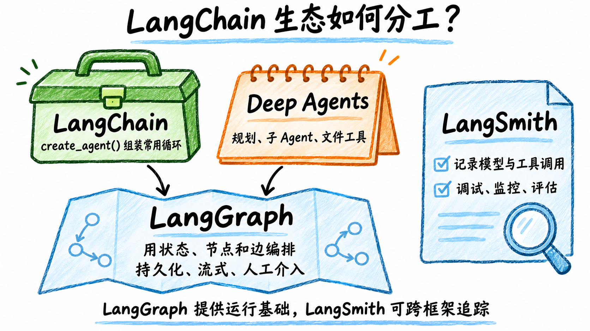

# LangChain 入门笔记 01：Agent 原理与快速入门

本文是《LangChain入门笔记》系列的第一篇。

“今天是几月几号？”——对能看一眼时钟的人来说，这是最简单的问题；对大语言模型（LLM）来说却未必。它可能给出一个日期，也可能说无法确认。即使答对了，你也无从判断这个日期从哪里来。

这道题很适合拿来拆开 Agent 看。接下来我们用同一道题走三遍：直接问模型，看它在没有外部信息时会怎么回答；手写一个能按需读取系统时钟的 Agent，看模型和程序之间究竟要传递些什么；最后用 LangChain 重写同一个例子，看框架替我们省掉了哪些重复劳动。

不需要预先准备任何仓库。文章从一个空目录开始，带你把项目建起来、依赖装上、代码跑通。读完你会拿到三个能运行的小程序，更重要的是能回答：Agent 到底比单独的 LLM 多了什么？自己写一个要多少代码？LangChain 又能省掉哪些？

## 1.1 先想清楚：模型为什么答不准“今天”

理解 LLM 的局限，可以从三个问题入手。模型在训练中学到了什么？这次推理能用到哪些信息？下一次调用时，谁负责把前面的信息接上？

1. **训练知识有时效。** 模型的参数反映了训练时学到的信息。训练之后发生的事件、此刻的库存、用户刚提交的订单等事实，需要在回答时从可用的上下文或外部来源获得。
2. **访问外部资源需要宿主提供能力。** 模型可以处理传入的文本，支持多模态的模型也可以处理图像等内容。如果应用提供了工具，模型还可以发出结构化的工具请求，由应用或服务执行。读取本机时钟、查询数据库等操作都需要运行环境提供访问途径。
3. **对话连续性依赖调用方或服务。** 一次独立的模型调用只能利用这次推理时可用的上下文。多轮对话通常由应用带上历史消息，或由托管服务保存历史并在后续调用中取回。

“今天是几月几号”同时涉及训练知识的时效和外部信息的访问。模型可以解释“今天”的含义，确定当前日期则需要知道回答时刻和所用时区。接下来的直调实验只发送问题，随后两遍再让模型有机会请求运行脚本的机器读取本地时间。



图 1 展示了训练知识、本次上下文和外部资源的关系。本篇的直调实验只把问题文本放入上下文。

## 1.2 从空目录开始：项目、依赖与配置

理论说完了，现在把能跑的现场搭起来。这个系列会持续往同一个项目里加内容，所以先建一个项目根目录，再把本篇的代码放进它自己的章节目录。第一篇只用到下面这一小块，后续篇章会照着同样的样子往里加。

先建项目，并进入目录：

```bash
uv init LangChainAgent
cd LangChainAgent
```

`uv init` 会生成一个最小的 `pyproject.toml`，用来声明项目信息和依赖。接着用 `uv add` 装依赖，它会自动更新这个文件，并生成 `uv.lock` 锁定版本：

```bash
uv add openai python-dotenv langchain langchain-deepseek
```

`openai` 用来调用 DeepSeek 的兼容接口，`python-dotenv` 读取 `.env`，`langchain` 和 `langchain-deepseek` 用于最后的框架版。装完依赖后，在项目根目录创建本篇的代码目录。

```bash
uv run python -c "from pathlib import Path; Path('LangChain入门笔记/01-Agent原理和LangChain快速入门').mkdir(parents=True, exist_ok=True)"
```

完成本篇后，项目里的相关文件如下。配套仓库另有 `notebooks/` 和 `images/`。

```text
LangChainAgent/
├── .env                  # API 密钥，自己创建
├── .gitignore            # 加入 /.env
├── pyproject.toml        # uv 生成，声明依赖
├── uv.lock               # uv add 生成，锁定版本
└── LangChain入门笔记/      # 系列笔记，按篇分目录
    └── 01-Agent原理和LangChain快速入门/   # 本篇
        ├── 01-llm-call.py      # 第一遍：直接问模型
        ├── 02-manual-agent.py  # 第二遍：手写 Agent
        └── 03-agent-call.py    # 第三遍：LangChain 版
```

先在项目根目录的 `.gitignore` 末尾加上 `/.env`。如果项目使用 Git，在根目录运行 `git check-ignore .env`，应看到输出 `.env`。

确认后，在项目根目录创建 `.env`，填入自己的 DeepSeek API 密钥。`python-dotenv` 会从脚本所在目录向上查找这个文件。

```dotenv
DEEPSEEK_API_KEY=你的实际密钥
```

三个示例都用 DeepSeek 的 `deepseek-flash`，并关闭思考模式，方便观察模型回答和工具请求的结构。 [DeepSeek API 调用指南](https://api-docs.deepseek.com/) · [DeepSeek 思考模式](https://api-docs.deepseek.com/guides/thinking_mode/)

如果你已有配套仓库，三个脚本和 Git 忽略规则都已就绪。直接在仓库根目录运行 `uv sync --locked` 安装锁定的依赖，然后创建本地 `.env` 并填入密钥。本篇的三个运行命令都从项目根目录执行。

## 1.3 第一遍：直接问模型

只给模型一个问题，既不提供当前日期，也不接入时钟工具，它会怎么回答？

从零搭建项目时，把下面的代码保存到章节目录，文件名为 `01-llm-call.py`。配套仓库已提供 [01-llm-call.py](./01-llm-call.py)。在项目根目录运行：

```bash
uv run "LangChain入门笔记/01-Agent原理和LangChain快速入门/01-llm-call.py"
```

```python
import os

from dotenv import load_dotenv
from openai import OpenAI

load_dotenv()

client = OpenAI(
    api_key=os.environ["DEEPSEEK_API_KEY"],
    base_url="https://api.deepseek.com",
)

response = client.chat.completions.create(
    model="deepseek-flash",
    messages=[{"role": "user", "content": "今天是几月几号"}],
    extra_body={"thinking": {"type": "disabled"}},
)

print(response.choices[0].message.content)
```

脚本只发送了一条用户消息，也没有注册工具。模型可能给出日期，也可能说无法确认。即使日期答对了，仅凭这次请求和输出，也无法把答案追溯到运行脚本的机器时钟。

碰到固定流程，比如“收到问题就先读时钟，再把日期交给模型组织措辞”，这么写就够了。但如果同一个入口要回答各种问题，“这次要不要查时间”就不该由你预先写死，而该让模型根据问题自己判断。要做到这一点，得给模型加上 tools。

## 1.4 Agent 是什么：模型、工具与循环

如果程序收到请求后总要读一次时钟，按固定流程读取时间，再交给模型组织措辞就够了。当同一个入口要回答不同问题，需要根据问题判断是否查时间、调用哪个工具或要不要继续查，才适合把这部分判断交给 Agent。模型每多做一次判断，就可能多一次请求，流程的耗时和结果也会有波动。

任务需要读时钟、查数据库或调接口时，应用可以把这些操作注册成工具。模型根据当前上下文请求动作，程序执行并回传结果，模型再决定下一步。围绕模型组织工具和执行循环，就构成了本篇要实现的 Agent。

这套结构有三块：

1. **模型负责判断。** 它读当前上下文，判断这一轮该直接回答，还是请求某个工具。模型依然是 LLM，能力边界没有变，变的是它多了一个“可以请求动作”的选项。
2. **工具负责执行。** 工具把外部能力（读时钟、查库、发请求）包装成模型可以请求的接口，附带名称、用途和参数说明。模型发出工具请求，真正的执行由程序完成。
3. **循环与状态负责驱动。** 程序执行工具、回填结果、再次调用模型，直到模型不再请求工具。本例用 `messages` 保存运行中的对话历史，并把它与工具说明一起提供给下一次模型调用。

把三块串起来，一次运行大概是这样：用户问题进入消息列表 → 模型读到工具说明，输出一条工具请求 → 程序按请求找到并执行工具，拿到结果 → 程序把结果作为新消息追加进列表，并标明它对应哪次请求 → 模型看到更新后的历史，再决定是继续请求工具，还是给出最终回答 → 直到某一轮没有工具请求为止。每一轮模型读到的，都是更新后的同一份上下文，工具结果正是靠回填进这里才被模型"看见"。这就是 ReAct 论文里"推理—行动—观察"交替的思路：模型不是一口气给出答案，而是看到结果后再决定下一步。

工具没注册、参数校验失败、循环不收敛，都可能让这条链路中断。下面的手写版会把这些步骤摊开，方便看清问题发生在哪一环。



图 2 展示了 Agent 的三个组成部分。模型判断下一步，工具执行外部操作，循环与状态负责记录结果、将结果交回模型并推进任务。

手写版把三块逻辑摆在一起：工具函数、工具说明、维护消息列表并反复调用模型的循环。从零搭建项目时，把代码保存到章节目录，文件名为 `02-manual-agent.py`。配套仓库已提供 [02-manual-agent.py](./02-manual-agent.py)。在项目根目录运行：

```bash
uv run "LangChain入门笔记/01-Agent原理和LangChain快速入门/02-manual-agent.py"
```

```python
import datetime
import json
import os

from dotenv import load_dotenv
from openai import OpenAI

load_dotenv()

client = OpenAI(
    api_key=os.environ["DEEPSEEK_API_KEY"],
    base_url="https://api.deepseek.com",
)


def current_time() -> str:
    """获取当前时间。"""
    return str(datetime.datetime.now())


tools_by_name = {"current_time": current_time}
tools = [
    {
        "type": "function",
        "function": {
            "name": "current_time",
            "description": "获取当前时间。",
            "parameters": {"type": "object", "properties": {}},
        },
    },
]


def run_agent(question: str) -> str:
    messages = [{"role": "user", "content": question}]

    for _ in range(5):
        response = client.chat.completions.create(
            model="deepseek-flash",
            messages=messages,
            tools=tools,
            tool_choice="auto",
            extra_body={"thinking": {"type": "disabled"}},
        )
        message = response.choices[0].message
        messages.append(message)

        if not message.tool_calls:
            return message.content or ""

        for call in message.tool_calls:
            name = call.function.name
            tool = tools_by_name.get(name)
            if tool is None:
                raise ValueError(f"未注册的工具：{name}")

            arguments = json.loads(call.function.arguments)
            print(f"工具请求：{name}，参数：{call.function.arguments}")
            result = tool(**arguments)
            print(f"工具结果：{result}")

            messages.append(
                {"role": "tool", "tool_call_id": call.id, "content": result}
            )

    raise RuntimeError("达到 5 次模型调用，仍未生成最终回答。")


print(f"最终回答：{run_agent('今天是几月几号')}")
```

模型选择调用工具时，输出类似这样。时间来自运行脚本的机器，日期和措辞会随运行变化。

```text
工具请求：current_time，参数：{}
工具结果：2026-11-24 21:44:05.338296
最终回答：今天是 11 月 24 日。
```

输出里三个字段对应三要素：`tool_calls` 是模型发出的工具请求；`role="tool"` 和 `tool_call_id` 把程序执行的结果回填进消息列表，并关联到对应请求；最终回答来自模型读完更新后历史的下一次决策。循环最多五轮，超了就报错——这是“循环与状态”落在工程上的落点。 [DeepSeek 工具调用文档](https://api-docs.deepseek.com/guides/tool_calls/) · [ReAct 原论文](https://arxiv.org/abs/2210.03629)

## 1.5 两条路径对比与选择

把两条路径放在一起看，差别更直观：

| 对比维度 | 本篇的模型直调 | 本篇的 Agent |
| --- | --- | --- |
| 产出方式 | 根据上下文直接生成回答 | 可直接回答，也可先请求工具再回答 |
| 实时信息来源 | 调用方可以把事实放进 `messages` | 可由模型请求工具获取，本例使用本机时钟 |
| 执行操作 | 脚本只发送问题 | 程序执行模型请求的已注册工具 |
| 对话历史 | 脚本只发送一条用户消息 | `messages` 保存同一次运行中的请求与结果 |
| 决策主体 | 无“是否行动”的判断，流程由程序写死 | 模型判断要不要调用工具、调用哪个 |
| 本例中的风险 | 碰巧答对，但日期来源无法验证 | 工具未注册、参数解析失败、循环上限等运行问题 |
| 本文中的对应 | 直接问模型：`01-llm-call.py` | 手写 `run_agent`；LangChain `create_agent` |

别把它理解成两种对立方案：Agent 里干决策的还是那个 LLM，只是外面加了工具与循环。

## 1.6 LangChain：把重复劳动交给框架

### 1.6.1 框架定位

LangChain 是一个用来构建 LLM 应用的框架，把接入模型、声明工具、组装 Agent 循环、管理消息这些重复工作收进统一接口。

为什么要它？回头看手写版：真正的业务逻辑只有“读系统时间”一行，其余都在处理工具注册、消息格式和循环控制。这些活儿每个 Agent 都要干一遍，却跟具体业务无关。

框架的做法是加一层抽象：模型接口统一，不同厂商一种调法；工具声明化，从函数签名和文档字符串生成说明；循环内置，调度交给框架；消息标准化，各类消息有统一类型。开发者只要说清楚用哪个模型、有哪些工具、问什么，执行结构框架接好。

边界也明显：常见 Agent 形态能省掉大量样板代码，但模型还是那个模型，能力边界没变。抽象有代价——调试时得透过框架去看消息列表，弄清里面发生了什么。

### 1.6.2 四个核心组件

框架的抽象落到四个组件上，正好替换手写版里那四块重复代码：

| 组件 | 封装的抽象 | 替代手写版的哪块工作 |
| --- | --- | --- |
| `init_chat_model` | 统一的模型接入 | 配置 `OpenAI(base_url=...)` 并读取响应 |
| `@tool` | 从函数签名生成工具说明 | 手写 `tools_by_name` 与 `tools` 描述字典 |
| `create_agent` | 内置的循环与工具调度 | `run_agent` 里的查找、解析、循环与回填 |
| `messages` | 标准化的消息类型 | 手写版里显式维护的 `messages` 列表 |

用这四个组件重写时钟示例，框架会接管工具注册、消息转换和循环。从零搭建项目时，把代码保存到章节目录，文件名为 `03-agent-call.py`。配套仓库已提供 [03-agent-call.py](./03-agent-call.py)。在项目根目录运行：

```bash
uv run "LangChain入门笔记/01-Agent原理和LangChain快速入门/03-agent-call.py"
```

```python
import datetime

from dotenv import load_dotenv
from langchain.agents import create_agent
from langchain.chat_models import init_chat_model
from langchain.messages import HumanMessage
from langchain.tools import tool

load_dotenv()

model = init_chat_model(
    model="deepseek-flash",
    extra_body={"thinking": {"type": "disabled"}},
)


@tool
def current_time() -> str:
    """获取当前时间"""
    return str(datetime.datetime.now())


agent = create_agent(model=model, tools=[current_time])
response = agent.invoke({"messages": [HumanMessage("今天是几月几号")]})

for message in response["messages"]:
    message.pretty_print()
```

如果模型调用一次时钟工具再作答，输出里会看到四条消息。`HumanMessage` 是提问，第一条 `AIMessage` 是工具请求，`ToolMessage` 记录本地时间，最后一条 `AIMessage` 给出回答。如果模型直接回答，输出里就只有提问和回答。

工具交给模型时，docstring 会成为工具的用途说明。上面的“获取当前时间”足够演示调用。同一个工具如果能查两个时区，说明可以写清什么时候该用它，还可以用参数描述和 `Literal` 告诉模型该传什么值。

```python
from datetime import datetime, timedelta, timezone
from typing import Annotated, Literal

from langchain.tools import tool
from pydantic import Field


@tool
def current_time(
    zone: Annotated[Literal["UTC", "UTC+8"], Field(description="要查询的时区")],
) -> str:
    """回答当前日期或时间时，查询指定时区的时钟。"""
    offset = timedelta(hours=8 if zone == "UTC+8" else 0)
    return datetime.now(timezone(offset)).isoformat(timespec="seconds")
```

模型看到的 `zone` 有两个可选值。`system_prompt` 则可以给整个 Agent 定一条规则，例如“回答当前日期前，先查时钟”。工具说明帮助模型选工具和填参数，系统提示词给出整个任务的行为要求。 [LangChain Tools](https://docs.langchain.com/oss/python/langchain/tools)

| 手写 Agent 要处理的工作 | LangChain 如何处理 |
| --- | --- |
| 配置 DeepSeek 请求并读取模型响应 | `init_chat_model()` 接入 DeepSeek，模型集成读取 `DEEPSEEK_API_KEY` 并把响应转换成标准消息 |
| 为工具编写名称、说明和参数结构 | `@tool` 从函数名、文档字符串和参数签名生成工具描述 |
| 根据名称查找函数、解析参数并执行 | `create_agent()` 根据传入的工具列表处理模型发出的工具请求 |
| 用调用 ID 关联结果，更新消息并再次请求模型 | Agent 把结果加到消息状态里，继续调用模型，直到模型这一轮没有新的工具请求 |

调用时只要给模型、工具函数和用户消息，完整流程就跑起来了。想调试，直接看 `response["messages"]`：模型有没有请求工具、工具返回了什么，都在里面。 [LangChain Agents 文档](https://docs.langchain.com/oss/python/langchain/agents) · [DeepSeek 模型集成](https://docs.langchain.com/oss/python/integrations/chat/deepseek)

### 1.6.3 工具如何拿到运行时信息

假设工具要知道当前用户是谁。应用可以用 `context_schema` 声明要传的字段，在调用 Agent 时通过 `context` 提供值，工具用 `ToolRuntime` 取到它。把下面的代码接在 1.6.2 的完整 `03-agent-call.py` 示例末尾一起运行，它会复用前面初始化好的 `model`。

```python
from dataclasses import dataclass

from langchain.agents import create_agent
from langchain.tools import ToolRuntime, tool


@dataclass
class UserContext:
    user_id: str


@tool
def current_user(runtime: ToolRuntime[UserContext]) -> str:
    """查询当前用户的编号。"""
    return runtime.context.user_id


agent = create_agent(model=model, tools=[current_user], context_schema=UserContext)
result = agent.invoke(
    {"messages": [{"role": "user", "content": "请调用工具查询我的用户编号。"}]},
    context=UserContext(user_id="student-01"),
)
print(result["messages"][-1].text)
```

工具调用成功时，工具返回 `student-01`，模型可以用这个结果回答。`messages` 记录提问、回答和工具结果。`context` 由应用为本次运行提供，`runtime` 参数由框架注入，模型发出工具请求时无需填写它。这个例子里，用户编号在工具返回后才进入消息历史。 [LangChain Tools](https://docs.langchain.com/oss/python/langchain/tools)

### 1.6.4 生态工具的分工

LangChain 的 `create_agent()` 和 Deep Agents 都运行在 LangGraph 上。LangSmith 可以跨框架追踪和评估运行结果。



图 3 展示了 LangChain、Deep Agents、LangGraph 和 LangSmith 的分工。

| 组件 | 解决的问题 |
| --- | --- |
| LangChain | 接入模型和工具，用 `create_agent()` 搭建和定制常见的 Agent 循环 |
| LangGraph | 用状态、节点和边显式编排流程，支持持久化执行、流式输出和人工介入 |
| Deep Agents | 为较长、分步骤的任务提供规划、子 Agent 和文件系统工具等预置能力 |
| LangSmith | 追踪每次运行中的模型与工具调用，帮助调试、监控和评估 |

四者不是层层替代，而是互补：日常循环用 LangChain，要显式控制流程换 LangGraph，长任务看 Deep Agents，调试和监控交给 LangSmith。产品分工可参阅 [LangGraph 官方概览](https://docs.langchain.com/oss/python/langgraph/overview)。

三个主示例都放在 1.2 搭好的项目里，用 `uv run` 就能直接跑。

### 1.6.5 循环出问题时从哪里查

手写版的 `for _ in range(5)` 给循环设了上限。换成 `create_agent` 后，可以用中间件给模型调用或工具调用设上限，也可以在出错时重试，或者把错误交回模型处理。

| 遇到的情况 | 从哪里查或怎么处理 |
| --- | --- |
| 工具找不到或参数不合法 | 先核对 `tools` 列表和参数 schema。工具执行抛出的异常可用 `ToolErrorMiddleware` 转成错误消息，让模型看到问题。 |
| 模型或工具遇到暂时性的超时、限流 | 分别用 `ModelRetryMiddleware` 或 `ToolRetryMiddleware` 做有限重试。 |
| 模型反复请求工具 | 用 `ModelCallLimitMiddleware` 限制模型调用次数，或用 `ToolCallLimitMiddleware` 限制工具调用次数。 |

[LangChain 内置中间件](https://docs.langchain.com/oss/python/langchain/middleware/built-in)

## 1.7 小结

走到这里，可以把几条线索收一收：

1. LLM 的训练知识有时效，外部资源访问需要宿主提供能力，多轮对话由应用或服务接续历史。日期实验展示了如何为模型提供可追溯的实时信息。
2. Agent 没换模型，只是在外面加了一层结构：判断交给模型，外部能力交给工具，循环和状态把两者接起来。
3. 消息列表记录“推理—行动—观察”过程中交换的信息，Runtime Context 把调用方提供的值传给工具。
4. 流程固定时可以直接写程序。引入 Agent 后，先从工具注册与参数定义查找问题，需要时用中间件重试或限制调用次数。
5. LangChain 把模型接入、工具声明、循环组装、消息管理收成四个组件，省样板代码，不换模型能力；再往复杂走，LangGraph 管显式编排，Deep Agents 管长任务，LangSmith 管追踪评估。

循环框架接好了，模型本身仍然是可以单独配置和调用的组件。下一篇从模型初始化接口讲起：[如何初始化和配置 LangChain 模型](../02-LangChain模型初始化/LangChain模型初始化.md)。
