## 1. 认识Agent

### 1.1 什么是Agent

什么是Agent，这其实没有一个标准的答案，每个人都有自己的理解。

对于这个问题，LangChain创始人[Harrison Chase](https://www.blog.langchain.com/tag/harrison-chase/)有一个偏向技术性的答案：

> An AI agent is a system that uses an LLM to decide the control flow of an application.
>
> Agent是一种使用大语言模型（LLM）来决定应用程序控制流的系统。


在人工智能领域，**Agent**（通常翻译为**智能体**或**代理**）是指**一种能够感知环境、进行推理、自主决策并采取行动以实现特定目标的智能系统。**


| **特性&#x20;** | **传统聊天机器人/LLM** | **AI Agent**                   |
| -------------- | ---------------------- | ------------------------------ |
| **交互模式**   | 被动响应，问一句答一句 | 主动规划，以目标为导向         |
| **执行力**     | 停留在文本生成层面     | 能操作软件、发送邮件、分析数据 |
| **自主性**     | 需要人类给出详细步骤   | 只需给定最终目标，自主寻找路径 |


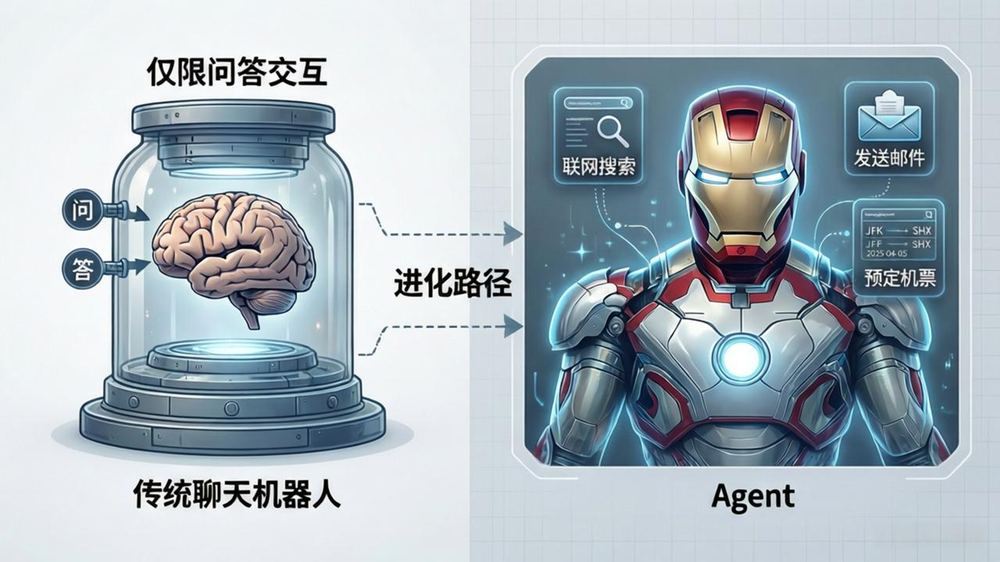

如果说大模型（LLM）是“大脑”，那么 Agent 就&#x662F;**“拥有手脚和思维逻辑的独立个体”**。

它不再只是被动地回答问题，而是能主动拆解任务并调用各种工具来完成工作。


例如：要开发一个《AI旅游助手》的应用。

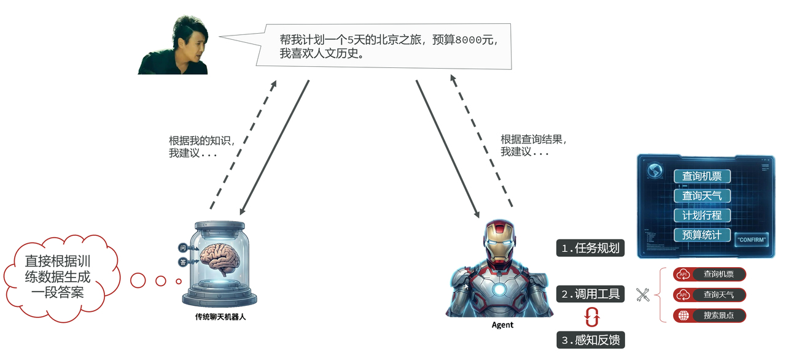


如果是**传统LLM应用**，程序流程是这样的：

> 1. 用户提出需求，例如：帮我计划一个5天的北京之旅，预算8000元，我喜欢历史。
>
> 2. 调用LLM，分析用户需求，直接由LLM生成一个简单旅游计划

这个计划基于它训练数据中的通用知识，可能没有考虑当前的天气、景点是否关闭、门票是否可预订等实时信息。


如果是**Agent应用**，Agent可以自主规划程序流程：

> 1. 用户提出需求，例如：帮我计划一个5天的北京之旅，预算8000元，我喜欢历史。
>
> 2. Agent分析用户需求，分步执行：
>
>    1. 规划： 将大目标分解为：查询机票酒店价格 -> 查询天气和景点信息 -> 设计每日行程 -> 计算总预算。
>
>    2. 调用工具：
>
>       * 调用机票/酒店API，查询用户指定日期范围内的价格和可选酒店。
>
>       * 调用天气预报API，查询未来5天北京的天气，建议携带的衣物。
>
>       * 调用搜索引擎/景点API，查询故宫、国博等热门景点的最新开放时间、预约政策和当前展览。
>
>    3. 感知与反馈： 综合感知所有查询到的实时信息，生成一个动态的、可执行的计划。例如：“根据预算和您对历史的兴趣，我推荐入住胡同里的XX酒店。第一天去故宫，但请注意下周一故宫闭馆，所以调整到第二天……总花费预计7500元，还在预算内。需要我现在帮您预订酒店和机票吗？”

Agent通过主动规划任务流程，主动使用工具，整合了实时信息，并进行了动态调整，最终产出的是一个真正可落地的方案。


总结如下：

* LLM = 聪明的大脑

* Agent = 聪明的大脑 + 工具（手脚）


那么问题来了：

> 工具该如何定义呢？
>
> LLM如何调用工具呢？


### 1.2 ToolCalling原理

工具的本质就是函数：

* 一个查询天气的函数，就是查天气工具

* 一个查询机票的函数，就是查机票工具

* ...


例如，我们来定义一个函数：

```python
def get_weather(location: str) -> str:
    """
    Get the weather in a given location.
    Args:
        location: city name or coordinates
    """
    return f"Current weather in {location} is sunny"
```

现在，这就是一个查询天气的工具。

但大家思考一下，**工具是在本地自己定义的，而模型则是在服务器上运行**的（比如DeepSeek）。

那么问题来了：

> * 模型如何知道我们有哪些工具？
>
> * 模型又该如何调用我们的工具呢？


其实调用函数只需要知道函数名和参数类型就可以了，模型在云端，无法调用我们，所以只能换一个思路：

* 让模型知道我们的工具(函数名称、参数名）

* 让模型把想调用的工具和参数（函数名、参数值）返回给我们


要解决这个问题，就需要用到ToolCalling技术了。原理如图：

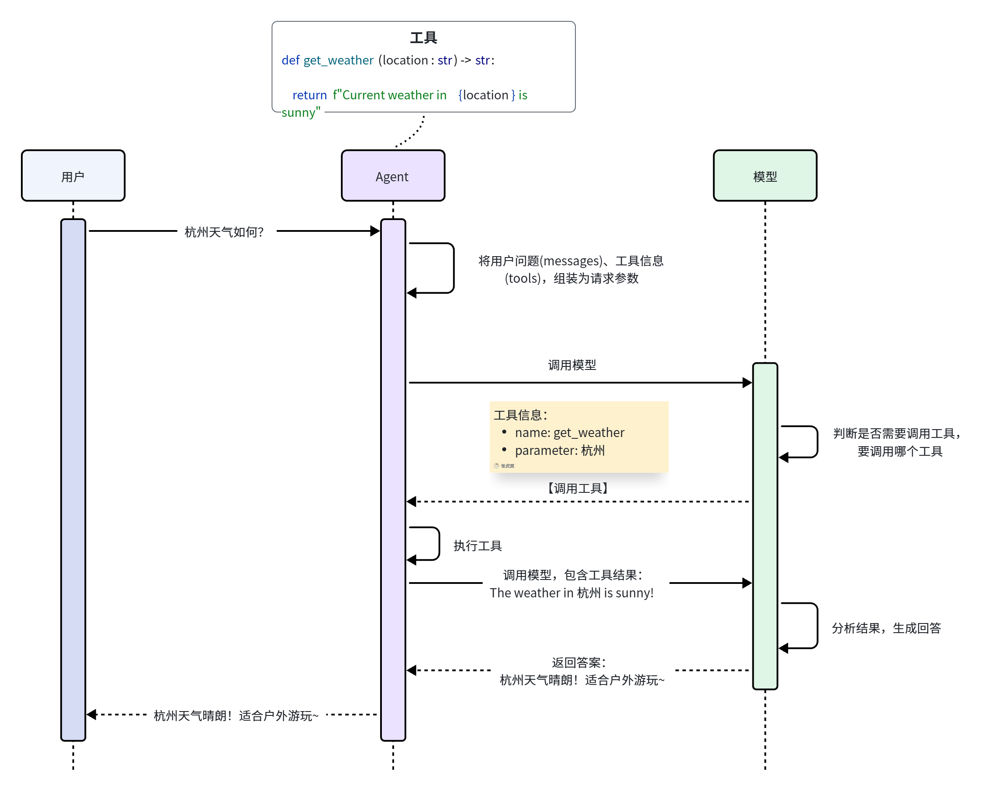

其实思路并不复杂，流程是这样的：

1. 我们在本地定义get\_weather这样的工具函数（可以有多个）

2. 用户询问杭州天气

3. 我们把工具对应的函数名、函数参数格式、用户问题组织在一起作为请求参数，发送给模型

4. 模型根据用户问题判断：

   1. 是否需要调用工具

   2. 要调用哪个工具

5. 模型返回工具信息，包括：要调用的函数名、参数

6. 我们根据函数名找到函数，调用函数，传入参数，得到结果

7. 把工具执行结果结合用户问题发送给模型，由模型分析结果，是否足以回答

   1. 足够，直接生成答案

   2. 不足，回到4（继续调用其它工具）


其实，在大模型提供的API接口中，有一个tools参数，描述了工具的详细信息：

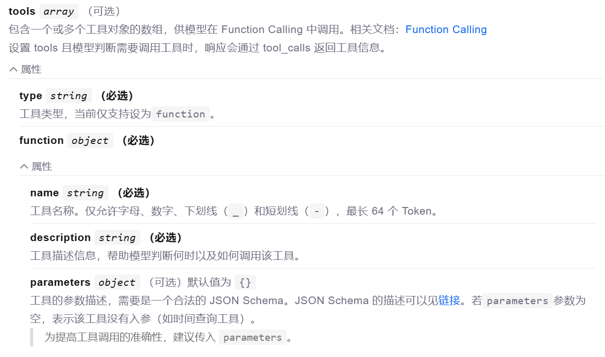

当模型判断需要调用工具时，在返回的结果中，就会有要调用的工具信息：

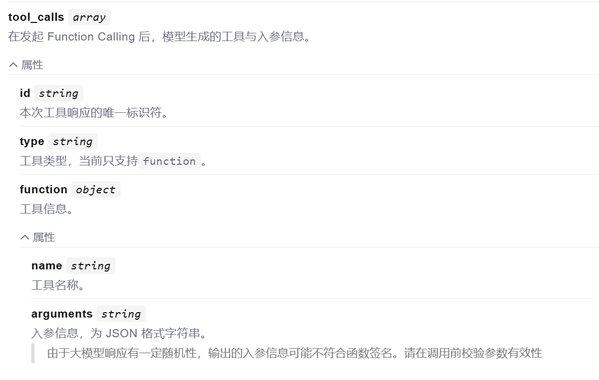

所以，我们只需要这么几件事情：

* 在调用LLM时传入toos参数，把工具信息发给LLM

* 在LLM返回结果中找到tool\_calls，找到要调用的function的name和arguments，然后调用function

* 把function结果发给LLM，让LLM生成自然语言回答


### 1.3 ToolCalling代码演示

接下来，我们就基于ToolCalling的原理，来手搓一个Agent，不过首先我们需要安装一些依赖：

```python
uv add openai
```

然后，在`notebooks`目录下新建一个`day05`，再新建一个`1.tool_calling.ipynb`文件：

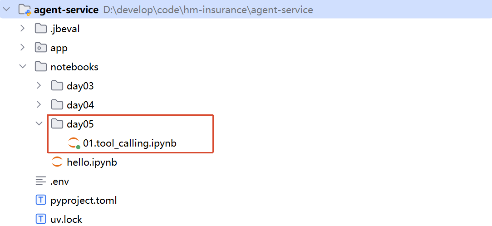

示例代码：

```python
import json
import os
from openai import OpenAI
from dotenv import load_dotenv
load_dotenv()


# ==================== 1. 定义工具 ====================
def get_weather(location: str) -> str:
    return f"Current weather in {location} is sunny"

def square_root(x: float) -> float:
    return x ** 0.5

# 把函数放到dict中，方便根据函数名查找
tools_by_name = {"get_weather": get_weather, "square_root": square_root}

# ==================== 2. 定义工具的LLM描述 ====================
tools = [
    {
        "type": "function",
        "function": {
            "name": "get_weather",
            "description": "Get weather of a location, the user should supply a location first.",
            "parameters": {
                "type": "object",
                "properties": {
                    "location": {
                        "type": "string",
                        "description": "The city and state, e.g. San Francisco, CA",
                    }
                },
                "required": ["location"]
            },
        }
    },
    {
        "type": "function",
        "function": {
            "name": "square_root",
            "description": "Calculate the square root of a given number.",
            "parameters": {
                "type": "object",
                "properties": {
                    "x": {
                        "type": "number",
                        "description": "The number to calculate square root for",
                    }
                },
                "required": ["x"]
            },
        }
    },
]

# ==================== 3. LLM客户端 ====================
client = OpenAI(
    api_key=os.getenv('DEEPSEEK_API_KEY'),
    base_url="https://api.deepseek.com"
)

# ==================== 4. 定义发送消息的方法 ====================
def send_messages(messages):
    response = client.chat.completions.create(
        model="deepseek-v4-flash",
        messages=messages,
        tools=tools,
        extra_body={"thinking": {"type": "disabled"}}
    )
    return response.choices[0].message

# ==================== 5. 定义执行Tool调用的方法 ====================
def execute_tool(message, messages):
    """解析Tool信息，执行对应的函数，并将结果追加到消息列表"""
    tool_call = message.tool_calls[0]
    tool_id = tool_call.id
    tool_name = tool_call.function.name
    tool_args = json.loads(tool_call.function.arguments)

    print(f"调用工具: {tool_name}, 参数: {tool_args}")

    # 根据函数名找到对应函数并执行
    result = tools_by_name[tool_name](**tool_args)
    print(f"工具结果: {result}")

    # 将AI消息和Tool结果追加到消息列表
    messages.append(message)
    messages.append({
        "role": "tool",
        "tool_call_id": tool_id,
        "content": result
    })
    return messages

# ==================== 6. 主流程 ====================
# 准备用户消息
messages = [{"role": "user", "content": "杭州天气怎么样?"}]
print(f"User> {messages[0]['content']}")

# 第一次调用LLM，获取ToolCall
message = send_messages(messages)
print(f"Tool> {message.tool_calls[0]}")

# 执行Tool并将结果传回LLM
messages = execute_tool(message, messages)

# 再次调用LLM，生成最终答案
message = send_messages(messages)
print(f"AI> {message.content}")
```


### 1.4 总结

传统的LLM应用都是一问一答的形式，模型只能根据自己的训练数据来回答，流程非常简单：

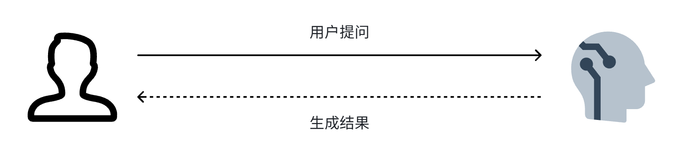


有了ToolCalling技术，则可以让LLM调用工具与外界交互，获取实时信息，工作流程则要复杂很多，是这样的：

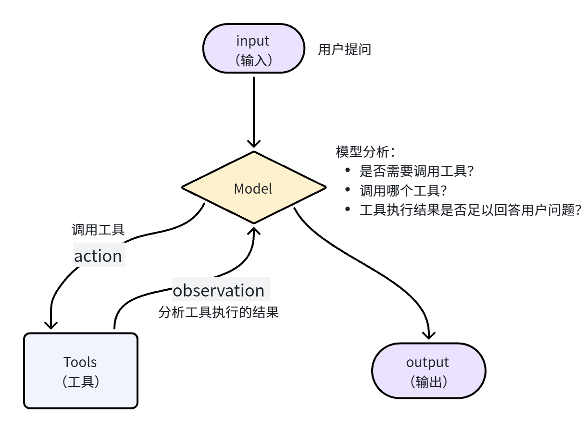

流程如下：

1. 用户提问（Input）：杭州今天天气如何？

2. 模型分析（Reasoning）：用户询问杭州天气，我不知道，需要调用查询天气的工具`get_weather`

3. 调用工具（Action）：调用工具，get\_weather，传入城市"杭州"

4. 分析结果（Observation）：工具返回结果，模型分析结果，判断是否足以回答用户问题

   1. 是：整理生成响应结果

   2. 否：重复前面步骤

5. 生成结果（Output）：根据工具的结果生成响应给用户


上图所说的这个工作模型，我们称为**ReAct**模型，即**R**easoning **Act**ion，而这也是最基础一种Agent工作模型。


恭喜你！已经完成了一个简单的Agent了


不过，可以发现自己手写Agent还是挺复杂的，如果程序工具多起来，代码会成倍增长！所以，为了提升Agent开发的效率，我们就必须学习工业级框架了。


## 2. 认识**LangChain**

LangChain 由 Harrison Chase 创建于2022年10月，是用于开发**智能体工程（Agent Engineering）**&#x7684;平&#x53F0;**。**

官网地址：

官网文档：


### 2.1 架构体系

**LangChain**并不仅仅是一个框架，而是一整个智能体开发平台，包含很多不同的组件。


其中，包含一系列开源的**智能体（Agent）**&#x5F00;发框架，而且兼容Python和TypeScript两种语言：

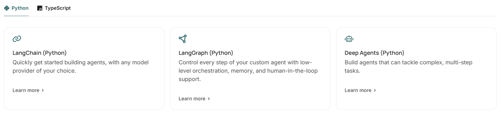

* LangChain：用于快速构建智能体，可兼容任何模型提供商。

* LangGraph：从底层一步步控制智能体的构建，包括记忆（Memory）、人机协同（HITL）等

* Deep Agents：用于构建复杂的、处理多步骤的任务的智能体


另外，LangChain还包含一套帮助人工智能团队利用实时生产数据进行**持续测试和改进**的平台，叫做LangSmith：

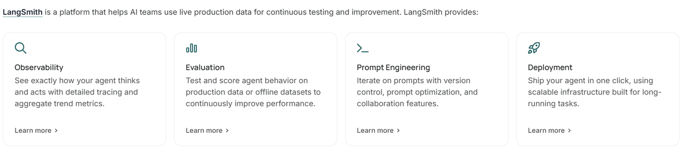


> 总结：
>
> LangChain是智能体开发平台，包含一套各种帮助开发、测试、评估智能体的框架。核心包括：
>
> * LangChain：用于快速构建智能体，可兼容任何模型提供商。
>
> * LangGraph：从底层一步步控制智能体的构建，包括记忆（Memory）、人机协同（HITL）等
>
> * Deep Agents：用于构建复杂的、处理多步骤的任务的智能体
>
> * LangSmith：用于测试、观察、评估、部署智能体

### 2.2 快速入门

下面，我们通过一个快速入门，了解Agent的定义和工作流程。

#### 2.2.1 安装依赖

**首先**，要使用LangChain必须先安装LangChain依赖、以及LangChain对模型的支持依赖。

```bash
uv add langchain langchain-deepseek
```


**然后**，我们要确保在项目&#x7684;**`.env`**&#x73AF;境中配置好**api\_key**:

```python
DEEPSEEK_API_KEY=your_api_key_here
```

接下来，就可以正式开发了。


#### 2.2.2 代码示例

接下来就可以开发Agent了，基本步骤如下：

1. 加载系统环境变量

2. 定义工具

3. 定义Agent，绑定模型和工具

4. 调用Agent


Langchain提供了**create\_agent**方法用来快速创建Agent，我们只需要提供好Agent所需的**模型（Models）**、**工具（Tools）**&#x5373;可。


我们在`notebooks/day05`新建一个`02.LangChain入门.ipynb`文件：

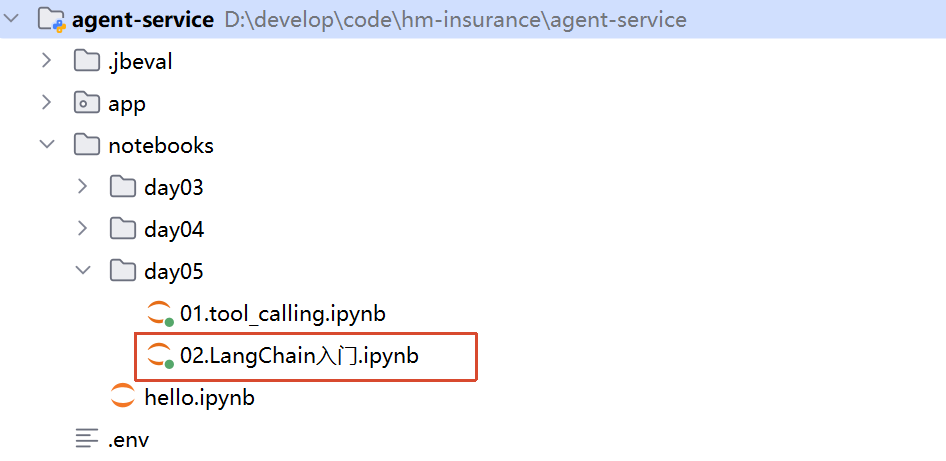

示例代码如下：

```python
from langchain.agents import create_agent
from langchain.tools import tool
from dotenv import load_dotenv

# 1.加载环境变量
load_dotenv() # 读取.env文件，加入系统环境变量中

# 2.定义工具，就是定义函数，给函数加装饰器 @tool
@tool
def get_weather(location: str):
    """查询指定location的天气"""
    return f"Current weather in {location} is sunny"

@tool
def square_root(x: float) -> float:
    """求x的平方根"""
    return x ** 0.5

# 3.定义Agent，绑定模型和工具，用函数create_agent
agent = create_agent(
    model="deepseek-v4-flash",
    tools=[get_weather, square_root]
)

# 4.调用Agent，用invoke函数，传入一个Dict，字典要有messages属性，里面是消息的列表
response = agent.invoke({
    "messages": [{"role": "user", "content": "杭州天气如何？"}]
})
print(response) #
```


> **说明**：
>
> * LangChain的Agent无需你指定api\_key和base\_url，而是会尝试自己去环境变量读取。
>
> * Pydantic Settings读取.env只会存入Settings对象，不会反向放入系统环境变量。在当前场景下需要读取系统环境变量就读取不到。
>
> * 为了保证代码通用性，我们用了另一个库：dotenv，它负责读取.env文件，把其中的变量作为环境变量的一部分，从而简化了LangChain调用。


运行结果如下：

```python
🚀 正在调用大模型...
{'messages': [HumanMessage(content='杭州今天天气如何?', additional_kwargs={}, response_metadata={}, id='c692ed96-916b-4e99-ac39-80106d21b27f'), AIMessage(content='', additional_kwargs={'refusal': None, 'reasoning_content': '用户想知道杭州今天的天气情况。我可以使用getWeather工具来获取杭州的天气信息。'}, response_metadata={'token_usage': {'completion_tokens': 63, 'prompt_tokens': 288, 'total_tokens': 351, 'completion_tokens_details': {'accepted_prediction_tokens': None, 'audio_tokens': None, 'reasoning_tokens': 19, 'rejected_prediction_tokens': None}, 'prompt_tokens_details': {'audio_tokens': None, 'cached_tokens': 0}, 'prompt_cache_hit_tokens': 0, 'prompt_cache_miss_tokens': 288}, 'model_provider': 'deepseek', 'model_name': 'deepseek-v4-flash', 'system_fingerprint': 'fp_8b330d02d0_prod0820_fp8_kvcache_20260402', 'id': '06041747-75ed-4c61-abee-a598feb08c5a', 'finish_reason': 'tool_calls', 'logprobs': None}, id='lc_run--019f22c6-3b84-7d22-afcd-5aee47623cd3-0', tool_calls=[{'name': 'getWeather', 'args': {'location': '杭州'}, 'id': 'call_00_cValv6t9HrvHNJ3WNCSD5096', 'type': 'tool_call'}], invalid_tool_calls=[], usage_metadata={'input_tokens': 288, 'output_tokens': 63, 'total_tokens': 351, 'input_token_details': {'cache_read': 0}, 'output_token_details': {'reasoning': 19}}), ToolMessage(content='Current weather in 杭州 is sunny', name='getWeather', id='32018b5d-00c8-46eb-bf6f-0e1e306b18e1', tool_call_id='call_00_cValv6t9HrvHNJ3WNCSD5096'), AIMessage(content='杭州今天天气晴朗 ☀️，阳光不错，适合外出活动哦！', additional_kwargs={'refusal': None, 'reasoning_content': '工具返回了杭州今天的天气是晴朗的。我可以直接告诉用户。'}, response_metadata={'token_usage': {'completion_tokens': 32, 'prompt_tokens': 370, 'total_tokens': 402, 'completion_tokens_details': {'accepted_prediction_tokens': None, 'audio_tokens': None, 'reasoning_tokens': 15, 'rejected_prediction_tokens': None}, 'prompt_tokens_details': {'audio_tokens': None, 'cached_tokens': 256}, 'prompt_cache_hit_tokens': 256, 'prompt_cache_miss_tokens': 114}, 'model_provider': 'deepseek', 'model_name': 'deepseek-v4-flash', 'system_fingerprint': 'fp_8b330d02d0_prod0820_fp8_kvcache_20260402', 'id': '4a6a34b6-2dae-45bf-bf54-5479f3fdf04d', 'finish_reason': 'stop', 'logprobs': None}, id='lc_run--019f22c6-41d2-7432-8ded-6121a3da3265-0', tool_calls=[], invalid_tool_calls=[], usage_metadata={'input_tokens': 370, 'output_tokens': 32, 'total_tokens': 402, 'input_token_details': {'cache_read': 256}, 'output_token_details': {'reasoning': 15}})]}
```


### 2.3 总结

可以看到，使用LangChain定义Agent代码会非常简单，步骤如下：

1. 使用`@tool`装饰器定义工具，通过文档注释描述工具作用

2. 基于`create_agent`定义Agent，指定`model`和`tools`

3. 调用Agent


很多之前需要自己写的代码都省略了：

* 定义工具时使用`@tool`装饰器，LangChain自动解析tool信息

* 调用LLM时，无需自己组织tools参数，LangChain自动封装

* LLM返回Tool结果时，无需自己解析Tool、调用Tool，LangChain自动处理

* 拿到Tool结果无需自己拼接消息，调用LLM，LangChain自动完成


可以说开发效率大大提高，这就是为什么要使用框架的原因！


当然，以上只是LangChain最基本的用法，接下来我们就详细学习LangChain中的各个组件。

