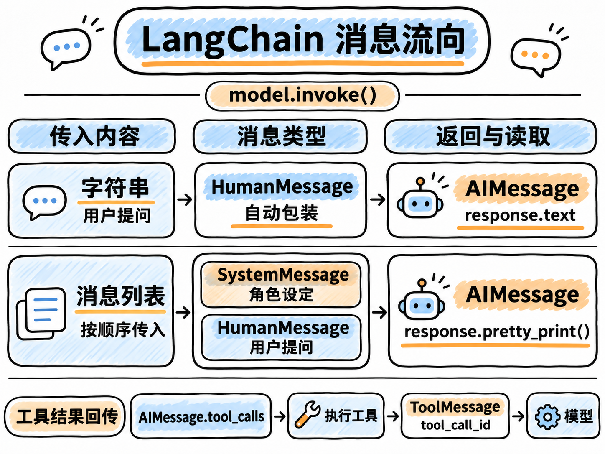

# LangChain 入门笔记 02：模型初始化与消息类型

第 1 篇用 DeepSeek 跑通了 Agent。这一篇从聊天模型本身开始。先拿到一个可以调用的模型对象，再学习怎么用消息向它提问。

## 1. LangChain 初始化模型的几种方式

### 1.1 初始化需要哪些信息

初始化聊天模型时，需要知道要用哪个模型、请求发往哪里，以及如何认证。LangChain 把这些信息放在几个参数里。

| 参数 | 用途 |
| --- | --- |
| `model` | 指定服务端提供的模型名 |
| `model_provider` | 让 `init_chat_model` 选择对应的服务商集成 |
| `base_url` | 指定 API 地址。服务商的集成通常有默认地址 |
| `api_key` | 提供调用凭证。服务商的集成通常也支持从约定的环境变量读取 |

哪些参数需要显式传入，取决于所选集成和端点。本文依次演示三种写法。

| 写法 | 适用场景 |
| --- | --- |
| `init_chat_model(model=...)` | 可以从模型名推断服务商，并使用该集成的默认配置 |
| `init_chat_model(model=..., model_provider=..., base_url=..., api_key=...)` | 需要显式选择集成，并配置自定义端点和密钥 |
| `ChatOllama(model=...)` | 已经知道要用哪个集成，可以直接创建它提供的模型类 |


DeepSeek 可以用第一种写法，是因为 LangChain 识别 `deepseek` 前缀。项目装好 `langchain-deepseek` 后，`init_chat_model` 会创建 `ChatDeepSeek`。这个集成默认使用 DeepSeek 官方地址，并从 `DEEPSEEK_API_KEY` 读取密钥。

[服务商推断规则](https://reference.langchain.com/python/langchain/chat_models/base/init_chat_model) · [聊天模型集成列表](https://docs.langchain.com/oss/python/integrations/chat)

### 1.2 从默认配置到自定义端点

已经跟着第 1 篇建好项目的，可以继续用原来的目录。第一次尝试的话，在一个空目录里初始化项目，再安装公共依赖。

```bash
uv init
uv add langchain python-dotenv
```

按下面各节安装对应的模型集成。如果使用云端模型，把密钥写入项目根目录的 `.env`。每段 Python 示例都可以单独保存为 `main.py`，再从项目根目录运行 `uv run main.py`。

#### 1.2.1 只传模型名初始化 DeepSeek

如果还没安装 DeepSeek 集成，先执行 `uv add langchain-deepseek`。密钥可以沿用第 1 篇的配置，也可以按下面的格式写入 `.env`。

```dotenv
DEEPSEEK_API_KEY=你的实际密钥
```

```python
from dotenv import load_dotenv
from langchain.chat_models import init_chat_model

load_dotenv()
deepseek_model = init_chat_model(model="deepseek-flash")
print(type(deepseek_model).__name__)
```

终端会输出 `ChatDeepSeek`，可以看出只传模型名也能选中 DeepSeek 集成。 [DeepSeek API 模型参数](https://api-docs.deepseek.com/api/create-chat-completion/#request)

#### 1.2.2 显式配置百炼千问

LangChain 无法从 `qwen3.8-flash` 推断服务商。

百炼提供 OpenAI 兼容接口，可以用 `model_provider="openai"` 选用 `ChatOpenAI`，再传入百炼的地址和密钥。如果还没安装 OpenAI 集成，先执行 `uv add langchain-openai`。

把百炼的密钥和 OpenAI 兼容接口地址加入 `.env`。如果控制台给你的访问地址不同，就用控制台显示的地址。

```dotenv
DASHSCOPE_API_KEY=你的实际密钥
DASHSCOPE_BASE_URL=https://dashscope.aliyuncs.com/compatible-mode/v1
```

```python
import os

from dotenv import load_dotenv
from langchain.chat_models import init_chat_model

load_dotenv()
bailian_model = init_chat_model(
    model="qwen3.8-flash",
    model_provider="openai",
    base_url=os.environ["DASHSCOPE_BASE_URL"],
    api_key=os.environ["DASHSCOPE_API_KEY"],
)
print(type(bailian_model).__name__)
```

终端会输出 `ChatOpenAI`。这里的类名表示使用 OpenAI 兼容接口，请求由 `base_url` 指向百炼。百炼千问也可以通过 `langchain-community` 的 `ChatTongyi` 接入。 [阿里云接入指南](https://help.aliyun.com/en/model-studio/use-bailian-in-langchain)

#### 1.2.3 直接实例化 Ollama 模型

集成提供专用的聊天模型类时，可以直接创建模型对象。Ollama 的专用类是 `ChatOllama`。LangChain 也支持用 `init_chat_model(..., model_provider="ollama")` 初始化 Ollama 模型。Ollama 本身还提供部分 OpenAI API 的兼容接口。 [LangChain 初始化参考](https://reference.langchain.com/python/langchain/chat_models/base/init_chat_model) · [Ollama 兼容接口文档](https://docs.ollama.com/api/openai-compatibility)

先安装 LangChain 的 Ollama 集成。

```bash
uv add langchain-ollama
```

安装并启动 Ollama，然后下载示例使用的模型。

```bash
ollama pull qwen3.5:0.8b
```

用 `ChatOllama` 初始化刚下载的模型，再沿用第 1 篇的 `create_agent` 发一次提问。连接默认的本地 Ollama 服务通常无需 API Key。

```python
from langchain.agents import create_agent
from langchain_ollama import ChatOllama

# 初始化 Ollama 上的本地模型
model = ChatOllama(
    model="qwen3.5:0.8b",
    temperature=1.0,
)

# 创建 Agent 并发送一条用户消息
agent = create_agent(model=model, tools=[])

response = agent.invoke({
    "messages": [{"role": "user", "content": "你是谁？"}]
})
print(response)
```

运行后，返回结果的 `messages` 里会包含这次提问和模型回复。想换成其他已经下载的聊天模型，把 `model` 改成对应的标签即可。

#### 1.2.4 在同一端点切换模型

沿用第 1.2.2 节的百炼配置。把初始化封装成函数后，传入不同模型名即可创建对应的模型对象。

```python
import os

from dotenv import load_dotenv
from langchain.chat_models import init_chat_model

load_dotenv()


def create_bailian_model(model_name: str):
    return init_chat_model(
        model=model_name,
        model_provider="openai",
        base_url=os.environ["DASHSCOPE_BASE_URL"],
        api_key=os.environ["DASHSCOPE_API_KEY"],
    )


for model_name in ("qwen3.8-flash", "qwen4-max"):
    model = create_bailian_model(model_name)
    print(model.model_name)
```

## 2. LangChain 的几种消息类型

### 2.1 模型接收什么，返回什么

聊天模型用 `model.invoke(...)` 接收输入，并返回一条 `AIMessage`。最简单的输入是一段字符串，LangChain 会把它包装成一条 `HumanMessage`。如果还要给模型提供角色设定、对话历史或工具结果，就可以传入消息列表。

消息正文放在 `content` 字段里。消息类型表明这段内容在对话中扮演什么角色。

| 类型 | 常见角色 | 用途 |
| --- | --- | --- |
| `HumanMessage` | `user` | 用户的提问或指令 |
| `AIMessage` | `assistant` | 模型的回答或工具调用请求 |
| `SystemMessage` | `system` | 给模型提供角色、语气或任务要求 |
| `ToolMessage` | `tool` | 把工具执行的结果传回模型 |



普通问答通常只涉及 `HumanMessage` 和 `AIMessage`。加入 `SystemMessage` 后，可以让同一个问题带上明确的身份或回答要求。多轮对话则按发生顺序把之前的消息一起传入。

工具调用多一层对应关系。模型发出的调用请求放在 `AIMessage.tool_calls`，工具执行完成后，`ToolMessage.tool_call_id` 要填入对应请求的 ID。第 1 篇的 Agent 就是通过这条消息把读取到的时间交回模型。

需要显式指定其他角色时，可以使用 `ChatMessage`。查看模型回复时，`response_metadata` 和 `usage_metadata` 还可以提供响应元信息和 token 用量。 [LangChain 消息文档](https://docs.langchain.com/oss/python/langchain/messages)

### 2.2 从单句提问到带角色的消息列表

下面两个例子都用 DeepSeek，运行前按第 1.2.1 节安装 `langchain-deepseek` 并配置 `DEEPSEEK_API_KEY`。两个脚本都包含模型初始化，用的是同一个问题。

#### 2.2.1 直接传入字符串

先问一个问题，用 `response.text` 读取回答文本。

```python
from dotenv import load_dotenv
from langchain.chat_models import init_chat_model

load_dotenv()
deepseek_model = init_chat_model(
    model="deepseek-flash",
    extra_body={"thinking": {"type": "disabled"}},
)

response = deepseek_model.invoke("为什么月亮每天看起来形状不一样？")
print(response.text)
```

如果想查看完整的 `AIMessage`，也可以直接打印 `response`。这里通过 `extra_body` 关闭思考模式。 [DeepSeek 思考模式文档](https://api-docs.deepseek.com/guides/thinking_mode/)

#### 2.2.2 传入带角色的消息列表

保留同一个问题，在前面加一条 `SystemMessage`，让模型以天文馆讲解员的身份回答。

```python
from dotenv import load_dotenv
from langchain.chat_models import init_chat_model
from langchain.messages import HumanMessage, SystemMessage

load_dotenv()
deepseek_model = init_chat_model(
    model="deepseek-flash",
    extra_body={"thinking": {"type": "disabled"}},
)

messages = [
    SystemMessage(content="你是一位天文馆讲解员，用小学生能听懂的语言回答。"),
    HumanMessage(content="为什么月亮每天看起来形状不一样？"),
]
response = deepseek_model.invoke(messages)
response.pretty_print()
```

`response.pretty_print()` 会打印模型返回的消息。要继续多轮问答，可以把这条回复和下一条用户提问按顺序追加到 `messages`，再调用一次模型。

下一篇讲 Agent 的调用细节。
