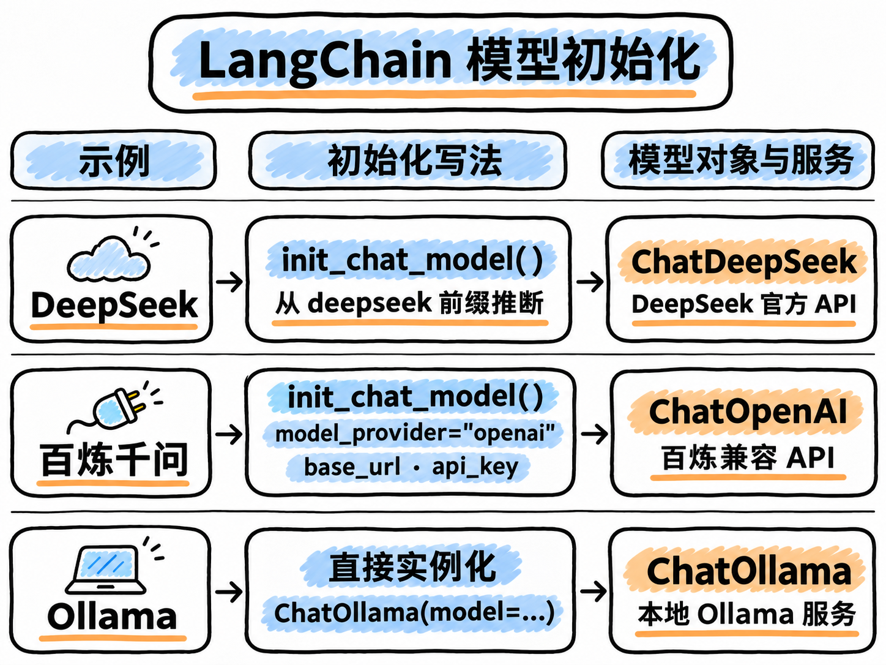

# LangChain 入门笔记 02：模型初始化、消息类型与内容

第 1 篇用 DeepSeek 跑通了 Agent。这一篇从聊天模型本身开始。先拿到一个可以调用的模型对象，再学习怎么用消息向它提问。

## 1. LangChain 初始化模型的几种方式

### 1.1 初始化需要哪些信息

LangChain中可以使用 `init_chat_model` 初始化聊天模型。

```python
init_chat_model(
  model: str | None = None,
  *,
  model_provider: str | None = None,
  configurable_fields: Literal['any'] | list[str] | tuple[str, ...] | None = None,
  config_prefix: str | None = None,
  kwargs: Any = {}
) -> BaseChatModel | _ConfigurableModel
```

**相关参数说明：**

| 参数 | 用途 |
| --- | --- |
| `model` | 指定服务端提供的模型名 |
| `model_provider` | 让 `init_chat_model` 选择对应的服务商集成 |
| `base_url` | 指定 API 地址。服务商的集成通常有默认地址 |
| `api_key` | 提供调用凭证。服务商的集成通常也支持从约定的环境变量读取 |

哪些参数需要显式传入，取决于所选集成和端点。本文依次演示三种写法。

| 写法 | 适用场景 |
| --- | --- |
| `init_chat_model(model=...)` | 可以从模型名推断服务商，并使用该集成的默认配置 |
| `init_chat_model(model=..., model_provider=..., base_url=..., api_key=...)` | 需要显式选择集成，并配置自定义端点和密钥 |
| `ChatOllama(model=...)` | 已经知道要用哪个集成，可以直接创建它提供的模型类 |



DeepSeek 可以用第一种写法，是因为 LangChain 识别 `deepseek` 前缀。

项目装好 `langchain-deepseek` 后，`init_chat_model` 会创建 `ChatDeepSeek`。

这个集成默认使用 DeepSeek 官方地址，并从环境变量 `DEEPSEEK_API_KEY` 读取密钥。

[服务商推断规则](https://reference.langchain.com/python/langchain/chat_models/base/init_chat_model) · [聊天模型集成列表](https://docs.langchain.com/oss/python/integrations/chat)

### 1.2 从默认配置到自定义端点

已经跟着第 1 篇建好项目的，可以继续用原来的目录。第一次尝试的话，在一个空目录里初始化项目，再安装公共依赖。

```bash
uv init
uv add langchain python-dotenv
```

按下面各节安装对应的模型集成。如果使用云端模型，把密钥写入项目根目录的 `.env`。每段 Python 示例都可以单独保存为 `main.py`，再从项目根目录运行 `uv run main.py`。

#### 1.2.1 只传模型名初始化 DeepSeek

如果还没安装 DeepSeek 集成，先执行 `uv add langchain-deepseek`。密钥可以沿用第 1 篇的配置，也可以按下面的格式写入 `.env`。

```dotenv
DEEPSEEK_API_KEY=你的实际密钥
```

```python
from dotenv import load_dotenv
from langchain.chat_models import init_chat_model

load_dotenv()
deepseek_model = init_chat_model(model="deepseek-flash")
print(type(deepseek_model).__name__)
```

终端会输出 `ChatDeepSeek`，可以看出只传模型名也能选中 DeepSeek 集成。 [DeepSeek API 模型参数](https://api-docs.deepseek.com/api/create-chat-completion/#request)

#### 1.2.2 显式配置百炼千问

LangChain 无法从 `qwen3.8-flash` 推断服务商。

百炼提供 OpenAI 兼容接口，可以用 `model_provider="openai"` 选用 `ChatOpenAI`，再传入百炼的地址和密钥。如果还没安装 OpenAI 集成，先执行 `uv add langchain-openai`。

把百炼的密钥和 OpenAI 兼容接口地址加入 `.env`。如果控制台给你的访问地址不同，就用控制台显示的地址。

```dotenv
DASHSCOPE_API_KEY=你的实际密钥
DASHSCOPE_BASE_URL=https://dashscope.aliyuncs.com/compatible-mode/v1
```

```python
import os

from dotenv import load_dotenv
from langchain.chat_models import init_chat_model

load_dotenv()
bailian_model = init_chat_model(
    model="qwen3.8-flash",
    model_provider="openai",
    base_url=os.environ["DASHSCOPE_BASE_URL"],
    api_key=os.environ["DASHSCOPE_API_KEY"],
)
print(type(bailian_model).__name__)
```

终端会输出 `ChatOpenAI`。这里的类名表示使用 OpenAI 兼容接口，请求由 `base_url` 指向百炼。百炼千问也可以通过 `langchain-community` 的 `ChatTongyi` 接入。 [阿里云接入指南](https://help.aliyun.com/en/model-studio/use-bailian-in-langchain)

#### 1.2.3 直接实例化 Ollama 模型

集成提供专用的聊天模型类时，可以直接创建模型对象。Ollama 的专用类是 `ChatOllama`。LangChain 也支持用 `init_chat_model(..., model_provider="ollama")` 初始化 Ollama 模型。Ollama 本身还提供部分 OpenAI API 的兼容接口。 [LangChain 初始化参考](https://reference.langchain.com/python/langchain/chat_models/base/init_chat_model) · [Ollama 兼容接口文档](https://docs.ollama.com/api/openai-compatibility)

先安装 LangChain 的 Ollama 集成。

```bash
uv add langchain-ollama
```

安装并启动 Ollama，然后下载示例使用的模型。

```bash
ollama pull qwen3.5:0.8b
```

用 `ChatOllama` 初始化刚下载的模型，再沿用第 1 篇的 `create_agent` 发一次提问。连接默认的本地 Ollama 服务通常无需 API Key。

```python
from langchain.agents import create_agent
from langchain_ollama import ChatOllama

# 初始化 Ollama 上的本地模型
model = ChatOllama(
    model="qwen3.5:0.8b",
    temperature=1.0,
)

# 创建 Agent 并发送一条用户消息
agent = create_agent(model=model, tools=[])

response = agent.invoke({
    "messages": [{"role": "user", "content": "你是谁？"}]
})
print(response)
```

运行后，返回结果的 `messages` 里会包含这次提问和模型回复。想换成其他已经下载的聊天模型，把 `model` 改成对应的标签即可。

## 2. LangChain 的几种消息类型

### 2.1 模型接收什么，返回什么

聊天模型用 `model.invoke(...)` 接收输入，并返回一条 `AIMessage`。最简单的输入是一段字符串，LangChain 会把它包装成一条 `HumanMessage`。如果还要给模型提供角色设定、对话历史或工具结果，就可以传入消息列表。

消息正文放在 `content` 字段里。消息类型表明这段内容在对话中扮演什么角色。

| 类型 | 常见角色 | 用途 |
| --- | --- | --- |
| `HumanMessage` | `user` | 用户的提问或指令 |
| `AIMessage` | `assistant` | 模型的回答或工具调用请求 |
| `SystemMessage` | `system` | 给模型提供角色、语气或任务要求 |
| `ToolMessage` | `tool` | 把工具执行的结果传回模型 |


普通问答通常只涉及 `HumanMessage` 和 `AIMessage`。

加入 `SystemMessage` 后，可以让同一个问题带上明确的身份或回答要求。多轮对话则按发生顺序把之前的消息一起传入。

工具调用多一层对应关系。模型发出的调用请求放在 `AIMessage.tool_calls`，工具执行完成后，`ToolMessage.tool_call_id` 要填入对应请求的 ID。第 1 篇的 Agent 就是通过这条消息把读取到的时间交回模型。

需要显式指定其他角色时，可以使用 `ChatMessage`。查看模型回复时，`response_metadata` 和 `usage_metadata` 还可以提供响应元信息和 token 用量。 [LangChain 消息文档](https://docs.langchain.com/oss/python/langchain/messages)

### 2.2 从单句提问到带角色的消息列表

下面两个例子都用 DeepSeek，运行前按第 1.2.1 节安装 `langchain-deepseek` 并配置 `DEEPSEEK_API_KEY`。两个脚本都包含模型初始化，用的是同一个问题。

#### 2.2.1 直接传入字符串

先问一个问题，用 `response.text` 读取回答文本。

```python
from dotenv import load_dotenv
from langchain.chat_models import init_chat_model

load_dotenv()
deepseek_model = init_chat_model(
    model="deepseek-flash",
    extra_body={"thinking": {"type": "disabled"}},
)

response = deepseek_model.invoke("为什么月亮每天看起来形状不一样？")
print(response.text)
```

如果想查看完整的 `AIMessage`，也可以直接打印 `response`。这里通过 `extra_body` 关闭思考模式。 [DeepSeek 思考模式文档](https://api-docs.deepseek.com/guides/thinking_mode/)

#### 2.2.2 传入带角色的消息列表

保留同一个问题，在前面加一条 `SystemMessage`，让模型以天文馆讲解员的身份回答。

```python
from dotenv import load_dotenv
from langchain.chat_models import init_chat_model
from langchain.messages import HumanMessage, SystemMessage

load_dotenv()
deepseek_model = init_chat_model(
    model="deepseek-flash",
    extra_body={"thinking": {"type": "disabled"}},
)

messages = [
    SystemMessage(content="你是一位天文馆讲解员，用小学生能听懂的语言回答。"),
    HumanMessage(content="为什么月亮每天看起来形状不一样？"),
]
response = deepseek_model.invoke(messages)
response.pretty_print()
```

`response.pretty_print()` 会打印模型返回的消息。要继续多轮问答，可以把这条回复和下一条用户提问按顺序追加到 `messages`，再调用一次模型。

## 3. 消息字段与多模态调用

第 2 部分用消息类型区分用户提问、模型回复和工具结果。这一部分接着看消息里有哪些字段，以及怎么把文字和文件一起交给模型。

### 3.1 Message 的各个字段有什么用

沿用上一节的月相问题。字典里的 `role="user"` 对应 `HumanMessage`，下面两种写法都能作为 `model.invoke(...)` 的消息列表项。

```python
from langchain.messages import HumanMessage

question = "为什么月亮每天看起来形状不一样？"
user_message = {"role": "user", "content": question}
human_message = HumanMessage(content=question)
```

| 字段或属性 | 在哪里使用 | 用途 |
| --- | --- | --- |
| `role` | 消息字典 | 表示消息在对话中的角色，如 `user`、`assistant`、`system`、`tool` |
| `type` | 消息对象 | LangChain 用来标识消息类型，例如 `HumanMessage.type` 的值是 `human` |
| `content` | 消息字典、消息对象 | 保存原始正文。纯文本可以用字符串，文字和图片等内容可以放在同一个列表里 |
| `text` | 消息对象 | 取出正文中的文字，适合直接显示回答 |
| `content_blocks` | 消息对象 | 按 LangChain 的标准内容块读取正文，可以根据块的 `type` 处理文字、图片等内容 |
| `id` | 消息对象 | 标识这条消息，可用于追踪 |
| `name` | 消息对象 | 可选的发送者名称，例如用户名或工具名 |
| `additional_kwargs` | 消息对象 | 保存额外数据，例如模型集成保留的服务商原始字段 |
| `response_metadata` | 消息对象，常见于 `AIMessage` | 保存模型响应附带的信息，例如模型名或结束原因。具体字段由集成决定 |
| `usage_metadata` | `AIMessage` | 记录可用的 token 用量，例如输入、输出和总 token 数 |
| `tool_calls` | `AIMessage` | 记录模型发出的工具调用，包括工具名、参数和调用 ID |
| `invalid_tool_calls` | `AIMessage` | 记录解析失败的工具调用，例如参数无法解析为 JSON |
| `tool_call_id` | `ToolMessage` | 对应 `AIMessage.tool_calls` 中某次调用的 ID，把结果关联到该请求 |
| `status` | `ToolMessage` | 标记工具执行结果是 `success` 还是 `error` |
| `artifact` | `ToolMessage` | 保存供应用使用的附加数据，例如检索结果的文档 ID。`content` 则承载要交给模型的工具结果 |

接着用第 2.2.2 节返回的 `response` 读取月相回答。纯文本回复的 `.text` 和 `.content` 通常会显示同一段文字，`.content_blocks` 则会把它表示为一个 `type` 为 `text` 的内容块。需要统计 token 时，再读取 `usage_metadata`。

```python
print(response.text)               # 显示回答文字
print(response.content)            # 查看原始正文
print(response.content_blocks)     # 查看标准内容块
print(response.response_metadata)  # 查看响应信息
print(response.usage_metadata)     # 查看 token 用量
```

[LangChain 消息文档](https://docs.langchain.com/oss/python/langchain/messages) · [BaseMessage 字段参考](https://reference.langchain.com/python/langchain-core/messages/base/BaseMessage)

### 3.2 怎么把图片、文档、音频和视频发给模型

想让模型看一张月亮照片时，可以把「这张照片里能看到月亮吗？」和照片放进同一条用户消息。把 `content` 写成列表，第一项是文字块，第二项是媒体块。每个块的 `type` 说明它是什么，`url`、`base64` 或 `file_id` 则说明文件从哪里来。

| 输入 | 媒体块的 `type` | 本节示例 |
| --- | --- | --- |
| 图片 | `image` | URL、Base64、文件 ID |
| PDF 文档 | `file` | URL、Base64、文件 ID |
| 音频 | `audio` | Base64、文件 ID |
| 视频 | `video` | Base64、文件 ID |

按第 1 部分的方法初始化聊天模型，并将它赋给 `model`。选型时确认模型和接入方式支持你要传的媒体类型、传入方式和文件大小。URL 要换成模型服务可以访问的文件地址，`file_id` 要换成对应服务商上传文件后返回的 ID。部分接口还要求为 PDF 提供文件名。 [LangChain 多模态输入文档](https://docs.langchain.com/oss/python/langchain/messages#multimodal)

下面每个小例子可以选一个运行。使用 Base64 时，先把这个函数放在示例前面，再把文件路径换成自己的路径。`mime_type` 要与文件实际格式一致。

```python
from base64 import b64encode
from pathlib import Path


def file_to_base64(path: str) -> str:
    return b64encode(Path(path).read_bytes()).decode("ascii")
```

#### 3.2.1 图片

**通过 URL 传入图片**

```python
message = {
    "role": "user",
    "content": [
        {"type": "text", "text": "这张照片里能看到月亮吗？"},
        {"type": "image", "url": "https://example.com/moon.jpg"},
    ],
}
response = model.invoke([message])
print(response.text)
```

**通过 Base64 传入本地 JPEG 图片**

```python
message = {
    "role": "user",
    "content": [
        {"type": "text", "text": "这张照片里能看到月亮吗？"},
        {"type": "image", "base64": file_to_base64("moon.jpg"), "mime_type": "image/jpeg"},
    ],
}
response = model.invoke([message])
print(response.text)
```

**通过文件 ID 引用已上传的图片**

```python
message = {
    "role": "user",
    "content": [
        {"type": "text", "text": "这张照片里能看到月亮吗？"},
        {"type": "image", "file_id": "file-image-example"},
    ],
}
response = model.invoke([message])
print(response.text)
```

#### 3.2.2 PDF 文档

PDF 用 `type="file"`，从本地读取时用 `mime_type="application/pdf"`。

**通过 URL 传入 PDF**

```python
message = {
    "role": "user",
    "content": [
        {"type": "text", "text": "请用三句话概括这份天文讲义。"},
        {"type": "file", "url": "https://example.com/astronomy-notes.pdf"},
    ],
}
response = model.invoke([message])
print(response.text)
```

**通过 Base64 传入本地 PDF**

```python
message = {
    "role": "user",
    "content": [
        {"type": "text", "text": "请用三句话概括这份天文讲义。"},
        {
            "type": "file",
            "base64": file_to_base64("astronomy-notes.pdf"),
            "mime_type": "application/pdf",
        },
    ],
}
response = model.invoke([message])
print(response.text)
```

**通过文件 ID 引用已上传的 PDF**

```python
message = {
    "role": "user",
    "content": [
        {"type": "text", "text": "请用三句话概括这份天文讲义。"},
        {"type": "file", "file_id": "file-pdf-example"},
    ],
}
response = model.invoke([message])
print(response.text)
```

#### 3.2.3 音频

**通过 Base64 传入本地 WAV 录音**

```python
message = {
    "role": "user",
    "content": [
        {"type": "text", "text": "这段录音讲了哪些月相？"},
        {"type": "audio", "base64": file_to_base64("moon-phases.wav"), "mime_type": "audio/wav"},
    ],
}
response = model.invoke([message])
print(response.text)
```

**通过文件 ID 引用已上传的录音**

```python
message = {
    "role": "user",
    "content": [
        {"type": "text", "text": "这段录音讲了哪些月相？"},
        {"type": "audio", "file_id": "file-audio-example"},
    ],
}
response = model.invoke([message])
print(response.text)
```

#### 3.2.4 视频

**通过 Base64 传入本地 MP4 视频**

```python
message = {
    "role": "user",
    "content": [
        {"type": "text", "text": "请按顺序描述视频里月亮形状的变化。"},
        {"type": "video", "base64": file_to_base64("moon-phases.mp4"), "mime_type": "video/mp4"},
    ],
}
response = model.invoke([message])
print(response.text)
```

**通过文件 ID 引用已上传的视频**

```python
message = {
    "role": "user",
    "content": [
        {"type": "text", "text": "请按顺序描述视频里月亮形状的变化。"},
        {"type": "video", "file_id": "file-video-example"},
    ],
}
response = model.invoke([message])
print(response.text)
```

### 3.3 用 DeepSeek Files API 上传 PDF 并调用模型

前面的文件 ID 示例假设文件已经上传。这里用 `files/` 目录中的《太平洋小蜜蜂6号综合意外险条款》跑一遍完整流程。先用 `purpose="text_recognition"` 上传 PDF，DeepSeek 完成文字解析后会返回文件对象。再把返回对象的 `id` 填进用户消息的 `file_id`，让 `deepseek-flash` 根据文档回答问题。 [DeepSeek 文件解析](https://api-docs.deepseek.com/zh-cn/guides/document_parsing/)

这个案例用 OpenAI SDK 连接 DeepSeek 的 OpenAI 兼容接口。当前项目的 `ChatDeepSeek` 会把 `file_id` 包到内层 `file` 对象里。直接使用 SDK 可以按 DeepSeek 的要求，把 `file_id` 放在 `type="file"` 的内容块顶层。 [DeepSeek Files API](https://api-docs.deepseek.com/zh-cn/guides/files_api/)

沿用第 1.2.1 节的 `DEEPSEEK_API_KEY`。如果还没安装 OpenAI SDK，先执行 `uv add openai`。示例脚本按自身所在目录定位 `files/` 中的 PDF。在项目根目录运行 [07-deepseek-files-api.py](./07-deepseek-files-api.py) 时无需传入文件路径。

```powershell
uv run "LangChain入门笔记/02-LangChain模型初始化/07-deepseek-files-api.py"
```

```python
import os
from pathlib import Path

from dotenv import load_dotenv
from openai import OpenAI

pdf_path = Path(__file__).parent / "files" / "太平洋小蜜蜂6号综合意外险条款.pdf"

load_dotenv()
client = OpenAI(
    api_key=os.environ["DEEPSEEK_API_KEY"],
    base_url="https://api.deepseek.com",
)

# 上传 PDF，使用文字解析并保留一小时
with pdf_path.open("rb") as pdf:
    uploaded = client.files.create(
        purpose="text_recognition",
        file=(pdf_path.name, pdf, "application/pdf"),
        expires_after={"anchor": "created_at", "seconds": 3600},
    )

file_id = uploaded.id
print("file_id =", file_id)

# 在用户消息中引用文件 ID
message = {
    "role": "user",
    "content": [
        {"type": "file", "file_id": file_id},
        {"type": "text", "text": "请根据文档首页列出条款正式名称、注册号和第一条标题。"},
    ],
}
response = client.chat.completions.create(
    model="deepseek-flash",
    messages=[message],
    extra_body={"thinking": {"type": "disabled"}},
)
print(response.choices[0].message.content)
```

Agent执行结果

```
file_id = file-api-1726c801-a3ff-45b7-9961-0199a654b975
根据文档首页，条款信息如下：

- **条款正式名称**：中国太平洋财产保险股份有限公司个人人身意外伤害保险（互联网）条款
- **注册号**：C00001432312022062408591
- **第一条标题**：保险合同构成
```

程序先打印 `file-api-...` 格式的文件 ID，再打印模型从 PDF 首页读到的内容。示例将文件有效期设为一小时。在有效期内可以用同一个 ID 继续提问。 [DeepSeek Files API](https://api-docs.deepseek.com/zh-cn/guides/files_api/)

下一篇讲 Agent 的调用细节。
