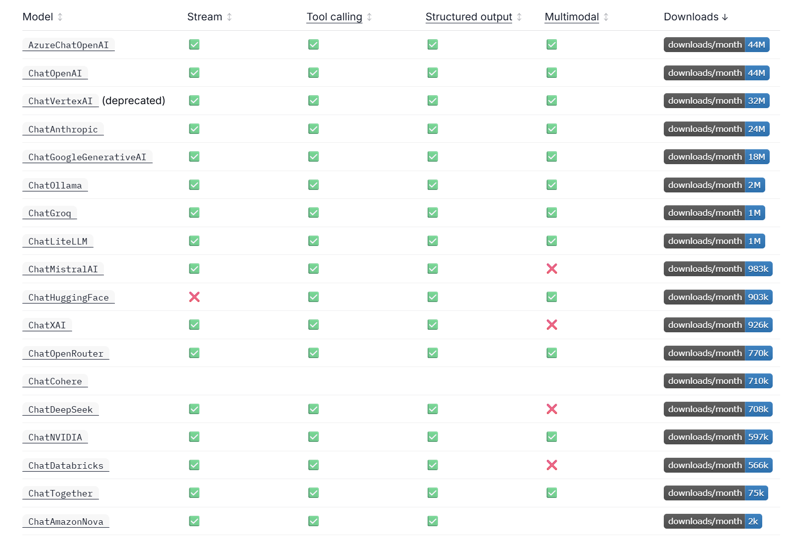
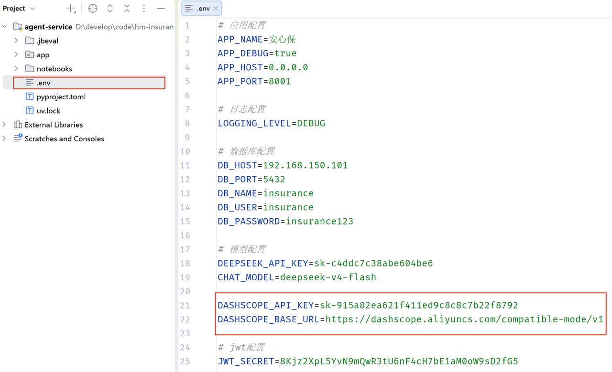

# 3. 模型（Models）

在入门案例中我们通过`create_agent`创建Agent，直接指定模型名就可以了，非常方便。但模型的参数却都是默认参数，无法修改。

如果要自定义模型参数，就需要单独初始化模型了。


langchain提供了两种常见方法用来初始化模型：

* 使用`init_chat_model`函数，由langchain自动创建模型对象

* 使用不同模型对应的Model类，手动创建模型对象


但最常用的还是`init_chat_model`.


## 3.1 初始化模型

在LangChain中开始使用独立模型的最简单方法是使用`init_chat_model`函数。`init_chat_model`的常见参数如下：

> * `model`：模型名称，**必填**
>
> * `model_provider`：模型提供者，包括OpenAI、DeepSeek、Anthropic、Google等，默认会根据模型名推断：
>
>   * 模型名以deepseek为前缀：推断为DeepSeek
>
>   * 模型名以gpt为前缀：推断为OpenAI
>
>   * ...
>
> * `api_key`：模型的认证key，默认会从环境变量读取与模型提供者有关的key，例如
>
>   * OpenAI：默认读取OPENAI\_API\_KEY
>
>   * DeepSeek：默认读取DEEPSEEK\_API\_KEY
>
>   * ...
>
> * `base_url`：模型提供者的url地址，默认会根据模型提供者去推断，例如
>
>   * DeepSeek：默认为https://api.deepseek.com
>
>   * OpenAI：默认为https://api.openai.com
>
>   * ...
>
> * 其它模型参数，参考模型官方文档，例如`temperature`、`max_tokens`、`extra_body`等


虽然有这么多参数，但并不是都需要填写。分为两种情况：

* **默认初始化**：用于LangChain默认支持的模型，只用传入model参数

* **自定义初始化**：用于LangChain默认不支持的模型，需要传入全部参数


LangChain支持的模型列表可以参考官方文档：https://docs.langchain.com/oss/python/integrations/chat




### 3.1.1 默认认初始化

对于LangChain默认支持的模型，调用`init_chat_model`时最少需要一个参数`model`，

LangChain会根据名称推断`model_provider`、`base_url`，并去环境变量加载对应的`api_key`。


例如，我们要使用Deepseek这个模型，LangChain默认就支持，所以就只需要`model`参数，但`API_KEY`还是要配置的：

* **首先**，我们需要安装模型依赖（如果已经安装可以跳过）：

  ```bash
  uv add langchain-deepseek
  ```

* **然后**，我们要确保在项目&#x7684;**.env**环境中配置好**api\_key**:

  ```shell
  DEEPSEEK_API_KEY=your_api_key_here
  ```

* **最后**，就可以直接使用init\_chat\_model初始化模型了：

  ```python
  # ===================1.初始化模型=====================
  # 导入Langchain的初始化模型的函数
  from langchain.chat_models import init_chat_model
  # 1. 加载环境变量
  from dotenv import load_dotenv
  load_dotenv()
  
  # 2.调用init_chat_model初始化模型，LangChain自动推断base_url和api_key，我们配置其它参数即可
  model = init_chat_model(
      model="deepseek-v4-flash",
      temperature=0.7,
      extra_body={"thinking": {"type": "disabled"}}
  )
  
  # =================2.测试====================
  from langchain.agents import create_agent
  
  # 3.初始化Agent，传入初始化好的model、tools，tools可以为空
  agent = create_agent(model = model, tools=[])
  
  # 4.调用Agent
  response = agent.invoke({
      "messages": [{"role": "user", "content": "你是谁？"}]
  })
  print(response)
  ```


可见，采用`init_chat_model`自动初始化模型时，模型的类型由LangChain通过模型名称自动推断。

如果要切换其它模型，我们只需要安装其它模型依赖，然后配置API\_KEY，改变模型名称即可，其它代码不用动。


### 3.1.2 自定义初始化

如果不是LangChain识别的模型，除了`model`以外，还需要自己配置`model_provider`、`base_url`、`api_key`了。


例如，我们要访问阿里云百炼的qwen模型，它就是不被langchain支持的模型，我们必须自定义模型参数来访问。

* 我们需要在环境变量中定义**api\_key**和**base\_url**

* 然后在`init_chat_model`中指定**model**、**model\_provider**、**base\_url**和**api\_key**


具体步骤如下：

* **首先，**&#x5728;.env中配置好`api_key`和`base_url`：

  

  示例：

  ```bash
  DASHSCOPE_API_KEY=your_api_key_here
  DASHSCOPE_BASE_URL=https://dashscope.aliyuncs.com/compatible-mode/v1
  ```

* **然后，**&#x624B;动读取环境变量中的`api_key`和`base_url`，再调用`init_chat_model`，手动传入`api_key`和`base_url`参数，初始化模型

  ```python
  # 导入Langchain的初始化模型的函数
  from langchain.chat_models import init_chat_model
  # ===================Step 1.初始化模型=====================
  # 1.加载环境变量
  from dotenv import load_dotenv
  load_dotenv()
  
  import os
  base_url = os.getenv("DASHSCOPE_BASE_URL")
  api_key = os.getenv("DASHSCOPE_API_KEY")
  
  # 2.初始化模型
  model = init_chat_model(
      model="qwen3.7-plus", # 模型名称，这里可以自定义，我们用的是阿里的qwen-max
      model_provider="openai", # 如果是Langchain不支持的模型，用openai的规范
      base_url=base_url,
      api_key=api_key
  )
  
  # =================Step 2.测试====================
  from langchain.agents import create_agent
  
  # 3.初始化Agent，传入初始化好的model、tools，tools可以为空
  agent = create_agent(model = model, tools=[])
  
  # 4.调用Agent
  response = agent.invoke({
      "messages": [{"role": "user", "content": "你是谁？"}]
  })
  print(response)
  ```

注意，由于qwen不被支持，但兼容OpenAI，所以`model_provider`用openai，但`base_url`和`api_key`就是阿里云自己的了。


### 3.1.3 Model初始化

某些模型提供商并不兼容OpenAI规范，也不被init\_chat\_model默认初始化支持，就必须使用专用的Model类来初始化了。

例如：Ollama

首先，需要安装Ollama依赖：

```plain&#x20;text
uv add langchain-ollama
```

然后，就可以利用它访问本地Ollama部署的任何模型了：

```python
from langchain_ollama import ChatOllama

# 初始化Ollama平台的模型
model = ChatOllama(
    model="qwen3.5:0.8b",
    temperature=1.0,
)

# =================测试====================
from langchain.agents import create_agent

# 初始化Agent，传入初始化好的model
agent = create_agent(model = model, tools=[])

response = agent.invoke({
    "messages": [{"role": "user", "content": "你是谁？"}]
})
print(response)
```


## 3.2 直接调用模型

对于简单的业务，没有必要创建Agent，直接调用模型也能达成目的。

LangChain提供了两个不同的方法来调用模型：

* invoke：阻塞式访问

* stream：流式访问


不过模型调用通常都是采用invoke阻塞调用，示例：

```python
from langchain.chat_models import init_chat_model
# 1.加载环境变量
from dotenv import load_dotenv
load_dotenv()

# 2.调用init_chat_model函数初始化模型
model = init_chat_model(
    model="deepseek-v4-flash",
    extra_body={"thinking": {"type": "disabled"}}
)

# 3.调用invoke方法，直接传字符串
response = model.invoke("你是谁？")
print(response)

print("="*50)

# 4.调用invoke，传消息数组
response = model.invoke([
    {"role": "system", "content": "你扮演小团团，用她的身份回答问题"},
    {"role": "user", "content": "你是谁？"}
])
# 查看响应结果
print(response)
```


## 3.3 消息（Messages）

在调用模型时，发送给LLM的消息、LLM返回的消息都包含以下几部分内容：

* role：消息所属角色，可以是system、user、assistant、tool

* content：消息的内容

* metadata（可选）：消息的元数据，例如：消息的ID、消耗的token等


之前我们都是自己用dict模拟消息：

```python
response = model.invoke(
    [{"role": "user", "content": "月亮的首都是哪里？"}]
)
```

这太麻烦了。在LangChain中发送给LLM的消息、LLM返回的消息都统一被封装为BaseMessage，它是中基本的上下文单元。


### 3.3.1 消息类型

在LangChain中，我们并不需要自己创建BaseMessage对象，LangChain已经把常见消息根据角色（Role）创建了对应的BaseMessage的子类：

* SystemMessage：role是system，代表系统消息，用于设定模型角色和交互背景

* HumanMessage：role是user，代表用户输入的消息

* AIMessage：role是assistant，代表LLM生成的响应，包含：文本、工具调用、元数据

* ToolMessage：role是tool，代表工具调用时产生的结果


### 3.3.2 定义Message消息

我们可以自定义LangChain的各种Message，像这样传递消息列表：

```python
# 模型消息
from langchain.messages import HumanMessage, SystemMessage
from langchain.chat_models import init_chat_model
# 1.加载环境变量
from dotenv import load_dotenv
load_dotenv()

# 2.初始化模型
model = init_chat_model(
    model="deepseek-v4-flash",
    extra_body={"thinking": {"type": "disabled"}}
)

# 3.调用模型，发送消息
response = model.invoke([
        SystemMessage(content="你扮演小团团，用她的身份回答问题"),
        HumanMessage(content="你是谁？")
    ])

print(response)
```


## 3.4 结构化输出

有时候我们需要让模型输出固定结构的数据，例如JSON，这样我们就能拿到JSON，转为对象。


而在LangChain中，只需要非常简单的配置即可让模型的输出按照我们的规定，直接转为对象。步骤为：

* 1.读取环境变量

* 2.初始化普通模型

* 3.定义Pydantic BaseModel类，约束输出结果

* 4.用模型绑定BaseModel

* 5.调用模型，完成结构化输出


示例：

```python
from dotenv import load_dotenv
from langchain.chat_models import init_chat_model
from langchain.messages import HumanMessage, SystemMessage, AIMessage
# 1.准备和加载环境变量
load_dotenv()

# 2.初始化模型 init_chat_model
model = init_chat_model(
    model="deepseek-v4-flash",
    extra_body={
        "thinking": {
            "type": "disabled"
        }
    }
)

# 3.定义 BaseModel 类，用来约束模型的输出，同时封装模型要输出的数据
from pydantic import BaseModel, Field

class CapitalInfo(BaseModel):
    name: str = Field(description="首都的名字")
    location: str = Field(description="The location of che capital")
    vibe: str = Field(description="The vibe of che capital")
    economy: str = Field(description="The economy source of che capital")

# 4.将BaseModel类与模型绑定，要求输出结构化结果
model_with_structured_output = model.with_structured_output(schema=CapitalInfo)

# 5.调用模型
response = model_with_structured_output.invoke([
    HumanMessage("你是科幻小说作家，帮我创造月球首都城市背景。"),
])

print(type(response)) # <class '__main__.CapitalInfo'>
print(response)
```

注意，在输出的结果中，有一个'structured\_response'的字段，就是结构化输出的对象：

```python
<class '__main__.CapitalInfo'>
name='广寒城 (Guanghan City)' location='月球正面第谷环形山（Tycho Crater），位于南纬43度，西经11度，建于环形山内部穹顶之下' vibe='赛博朋克与东方古典美学的融合——全息投影的琉璃瓦屋顶、悬浮的霓虹灯笼、街道两旁延伸的透明穹顶外是永恒的星空。城市分为七层垂直结构，最底层是工业区与贫民窟，顶层是执政院与富商宅邸。空气中飘着合成茉莉花香，全息广告用古汉语、英语和月球通用语轮流播放。' economy='氦-3采矿（能源出口地球）、月球旅游业（零重力观光、地球升起观景台）、尖端量子计算芯片制造、月球地产与高空土地交易、地下农场粮食自给'
```


## 3.5 总结

尽管里面Model已经能完成与模型交互，但模型更擅长完成一次性对话任务，如果要调用工具，实现复杂逻辑，还是要用Agent，而且LangChain还给Agent添加了很多高级功能，接下来我们就继续深入学习Agent