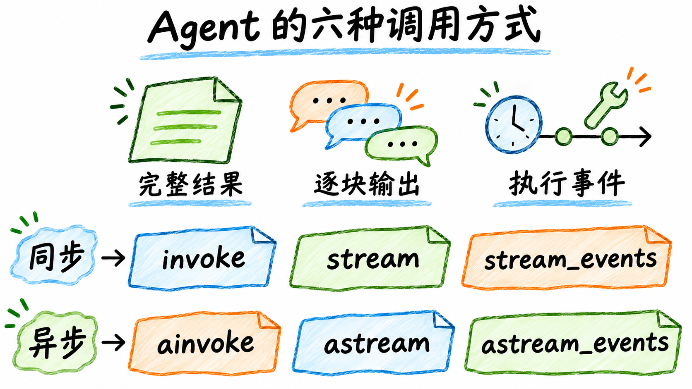
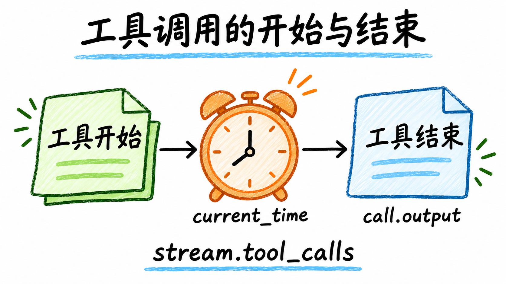

# LangChain 入门笔记 03：Agent 的几个调用方式

同一个 Agent，有时要等它把整轮循环跑完才交出一个答案，有时能看着文字一个个往外蹦，有时还能顺带看到它调用了哪个工具、状态在中间怎么变化。模型没换，工具没换，Agent 也没换，变的只是调用它的方法。

调用方式决定的是：一次运行的结果什么时候交回给你、一次交回多少、交回的是最终状态还是执行过程。这几件事看着像细节，落到界面上就是"转圈等结果"和"逐字显示"的差别，落到服务里就是"阻塞请求"和"并发处理"的差别。

这篇只回答这一个问题：LangChain 的 Agent 提供哪几种调用方式，它们的核心特点是什么，分别在什么场景下用，以及怎么选。模型层怎么调用、工具怎么定义、系统提示词怎么写，都不在这里展开。读完你会拿到六个能运行的小程序，六个程序只在最后一步调用上不同。

## 1. 六种调用方式从哪来



### 1.1 调用方式解决什么问题

Agent 的一次运行不是一次模型请求。它会把用户消息交给模型，接收模型给出的回答或工具请求，执行工具，再把结果填回消息列表，然后决定是继续循环还是结束。整个过程结束后，调用方拿到的通常是一份完整的状态字典。

问题在于，调用方不一定愿意等到最后才拿到东西。做调试时想知道中间发生了什么，做聊天界面时希望第一个字尽快出现，做 Web 服务时不能让一个请求把线程占住。LangChain 把"怎么交回结果"做成了一组接口，这就是调用方式。

把它们放在一起看，差别落在三个维度上：同步还是异步，一次性返回还是逐块产出，交回的是输出还是事件。本篇讲的六种方法，都是这三个维度的组合。

### 1.2 维度一：同步阻塞与异步等待

`invoke`、`stream`、`stream_events` 是同步方法，获取结果或迭代流时会占用当前线程。异步版本在等待期间会让出事件循环。用 `await` 等待 `ainvoke` 的结果，用 `async for` 消费 `astream`，用 `await` 取得 V3 的 `astream_events` 流后，再异步遍历需要的通道。

异步版本不会让 Agent 跑得更快。它解决的是并发问题：一个 FastAPI 接口里同时进来十个请求，用同步方法，十个请求就得排队占着线程；用异步方法，等待模型返回的那段时间可以让给别的请求。写命令行脚本、做一次性实验时，同步版本更简单，也没有事件循环的概念要处理。

挑异步版本有个简单的规则：如果你的代码已经在 `async def` 里跑，就用 `a` 前缀的那个；如果整段程序是线性的，就用没有 `a` 的。

### 1.3 维度二：一次性返回与逐块产出

`invoke` 和 `ainvoke` 要等 Agent 终止，然后把完整的状态字典交回来。字典里的 `messages` 包含这次运行产生的所有消息，模型最后的回答在最后一条。前两篇已经建立过这个口径：`agent.invoke` 收的是 `{"messages": [...]}` 这样的字典，返回的也是字典；`model.invoke` 收的是字符串或消息列表，返回的是一条 `AIMessage`。这里只看 Agent 这一层，模型那层的差别不再展开。

`stream` 和 `astream` 不等结束。Agent 每产生一块数据，就把它交给调用方，你可以边跑边消费。最直接的收益是首字延迟：模型生成第一个字时就能显示出来，不用等整段回答写完。代价是，消费完之前你手上没有完整状态，想拿到它得自己收集或者再从返回结果里取。

一次返回适合"我只要最终答案，还要拿它做后续处理或调试"的场景；逐块产出适合"答案很长，用户不想盯着空白等"的场景。

### 1.4 维度三：输出流与事件流

`stream` 交回的是低层的执行块。它用 `stream_mode` 决定要哪些内容，常用的有 `messages`（模型输出的 token）、`updates`（每一步的状态更新）和 `custom`（节点里主动写入的数据）。传 `version="v2"` 时，每个块是统一的 `{"type", "ns", "data"}` 结构，`type` 表明来自哪种模式，`data` 是对应的数据。要逐字显示，就从 `messages` 模式的块里取消息片段。

`stream_events` 交回的是按语义整理过的事件流，传 `version="v3"` 时返回一个 `GraphRunStream`。`stream.messages` 提供模型消息，`stream.values` 提供状态快照，`stream.tool_calls` 提供工具执行过程，`stream.output` 提供最终状态。遍历消息流里的 `message.text` 就能得到逐步生成的文字。

两者的分工可以这样理解：`stream` 给你原始的图执行数据，细节多、控制力强；`stream_events` 给你已经分好类的 Agent 事件，直接知道这块是文字、那块是工具调用。只想把回答打出来，两种都行；想在界面上同时显示"正在查询天气"这样的过程提示，事件流省掉自己做聚合的工作。

`stream_events` 的 V3 协议目前仍标记为实验性，接口可能调整。本篇只在 `version="v3"` 下讲它，不混用旧版本的事件格式；`subgraphs`、`extensions` 这些更细的通道留给多 Agent 或自定义场景，这里不展开。

### 1.5 横向对比：六种方式的核心特点

| 接口 | 同步/异步 | 返回形态 | 产出粒度 | 版本参数 | 典型场景 |
| --- | --- | --- | --- | --- | --- |
| `invoke` | 同步 | 完整状态字典 | 一次性全量 | 无 | 拿全量结果、检查消息历史、调试 |
| `ainvoke` | 异步 | 完整状态字典（`await`） | 一次性全量 | 无 | 异步服务里拿全量结果 |
| `stream` | 同步 | 逐块迭代器 | 按 `stream_mode` 产出 | `version="v2"` 统一块格式 | 命令行里逐字输出、按模式取数据 |
| `astream` | 异步 | 异步逐块迭代器 | 同上 | `version="v2"` | 异步服务里逐字输出 |
| `stream_events` | 同步 | `GraphRunStream` | 按事件通道产出 | `version="v3"` | 观察消息、状态、工具调用过程 |
| `astream_events` | 异步 | 异步事件流对象 | 同上 | `version="v3"` | 异步服务里展示执行过程 |

`version` 参数在两个系列里含义不同：`stream` 系列用 `v2` 统一数据块，`stream_events` 系列用 `v3` 开启 Agent 语义事件流。不要互相传错，也不必在同一段代码里同时用两套协议。

### 1.6 怎么选：适用场景、主要区别与边界

按你要交付的东西来选，比按 API 名字来选容易：

- 只要一个最终答案，还要拿 `messages` 做后续处理或排查问题，用 `invoke`。代码在异步上下文里就换成 `ainvoke`。
- 要把回答逐字显示出来，用 `stream` 或 `astream`。`stream_mode="messages"` 给的是模型输出片段，接到界面上就是打字机效果。
- 想展示工具什么时候开始、什么时候结束，可以用 `stream_events` 或 `astream_events` 的工具执行通道。
- 运行在 FastAPI 这类异步服务里，一律选带 `a` 的版本，避免同步调用占住事件循环。

`invoke` 系在等待期间没有中间输出。`stream` 系的 `updates` 模式也能看到工具节点执行后的状态更新。要直接跟踪工具何时开始和结束，可以用 V3 的工具执行通道。V3 仍在实验阶段，升级时要留意接口变化。 [LangChain 流式输出](https://docs.langchain.com/oss/python/langchain/streaming)

## 2. 运行准备

### 2.1 沿用前两篇的项目与配置

已经跟着第 1 篇建好项目的，继续用原来的目录就行，依赖都在 `pyproject.toml` 和 `uv.lock` 里。第一次尝试的话，回到第 1 篇从 `uv init` 开始，装好 `langchain`、`langchain-deepseek` 和 `python-dotenv`，并在项目根目录的 `.env` 里写入 `DEEPSEEK_API_KEY`。

如果你拿到的是配套仓库，直接在仓库根目录运行 `uv sync --locked` 安装锁定的依赖，再创建本地 `.env`。六个脚本都从项目根目录运行，模型统一用 `deepseek-flash`，并关闭思考模式，方便观察流式输出。

### 2.2 六个脚本共用的样板

六个主脚本都先加载环境变量、初始化模型，再用空工具列表创建 Agent，方便对照调用方式。3.5 另外用一个时钟工具演示工具执行通道。

第五步才是本篇的主角。把同一个问题交给同一个 Agent，换一个调用方法，观察返回结果和打印方式怎么变。旧的两个 notebook 也保留在章节目录里：[invoke 阻塞式调用](./notebools/01-Agent-invoke阻塞式调用.ipynb) 和 [stream_events 流式调用](./notebools/02-Agent-stream_events流式调用.ipynb)，它们用的模型名是 `deepseek-v4-flash`，与下面脚本的 `deepseek-flash` 只差一个名称，调用逻辑是一致的。

### 2.3 异步脚本的运行方式

三个异步脚本都用 `asyncio.run()` 启动事件循环。`ainvoke` 返回一次调用的协程，可以直接交给 `asyncio.run()`。两个流式示例需要用 `async for` 读取结果，所以各用一个小函数遍历并打印文本。在项目根目录执行 `uv run` 加脚本路径即可。

Jupyter notebook 已经有事件循环。把示例移到单元格时，可以直接写 `await` 或 `async for`。

## 3. 实战：六种方式逐一验证

### 3.1 invoke：一次拿全量 state

`invoke` 是 1.3 里说的“等到底”。Agent 跑完才把最终状态字典交回来。这个文本示例从 `messages` 的最后一条消息里取回答。

从零搭建项目时，把下面的代码保存到章节目录，文件名为 `01-agent-invoke.py`。配套仓库已提供 [01-agent-invoke.py](./01-agent-invoke.py)。在项目根目录运行：

```bash
uv run "LangChain入门笔记/03-LangChain-Agent调用细节/01-agent-invoke.py"
```

```python
from dotenv import load_dotenv
from langchain.agents import create_agent
from langchain.chat_models import init_chat_model
from langchain.messages import HumanMessage

load_dotenv()

model = init_chat_model(
    model="deepseek-flash",
    extra_body={"thinking": {"type": "disabled"}},
)
tools = []
agent = create_agent(model=model, tools=tools)

response = agent.invoke({
    "messages": [HumanMessage("你是谁？")]
})
for message in response["messages"]:
    message.pretty_print()
```

终端会把 `HumanMessage` 和 `AIMessage` 依次格式化打印出来。这里遍历 `response["messages"]` 而不是只取最后一条，就是在验证返回值是一份完整状态。等待期间没有任何输出，这是 `invoke` 的边界，也是它适合调试的原因：结果到手时，过程信息都还在。

#### 需要程序读取结果时，用结构化输出

如果接下来的代码要按天文问题的类别分流，可以用 Pydantic 模型声明需要哪些字段。把下面的代码接在本节的完整 `invoke` 示例末尾，在同一个脚本里一起运行。它会复用前面的 `model`、`create_agent` 和 `HumanMessage`，再用 `response_format` 创建一个能返回结构化结果的 Agent。

```python
from typing import Literal

from langchain.agents.structured_output import ToolStrategy
from pydantic import BaseModel, Field


class AstronomyQuestion(BaseModel):
    category: Literal["天体知识", "观测方法", "航天任务"]
    topic: str = Field(description="问题的核心对象名称，例如土星。")


agent = create_agent(model=model, tools=[], response_format=ToolStrategy(AstronomyQuestion))
result = agent.invoke({"messages": [HumanMessage("土星属于哪一类行星？")]})
question = result["structured_response"]
print(question.category, question.topic)
```

输出可能是 `天体知识 土星`。程序可以直接读取 Pydantic 对象上的两个字段，`messages` 仍可用于查看运行过程。`ToolStrategy` 借助工具调用生成结构化结果，需要模型支持工具调用，相关调用也可能出现在消息历史里。`ProviderStrategy` 则使用模型服务商提供的原生结构化输出。 [LangChain 结构化输出](https://docs.langchain.com/oss/python/langchain/structured-output)

### 3.2 ainvoke：异步单次调用

异步单次调用用 `ainvoke`。它接收和 `invoke` 相同的输入，等待完成后得到同样结构的结果。在已有的异步函数里可以用 `await`，下面的脚本直接用 `asyncio.run()` 执行这次调用。

从零搭建项目时，把下面的代码保存到章节目录，文件名为 `02-agent-ainvoke.py`。配套仓库已提供 [02-agent-ainvoke.py](./02-agent-ainvoke.py)。在项目根目录运行：

```bash
uv run "LangChain入门笔记/03-LangChain-Agent调用细节/02-agent-ainvoke.py"
```

```python
import asyncio

from dotenv import load_dotenv
from langchain.agents import create_agent
from langchain.chat_models import init_chat_model
from langchain.messages import HumanMessage

load_dotenv()

model = init_chat_model(
    model="deepseek-flash",
    extra_body={"thinking": {"type": "disabled"}},
)
tools = []
agent = create_agent(model=model, tools=tools)

messages = [HumanMessage("你是谁？")]
response = asyncio.run(agent.ainvoke({"messages": messages}))
print(response["messages"][-1].content)
```

脚本会等到 `asyncio.run()` 返回后再打印回答。在 FastAPI 等已经运行事件循环的场景里，可以直接 `await agent.ainvoke(...)`，等待模型时事件循环仍能处理其他请求。

### 3.3 stream：同步逐块产出

1.4 里说的输出流，落到代码上就是给 `stream` 传 `stream_mode="messages"`。Agent 每产出一块模型输出就交回一块，`version="v2"` 让每个块都有统一的 `type` / `ns` / `data` 结构。

从零搭建项目时，把下面的代码保存到章节目录，文件名为 `03-agent-stream.py`。配套仓库已提供 [03-agent-stream.py](./03-agent-stream.py)。在项目根目录运行：

```bash
uv run "LangChain入门笔记/03-LangChain-Agent调用细节/03-agent-stream.py"
```

```python
from dotenv import load_dotenv
from langchain.agents import create_agent
from langchain.chat_models import init_chat_model
from langchain.messages import HumanMessage

load_dotenv()

model = init_chat_model(
    model="deepseek-flash",
    extra_body={"thinking": {"type": "disabled"}},
)
tools = []
agent = create_agent(model=model, tools=tools)

for chunk in agent.stream(
    {"messages": [HumanMessage("你是谁？")]},
    stream_mode="messages",
    version="v2",
):
    token, _ = chunk["data"]
    print(token.text, end="", flush=True)
```

文字会随着模型生成逐段出现。这里 `chunk["data"]` 是一个二元组，第一项是消息片段，第二项是来源信息。取第一项的 `.text` 就能显示文字，`flush=True` 让每段文字立即显示。这个脚本只打印了消息流中的文本片段。

### 3.4 astream：异步逐块产出

同样的逐块产出放进异步流程，循环从 `for` 换成 `async for`，数据块还是上一节那套 v2 结构。

从零搭建项目时，把下面的代码保存到章节目录，文件名为 `04-agent-astream.py`。配套仓库已提供 [04-agent-astream.py](./04-agent-astream.py)。在项目根目录运行：

```bash
uv run "LangChain入门笔记/03-LangChain-Agent调用细节/04-agent-astream.py"
```

```python
import asyncio

from dotenv import load_dotenv
from langchain.agents import create_agent
from langchain.chat_models import init_chat_model
from langchain.messages import HumanMessage

load_dotenv()

model = init_chat_model(
    model="deepseek-flash",
    extra_body={"thinking": {"type": "disabled"}},
)
tools = []
agent = create_agent(model=model, tools=tools)


async def print_text_chunks():
    async for chunk in agent.astream(
        {"messages": [HumanMessage("你是谁？")]},
        stream_mode="messages",
        version="v2",
    ):
        token, _ = chunk["data"]
        print(token.text, end="", flush=True)


asyncio.run(print_text_chunks())
```

输出和上一段一样，都是一个字一个字往外蹦。把两段代码放在一起看，`stream` 换成 `astream` 只动了循环写法和外层入口，数据块结构没有变。这就是同一维度下同步版与异步版的关系。

### 3.5 stream_events：V3 事件流

事件流在代码里只多了一个 `version="v3"`。返回的 `GraphRunStream` 把执行内容分成子流，文字从 `stream.messages` 取，最终状态在 `stream.output`，正是 1.4 里描述的那两样东西。

从零搭建项目时，把下面的代码保存到章节目录，文件名为 `05-agent-stream-events.py`。配套仓库已提供 [05-agent-stream-events.py](./05-agent-stream-events.py)。在项目根目录运行：

```bash
uv run "LangChain入门笔记/03-LangChain-Agent调用细节/05-agent-stream-events.py"
```

```python
from dotenv import load_dotenv
from langchain.agents import create_agent
from langchain.chat_models import init_chat_model
from langchain.messages import HumanMessage

load_dotenv()

model = init_chat_model(
    model="deepseek-flash",
    extra_body={"thinking": {"type": "disabled"}},
)
tools = []
agent = create_agent(model=model, tools=tools)

stream = agent.stream_events(
    {"messages": [HumanMessage("你是谁？")]},
    version="v3",
)
for message in stream.messages:
    for text in message.text:
        print(text, end="", flush=True)
```

文字同样是逐段出现的。V3 把文本片段放在 `stream.messages` 这条消息子流里。需要最终状态时，直接读 `stream.output`。

#### 看一次工具从开始到结束



把下面的代码接在本节的完整 `stream_events` 示例末尾，在同一个脚本里一起运行。它会复用前面的 `model`、`create_agent` 和 `HumanMessage`，接上第 1 篇的时钟工具，再用 `stream.tool_calls` 观察工具执行。

```python
from datetime import datetime

from langchain.tools import tool


@tool
def current_time() -> str:
    """获取当前时间。"""
    return str(datetime.now())


agent = create_agent(model=model, tools=[current_time])
stream = agent.stream_events(
    {"messages": [HumanMessage("请调用时钟工具，告诉我现在几点。")]},
    version="v3",
)
print()
for call in stream.tool_calls:
    print("工具开始", call.tool_name, flush=True)
    for delta in call.output_deltas:
        print(delta)
    print("工具结束", call.output)
```

工具开始执行时，`stream.tool_calls` 会给出这次调用，可以立即打印工具名。`call.output_deltas` 在工具结束时关闭，此时就能读取 `call.output`。时钟工具一次返回结果，通常只会看到开始和结束两条输出。 [LangChain V3 事件流](https://docs.langchain.com/oss/python/langchain/event-streaming)

### 3.6 astream_events：异步 V3 事件流

把上一段的事件流搬进异步流程，入口要先 `await`，子流再用 `async for` 消费。通道和文本片段的含义没有变，变的只是消费方式。

从零搭建项目时，把下面的代码保存到章节目录，文件名为 `06-agent-astream-events.py`。配套仓库已提供 [06-agent-astream-events.py](./06-agent-astream-events.py)。在项目根目录运行：

```bash
uv run "LangChain入门笔记/03-LangChain-Agent调用细节/06-agent-astream-events.py"
```

```python
import asyncio

from dotenv import load_dotenv
from langchain.agents import create_agent
from langchain.chat_models import init_chat_model
from langchain.messages import HumanMessage

load_dotenv()

model = init_chat_model(
    model="deepseek-flash",
    extra_body={"thinking": {"type": "disabled"}},
)
tools = []
agent = create_agent(model=model, tools=tools)


async def print_message_text():
    stream = await agent.astream_events(
        {"messages": [HumanMessage("你是谁？")]},
        version="v3",
    )
    async for message in stream.messages:
        async for text in message.text:
            print(text, end="", flush=True)


asyncio.run(print_message_text())
```

输出与同步版一致。和 `stream_events` 对照，改动集中在两处：入口多了 `await`，两层遍历换成 `async for`。事件通道、文本片段的含义都没有变。写异步服务时，这就是展示 Agent 执行过程的标准写法。

## 4. 小结

1. 六种调用方式是三个维度的组合：同步与异步、一次性返回与逐块产出、输出流与事件流。名字里的 `a` 只负责第一个维度。
2. `invoke` / `ainvoke` 交回最终状态字典。可以从 `messages` 查看消息，从 `structured_response` 取出配置了结构化输出的结果。
3. `stream` / `astream` 按 `stream_mode` 逐块产出，`version="v2"` 统一为 `type` / `ns` / `data` 结构。常用的是模型消息和状态更新。
4. `stream_events` / `astream_events` 的 V3 接口仍在实验阶段。它提供消息、工具执行等独立通道，并通过 `stream.output` 交回最终状态。

下一篇会展开讲工具的定义和调用。 [LangChain 的 Tool 调用](../04-LangChain-Tool调用/LangChain-Tool调用.md)
