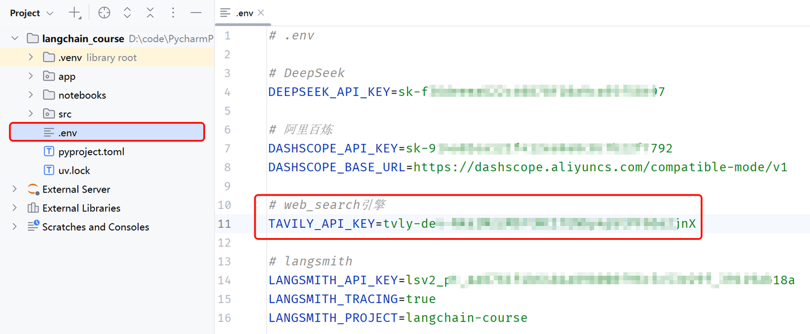

# 5. 工具（Tools）

一个完整的Agent至少要包含两个关键的部分：

* **模型**：是Agent的大脑，负责推理、分析，规划任务步骤

* **工具**：是Agent的手脚，负责执行任务，与外界交互


所谓的**工具（Tool）**，本质就是一个可调用的**函数**，但是这个函数不是我们自己去调用，而是给模型调用。因此除了定义函数外，我们还需要清晰描述这个工具，让模型知道这个工具如何使用。包括下列信息：

* 工具名

* 工具的作用描述

* 工具需要的参数


在LangChain中，只要在工具函数上添加`@tool`装饰器，它就会自动提取函数信息，无需我们自己组装。不过`@tool`装饰器获取函数信息的方式有多种：

* 基于`@tool`装饰器属性

* 基于函数的文档注释

* 基于BaseModel作为schema


> **注意**：
>
> 在LangChain中，作为工具的函数**有两个保留的参数名**，你的自定义参数不能与之重复！他们是：
>
> * **config**：用来传递运行时配置
>
> * **runtime**：用来传递运行时上下文
>
> 
>
> 具体可参考官方文档：[保留参数名（Reserved argument names）](https://docs.langchain.com/oss/python/langchain/tools#reserved-argument-names)，后续我们会讲到这两个参数的用法。


## 5.1 基于装饰器属性描述工具

在LangChain中，定义工具需要用到@tool装饰器，我们可以通过装饰器来定义工具名、工具的作用：

```python
# 定义工具
from langchain.tools import tool

# =================方式一：基于装饰器描述工具==================
@tool("square_root", description="Calculate the square root of a number")
def tool1(x: float) -> float:
    return x ** 0.5
```


智能体在工作时，需要将函数的名称、输入、作用传递给大模型，默认情况下这些信息的来源是：

* 工具名称：函数名

* 工具输入：函数入参

* 工具作用：函数的注释


## 5.2 基于文档注释描述工具

如果不@tool装饰器没有定义工具名和作用描述，此时：

* 工具名：默认就是函数名

* 工具所需的参数：默认就是函数的参数列表

* 工具作用的描述：默认就是函数的文档注释（此时文档注释必须有，否则报错）

```python
# =================方式二：基于文档注释描述工具==================
from langchain.tools import tool

# 定义一个查询天气的tool
@tool
def get_weather(location: str, units: str = "celsius", include_forecast: bool = False) -> str:
    """
    Get current weather and optional forecast.
    Args:
        location: city name or coordinates
        units: unit of degrees
        include_forecast: does it include the weather forecast
    """
    temp = 22 if units == "celsius" else 72
    result = f"Current weather in {location}: {temp} degrees {units[0].upper()}"
    if include_forecast:
        result += "\nNext 5 days: Sunny"
    return result
```


## 5.3 定义BaseModel描述工具参数

如果函数的参数比较多，而且比较复杂，此时建议通过pydantic model来描述参数列表。


例如，我们需要定义个查询天气的tool，借助于Pydantic来约束入参。

我们定义一个入参的模型，在模型中添加入参描述信息：

```python
# ==================方式三：基于BaseModel描述工具参数=================
from pydantic import BaseModel, Field
from typing import Literal
from langchain.tools import tool
# 例如一个查询天气的tool
class WeatherInput(BaseModel):
    """查询天气的输入参数."""
    location: str = Field(description="City name or coordinates")
    units: Literal["celsius", "fahrenheit"] = Field(
        default="celsius",
        description="Temperature unit preference"
    )
    include_forecast: bool = Field(
        default=False,
        description="Include 5-day forecast"
    )
    
# 定义一个查询天气的tool
@tool(args_schema=WeatherInput)
def get_weather(location: str, units: str = "celsius", include_forecast: bool = False) -> str:
    """Get current weather and optional forecast."""
    temp = 22 if units == "celsius" else 72
    result = f"Current weather in {location}: {temp} degrees {units[0].upper()}"
    if include_forecast:
        result += "\nNext 5 days: Sunny"
    return result
```


## 5.4 总结

虽然方式有三种，但大多数情况下都推荐使用第二种方式，即：tool装饰器 + 文档注释


## 5.1 基本用法

我们先通过一个案例快速回顾Agent定义的步骤，以及Agent的工作原理。

定义一个带有工具的Agent分为两步：

* 定义工具

* 定义Agent，绑定工具


首先，使用tool装饰器定义工具：

```python
# 1.使用tool装饰器定义工具
from langchain.tools import tool

@tool
def get_weather(location: str) -> str:
    """
    Get the weather in a given location.
    Args:
        location: city name or coordinates
    """
    return f"Current weather in {location} is sunny"
```

接着，定义Agent，绑定工具：

```python
from langchain.agents import create_agent
from langchain_core.messages import HumanMessage

# 2.创建智能体，并绑定工具
agent = create_agent(
    model="deepseek-chat",
    tools=[get_weather]
)

# 3.调用Agent
response = agent.invoke(
    {"messages": [HumanMessage(content="杭州今天天气如何?")]},
)

for message in response['messages']:
    message.pretty_print()
```

执行结果如下：

```python
================================ Human Message =================================

杭州今天天气如何?
================================== Ai Message ==================================

我来帮您查询杭州今天的天气情况。
Tool Calls:
  get_weather (call_00_FETE4MIR9p1Gr6uszgjcko6m)
 Call ID: call_00_FETE4MIR9p1Gr6uszgjcko6m
  Args:
    location: 杭州
================================= Tool Message =================================
Name: get_weather

Current weather in 杭州 is sunny
================================== Ai Message ==================================

根据查询结果，杭州今天的天气是晴朗的。天气很好，适合外出活动！
```

流程图：


由此可见，所谓的工具，本质就是一个**可调用的函数**，要想让Agent知道有哪些工具可调用，该如何调用这些工具，就必须把这个函数的详细信息发送给模型。包括：

* 函数名

* 函数的作用

* 函数的参数和返回值信息


所以，定义工具的时候，关键就是把这些信息描述清楚即可。


## 5.2 自定义工具

在LangChain中，定义工具的过程被大大简化，与定义普通函数几乎没什么差别，只是在一些细节上需要注意。


首先，定义工具需要在函数上添加`@tool`装饰器。


例如，我们定义一个计算平方根的数学工具：

```python
# 定义工具
from langchain.tools import tool

@tool
def square_root(x: float) -> float:
    """计算指定数字的平方根"""
    return x ** 0.5
```


智能体在工作时，需要将函数的名称、输入、作用传递给大模型，默认情况下这些信息的来源是：

* 工具名称：函数名

* 工具输入：函数入参

* 工具作用：函数的注释


当然，我们可以通过tool装饰器来覆盖上述信息：

* 通过装饰器定义工具名称

```python
@tool("square_root")
def tool1(x: float) -> float:
    """Calculate the square root of a number"""
    return x ** 0.5
```

* 通过装饰器定义工具作用描述

```python
@tool("square_root", description="Calculate the square root of a number")
def tool1(x: float) -> float:
    return x ** 0.5
```


* 通过装饰器定义工具入参约束

如果要覆盖工具的入参信息则会复杂很多，我们要借助于Pydantic或JSON约束。


例如，我们需要定义个查询天气的tool，借助于Pydantic来约束入参。

我们定义一个入参的模型，在模型中添加入参描述信息：

```python
# 例如一个查询天气的tool
class WeatherInput(BaseModel):
    """查询天气的输入参数."""
    location: str = Field(description="City name or coordinates")
    units: Literal["celsius", "fahrenheit"] = Field(
        default="celsius",
        description="Temperature unit preference"
    )
    include_forecast: bool = Field(
        default=False,
        description="Include 5-day forecast"
    )
```

定义工具，使用定义的模型来约束入参：

```python
# 定义一个查询天气的tool
@tool(args_schema=WeatherInput)
def get_weather(location: str, units: str = "celsius", include_forecast: bool = False) -> str:
    """Get current weather and optional forecast."""
    temp = 22 if units == "celsius" else 72
    result = f"Current weather in {location}: {temp} degrees {units[0].upper()}"
    if include_forecast:
        result += "\nNext 5 days: Sunny"
    return result
```


工具定义好之后，调用方式与普通函数类似：

```bash
# 调用数学工具
tool1.invoke({"x": 467})

# 调用查询天气工具
get_weather.invoke({"location": "杭州", "include_forecast": True})
```


> **注意**：
>
> 在LangChain中，作为工具的函数**有两个保留的参数名**，你的自定义参数不能与之重复！他们是：
>
> * **config**：用来传递运行时配置
>
> * **runtime**：用来传递运行时上下文
>
> 
>
> 具体可参考官方文档：[保留参数名（Reserved argument names）](https://docs.langchain.com/oss/python/langchain/tools#reserved-argument-names)，后续我们会讲到这两个参数的用法。


当我们创建智能体时，可以把定义好的工具传递给智能体，将来模型就能得到工具信息，并根据情况判断是否需要调用工具，需要调用哪个工具了。

```bash
from langchain.agents import create_agent

# 创建智能体，并添加工具
agent = create_agent(
    model="deepseek-chat",
    tools=[tool1, get_weather],
    system_prompt="你是一个智能助手，你使用工具来解决用户问题。"
)
```


接下来，调用智能体，向其提问，模型会自动根据用户问题判断：

* 是否需要调用工具？

* 该调用哪个工具？

* 该传递那些参数？

并且在调用工具之后，根据工具执行结果给用户生成响应。

```python
# 调用智能体
for token, metadata in agent.stream(
    {"messages": [HumanMessage(content="467的平方根是多少?")]},
    stream_mode="messages"
):
    print(token.content, end="", flush=True)
    

for token, metadata in agent.stream(
    {"messages": [HumanMessage(content="北京和杭州接下来几天天气如何?")]},
    stream_mode="messages"
):
    print(token.content, end="", flush=True)
```


如果采用stream模式的updates模式，可以看到工具调用的具体步骤：

```python
for chunk in agent.stream(
    {"messages": [HumanMessage(content="467、529的平方根是多少?")]},
    stream_mode="updates"
):
    for step, data in chunk.items():
        print(f"step: {step}")
        print(f"content: {data['messages'][-1].content_blocks}")
        print()
```

输出如下：

```sql
step: model
content: [{'type': 'text', 'text': '我来帮你计算这两个数的平方根。'}, {'type': 'tool_call', 'id': 'call_00_oWChR8Xgo21mmWKW0SP9uOS9', 'name': 'square_root', 'args': {'x': 467}}, {'type': 'tool_call', 'id': 'call_01_UqzhGeRNcoSoidItA0gScaoY', 'name': 'square_root', 'args': {'x': 529}}]

step: tools
content: [{'type': 'text', 'text': '21.61018278497431'}]

step: tools
content: [{'type': 'text', 'text': '23.0'}]

step: model
content: [{'type': 'text', 'text': '计算结果如下：\n\n- **467的平方根** ≈ 21.6102\n- **529的平方根** = 23.0（因为23 × 23 = 529，所以529是完全平方数）\n\n所以：\n- √467 ≈ 21.6102\n- √529 = 23'}]

```


工作流程如图：


## 5.3 预定义工具

LangChain中提供了很多预定义好的工具，方便我们使用，可使用的预定义工具列表可参考官网：


例如，模型本身只能根据本身的训练数据回答问题，无法获取实时信息。但如果我们给它提供了web搜索的工具，那么你的Agent就如同具备了实时web搜索的能力，回答会更加准确。


有一个专门用于给Agent提供Web搜索的工具，叫做Tavily，官网如下：

<iframe src="https://www.tavily.com/" sandbox="allow-scripts allow-same-origin allow-presentation allow-forms allow-popups allow-downloads" allowfullscreen allow="encrypted-media; fullscreen; autoplay" referrerpolicy="strict-origin-when-cross-origin" frameborder="0" style="width: 100%; min-height: 461px; border-radius: 8px;"></iframe>


在LangChain中也提供了对Tavily的支持：


要使用这个工具，步骤如下：

### 5.3.1 注册账号

首先，我们要在Tavily官网注册一个账号，可以选择邮箱注册，或者直接用google、github登录：


注册成功后，我们登录后台（https://app.tavily.com/home），即可看到一个默认的API\_KEY：


### 5.3.2 配置环境变量

接下来，我们需要把这个KEY配置到我们的.env文件中：




### 5.3.3 安装依赖

然后，我们需要安装langchain-tavily的依赖：

```bash
# 使用uv的环境
uv add langchain-tavily
```


### 5.3.4 使用工具

接下来，就可以使用tavily来做web搜索了：

```python
# 使用tavily作为web搜索工具
from langchain_tavily import TavilySearch

# 初始化工具，并设置参数，具体参数设置参考官网
tool = TavilySearch(
    max_results=5,
    topic="general",
    # include_answer=False,
    # include_raw_content=False,
    # include_images=False,
    # include_image_descriptions=False,
    # search_depth="basic",
    # time_range="day",
    # include_domains=None,
    # exclude_domains=None
)
```

这里我们无需自己定义工具，而是直接导入即可，然后根据自己的需要设置参数。


完整的参数设置参考官网：[langchain官网参考](https://docs.langchain.com/oss/python/integrations/tools/tavily_search)、[tavily官网参考](https://docs.tavily.com/documentation/api-reference/endpoint/search)


试试看调用工具：

```bash
tool.invoke("杭州今天天气如何？")
```

结果：

```sql
{'query': '杭州今天天气如何？',
 'follow_up_questions': None,
 'answer': None,
 'images': [],
 'results': [{'url': 'https://weathernew.pae.baidu.com/weathernew/pc?query=%E6%B5%99%E6%B1%9F%E6%9D%AD%E5%B7%9E%E5%A4%A9%E6%B0%94&srcid=4982',
   'title': '杭州 - 百度',
   'content': '杭州 今天：多云 9°~16°C 东北风2级. 02月28日 周六 农历正月十二. 9°. 20 优. 晴 ... 生活气象指数 夜深了，天气不好，也记得让心情保持舒畅哦. 穿衣: 大衣类. 9℃~16',
   'score': 0.9999329,
   'raw_content': None},
  {'url': 'https://www.hzqx.cn/pc/hztq/',
   'title': '杭州气象',
   'content': '... 今日天气，杭州周末天气，杭州一周天气预报，杭州天气预报，杭州14日天气预报，还提供杭州的生活指数、健康指数、交通指数、旅游指数，及时发布杭州气象预警信号、各类气象资讯。',
   'score': 0.9996724,
   'raw_content': None},
  {'url': 'https://www.wunderground.com/weather/cn/hangzhou',
   'title': "Hangzhou, People's Republic Of China Weather Conditions",
   'content': "Skip to Main Content \\_. * *gps\\_fixed*Find Nearest Station. *account\\_box* Log in Go Ad Free*settings* SettingsSensor NetworkMaps & RadarSevere WeatherNews & BlogsMobile AppsHistorical Weather. * *gps\\_fixed*Find Nearest Station. **30.25** °N, **120.2** °E. # Hangzhou, Zhejiang, People's Republic of China Weather Conditions*star\\_rate**home*. icon50\xa0°F Hangzhou Xiaoshan Intl Airport Station|Report. Thank you for reporting this station. We will review the data in question. You are about to report this weather station for bad data. Please select the information that is incorrect. Hangzhou Xiaoshan Intl Airport (ZSHC). Location: **Hangzhou, Zhejiang, People's Republic of China**. Reset Map, or Add PWS. *access\\_time* **3:46 PM CST on February 24, 2026** (GMT +8) | Updated just now. Tomorrow's temperature is forecast to be NEARLY THE SAME as today. TonightMon 02/23 Low 45\xa0°F. Winds N at 5 to 10 mph. TomorrowTue 02/24 High 55\xa0°F. Winds ENE at 5 to 10 mph. Tomorrow nightTue 02/24 Low 48\xa0°F. Winds E at 5 to 10 mph. Tomorrow will be 1 minutes 46 seconds longer.",
   'score': 0.99957615,
   'raw_content': None},
  {'url': 'https://www.nmc.cn/publish/forecast/AZJ/hangzhou.html',
   'title': '杭州-天气预报 - 中央气象台',
   'content': '北京 18.3℃ 西南风 微风. 发布时间：02-10 20:00. 国家气象中心 版权所有 Copyright©2009-2026. 制作维护：国家气象中心预报系统开放实验室 地址：北京市中关村南大街46号 邮编：100081.',
   'score': 0.99736834,
   'raw_content': None},
  {'url': 'https://www.accuweather.com/zh/cn/hangzhou/106832/weather-forecast/106832',
   'title': '杭州, 浙江省, 中國三日天氣預報 - AccuWeather',
   'content': '# 杭州, 浙江省. ## 全球範圍. ### 颶風. ### 惡劣天氣. ### 雷達與氣象圖. ### 視訊. ## 今天. ## 目前天氣. ## 展望未來. ## 杭州 氣象雷達圖. ## 每小時預測. ## 每日預報. ## 太陽和月亮. ## 空氣品質. ## 過敏展望. ## 附近地方:.',
   'score': 0.99528164,
   'raw_content': None}],
 'response_time': 0.63,
 'request_id': '1ab6bd73-98c6-4643-82d0-202f38f775c8'}
```


### 5.3.5 结合智能体

我们结合智能体来使用Tavily搜索工具：

```bash
# 创建智能体，使用预定义工具tavily
agent = create_agent(
    model="deepseek-chat",
    tools=[tool],
    system_prompt="你是一个智能助手，你使用工具来解决用户问题。"
)

# 调用工具
for chunk in agent.stream(
    {"messages": [HumanMessage(content="北京接下来5天天气如何?")]},
    stream_mode="updates"
):
    for step, data in chunk.items():
        print(f"step: {step}")
        print(f"content: {data['messages'][-1].content_blocks}")
        print()
```


执行过程：

```json
step: model
content: [{'type': 'text', 'text': '我来帮您查询北京接下来5天的天气情况。'}, {'type': 'tool_call', 'id': 'call_00_e0PbwzrTI77ojtewzw9VuPfR', 'name': 'tavily_search', 'args': {'query': '北京未来5天天气预报', 'search_depth': 'basic', 'time_range': 'day'}}]

step: tools
content: [{'type': 'text', 'text': '{"query": "北京未来5天天气预报", "follow_up_questions": null, "answer": null, "images": [], "results": [{"url": "https://www.bjfsh.gov.cn/zhxw/fsdt/202602/t20260228_40112151.shtml", "title": "未来一周气温“过山车”！具体预报—— - 房山区", "content": "访问我的专属空间 公务员邮箱 繁体; \\"繁体\\") 简体; \\"简体\\") 无障碍 长者专区. 日期:2026-02-28 09:47\xa0\xa0\xa0\xa0 来源:北京发布微信公众号 气象北京微信公众号. 北京市气象台27日14时发布：今天下午阴转多云，偏南风二三级，**最高气温7℃；**夜间多云转阴，南转东风一二级，**最低气温-1℃。**今天气温下降，外出注意防寒保暖。. 雨雪过后，部分路面湿滑，**目前平谷、房山、密云、门头沟、昌平、延庆、怀柔区仍处于道路结冰黄色预警中，**提醒大家出行注意安全，驾车减速慢行，保持车距。. 未来三天，我市低层湿度较大，天气以多云到阴天为主，气温较低。**明天白天最高气温将降至4℃左右，西部北部有雨夹雪，**户外体感阴冷，大家外出要多穿一点，以免着凉感冒。. **3日（元宵节）白天最高气温将升至10℃左右，**大部分时间比较适宜大家出行，夜间最低气温-1℃，户外活动需注意保暖。下周冷空气活动频繁，天空云量较多，气温波动起伏，请关注临近预报，根据天气和气温变化，适时调整着装。. **27日（星期五）下午：**阴转多云；偏南风2、3级；**平原地区最高气温7℃，**山区最高气温5～7℃；最小相对湿度40%。. **27日夜间：**多云转阴；南转东风1、2级；平原地区最低气温-1℃，山区最低气温-4～-3℃；最大相对湿度85%。. **28日（星期六）白天：**阴，**西部、北部有雨夹雪；**东转南风2、3级；**平原地区最高气温4℃，**山区最高气温2～4℃；最小相对湿度50%。. **28日夜间：**阴，**山区有零星小雪；**南转北风1、2级；平原地区最低气温-1℃，山区最低气温-5～-2℃。. **1日（星期日）白天：**阴转多云；北转南风2、3级；**平原地区最高气温5℃**，山区最高气温4～6℃。. **1日夜间：**多云转阴；南转北风1、2级；平原地区最低气温0℃，山区最低气温-3～-1℃。. * 客服信箱：webmaster@bjfsh.gov.cn.", "score": 0.72231215, "raw_content": null}, {"url": "https://news.bjd.com.cn/2026/02/28/11605674.shtml", "title": "未来三天北京多弱雨雪，4日夜间至5日白天将有降雪 - 新闻- 京报网", "content": "热\xa0\xa0点 锐\xa0\xa0评 发布厅 城\xa0\xa0事 影\xa0\xa0视 视\xa0\xa0觉 京\xa0\xa0剧 汽\xa0\xa0车 纸上听 时\xa0\xa0事 学\xa0\xa0习 都视频 艺\xa0\xa0绽 深\xa0\xa0读 京\xa0\xa0味 体\xa0\xa0育 天\xa0\xa0下 长\xa0\xa0城 经\xa0\xa0济. 热点 锐评 城事 影视 辟谣 京剧 都视频 电子报 汽车 时事 学习 视觉 艺绽 深读 京味 纸上听 体育 天下 长城 经济 北京民声 北晚在线. 今天白天北京天空阴沉，有弱雨雪天气，最高气温仅为2℃左右，体感阴冷，外出注意防寒保暖和交通安全。夜间山区仍有零星小雪，最低气温在冰点以下。. 阴，平原地区有雨夹雪，山区有小雪；偏东风2级；2～1℃。. 阴；偏北风1、2级；-1～1℃。. 28日（周六）下午：阴，平原地区有雨夹雪，山区有小雪；偏东风2级左右；平原地区最高气温2℃，山区最高气温0～2℃；最小相对湿度50%。. 28日夜间：阴，山区有零星小雪；东转北风1、2级；平原地区最低气温-1℃，山区最低气温-5～-4℃；最大相对湿度70%。. 3月1日（周日）白天：阴转多云；北转南风2、3级；平原地区最高气温6℃，山区最高气温5～7℃；最小相对湿度50%。. 3月1日夜间：多云转阴，大部地区有雨夹雪或小雪；南转北风1、2级；平原地区最低气温0℃，山区最低气温-2～-1℃。. 2日（周一）白天：阴，大部地区有雨夹雪或零星小雪；北转南风2、3级；平原地区最高气温6℃，山区最高气温2～4℃。. 2日夜间：阴，山区有小雪；南转北风1、2级；平原地区最低气温-1℃，山区最低气温-2～-1℃。. 明天北京整体还是阴到多云为主，湿度较大，白天最高气温6℃左右。3月1日夜间到2日白天大部地区有雨夹雪或小雪天气，雨雪将导致路面湿滑、能见度下降，对2日（周一）早高峰有不利影响，外出注意防范雨雪和行车安全。. 3月1日至8日气温变化幅度较大，最高气温3~10℃，最低气温-4~1℃。. 如遇作品内容、版权等问题，请在相关文章刊发之日起30日内与本网联系。版权侵权联系电话：010-85202353. 人民网 新华网 央视网 光明网 中国网 中国日报网 中国经济网 千龙网 今日头条 百度 新浪 网易 腾讯 搜狐 爱奇艺 优酷. 主管：北京日报报业集团 主办：京报移动传媒有限公司 Copyright ©1996-2026 Beijing Daily Group, All Rights Reserved. 互联网新闻信息服务许可证11120180001号 网络出版服务许可证（京）字第338号 信息网络传播视听节目许可证0122682号 广播电视节目制作经营许可证（京）字第00693号. 京公网安备11040202440037号  工信部备案号：京ICP备16035741号-1 京新网备2010001号   网上有害信息举报专区    北京互联网举报中心. Copyright ©1996-2026 Beijing Daily Group, All Rights Reserved.", "score": 0.64478505, "raw_content": null}, {"url": "https://cj.sina.com.cn/articles/view/1617264814/606580ae02002jbfe", "title": "未来三天北京多弱雨雪，4日夜间至5日白天将有降雪 - 新浪财经", "content": "外汇 管理 消费 科技 互联网 手机. 保险 数码 科普 创业 银行 新三板 其他. # 未来三天北京多弱雨雪，4日夜间至5日白天将有降雪. 语音播报 缩小字体 放大字体 微博 微信 分享 0. 今天白天北京天空阴沉，有弱雨雪天气，最高气温仅为2℃左右，体感阴冷，外出注意防寒保暖和交通安全。夜间山区仍有零星小雪，最低气温在冰点以下。. 阴，平原地区有雨夹雪，山区有小雪；偏东风2级；2～1℃。. 阴；偏北风1、2级；-1～1℃。. 28日（周六）下午：阴，平原地区有雨夹雪，山区有小雪；偏东风2级左右；平原地区最高气温2℃，山区最高气温0～2℃；最小相对湿度50%。. 28日夜间：阴，山区有零星小雪；东转北风1、2级；平原地区最低气温-1℃，山区最低气温-5～-4℃；最大相对湿度70%。. 3月1日（周日）白天：阴转多云；北转南风2、3级；平原地区最高气温6℃，山区最高气温5～7℃；最小相对湿度50%。. 3月1日夜间：多云转阴，大部地区有雨夹雪或小雪；南转北风1、2级；平原地区最低气温0℃，山区最低气温-2～-1℃。. 2日（周一）白天：阴，大部地区有雨夹雪或零星小雪；北转南风2、3级；平原地区最高气温6℃，山区最高气温2～4℃。. 2日夜间：阴，山区有小雪；南转北风1、2级；平原地区最低气温-1℃，山区最低气温-2～-1℃。. 明天北京整体还是阴到多云为主，湿度较大，白天最高气温6℃左右。3月1日夜间到2日白天大部地区有雨夹雪或小雪天气，雨雪将导致路面湿滑、能见度下降，对2日（周一）早高峰有不利影响，外出注意防范雨雪和行车安全。. 3月1日至8日气温变化幅度较大，最高气温3~10℃，最低气温-4~1℃。. ## 头条号入驻. ## 财经自媒体联盟更多自媒体作者. ## 热文排行榜. * 04 在美国，我感受到“越南制造”在取代“中国制造”. * 06 三星“宫心计”：儿子检举父亲，父母逼死女儿. * 10 56岁创业，年利是华为1.5倍，他是让对手发抖的人！. 关于头条 | 如何入驻 | 发稿平台 | 奖励机制 版权声明 | 用户协议 | 帮助中心. Copyright © 1996-2019 SINA Corporation. All Rights Reserved 新浪公司 版权所有.", "score": 0.61307496, "raw_content": null}, {"url": "https://www.nmc.cn/f/index-1.html", "title": "关注阴晴冷暖，守望四时安康 - 中央气象台", "content": "北京 18.3℃ 西南风 微风. 北方冬麦区气象条件利于小麦越冬 5-7日中东部雨雪降温影响设施农业生产 未来10天江南西部和西南地区东部多阴雨 须注意防范湿渍害. [2026年2月9日[新闻直播间]中央气象台\\\\_中东部气温波动回升\\\\_累积升幅可超10℃](/publish/cms/view/c5e4387dc33441e4853dead0d400b0b9.html). [2026年2月9日[新闻直播间]中央气象台\\\\_江南等地雨雪再度发展\\\\_春运出行需防范](/publish/cms/view/5db2a19c37264a97a634ab5afd39ed17.html). [2026年2月6日[新闻直播间]中央气象台\\\\_寒潮影响持续\\\\_江南局地降温将超12℃](/publish/cms/view/6fb5e2802bc5421480f4b5eb463ff0d6.html). #### 城市定制. 关于我们 联系方式 网站声明 业务信息 网站动态 网站地图 触摸屏版. 国家气象中心 版权所有 Copyright©2009-2026. 制作维护：国家气象中心预报系统开放实验室 地址：北京市中关村南大街46号 邮编：100081.", "score": 0.57236487, "raw_content": null}, {"url": "https://www.qweather.com/weather30d/beijing-101010100.html", "title": "北京市未来30天天气预报", "content": "北京市. 中国. 2026-02-28. 未来30天将有3天下雪，最高温20°（03月13日，03月14日），最低温-4°（03月05日）。 日. 一. 二. 三. 四. 五. 六. 28 QWeather. 2°~0°.", "score": 0.5125224, "raw_content": null}], "response_time": 0.8, "request_id": "1809e393-2e22-48c9-bed9-33698921890a"}'}]

step: model
content: [{'type': 'text', 'text': '让我搜索更具体的北京未来5天天气预报信息：'}, {'type': 'tool_call', 'id': 'call_00_SEyG6p5wcIoz6exnXKvBxt88', 'name': 'tavily_search', 'args': {'query': '北京天气预报未来5天详细气温降水风力', 'search_depth': 'advanced', 'time_range': 'day'}}]

step: tools
content: [{'type': 'text', 'text': '{"query": "北京天气预报未来5天详细气温降水风力", "follow_up_questions": null, "answer": null, "images": [], "results": [{"url": "https://m.weather.com.cn/mweather15d/101010100.shtml", "title": "北京天气预报15天查询", "content": "|  |  |  |  |\\n   ---  --- |\\n  |  |  |  |  |\\n 4/0℃\\n\\n  |  |  |  |  |\\n   ---  --- |\\n  | 东风<3级  东北风<3级 |  |  | 详情 |\\n 周日\\n\\n  03/01\\n\\n  多云转阴\\n\\n  5/0℃\\n\\n  |  |  |  |  |\\n   ---  --- |\\n  | 东南风<3级  南风<3级 |  |  | 详情 |\\n 周一\\n\\n  03/02\\n\\n  阴\\n\\n  5/-1℃\\n\\n  |  |  |  |  |\\n   ---  --- |\\n  | 南风<3级  南风<3级 |  |  | 详情 |\\n 周二\\n\\n  03/03\\n\\n  多云\\n\\n  10/-1℃\\n\\n  |  |  |  |  |\\n   ---  --- |\\n  | 北风<3级  北风<3级 |  |  | 详情 |\\n 周三\\n\\n  03/04\\n\\n  多云\\n\\n  6/0℃\\n\\n  |  |  |  |  |\\n   ---  --- |\\n  | 东北风<3级  东风<3级 |  |  | 详情 |\\n 周四\\n\\n  03/05\\n\\n  阴\\n\\n  5/-3℃\\n\\n  |  |  |  |  |\\n   ---  --- |\\n  | 西风<3级  西北风<3级 |  |  | 详情 |\\n 周五\\n\\n  03/06\\n\\n  阴转雨夹雪\\n\\n  6/-1℃\\n\\n  |  |  |  |  |\\n   ---  --- |\\n  | 西南风<3级  东南风<3级 |  |  | 详情 |\\n 周六\\n\\n  03/07\\n\\n  雨转雨夹雪\\n\\n  7/-2℃\\n\\n  |  |  |  |  |\\n   ---  --- |\\n  | 南风<3级  东南风<3级 |  |  | 详情 |\\n 周日\\n\\n  03/08\\n\\n  雨转阴\\n\\n  9/-2℃ [...] 03/08\\n\\n  雨转阴\\n\\n  9/-2℃\\n\\n  |  |  |  |  |\\n   ---  --- |\\n  | 东南风<3级  南风<3级 |  |  | 详情 |\\n 周一\\n\\n  03/09\\n\\n  阴转雪\\n\\n  9/-4℃\\n\\n  |  |  |  |  |\\n   ---  --- |\\n  | 西南风<3级  东北风<3级 |  |  | 详情 |\\n 周二\\n\\n  03/10\\n\\n  多云转阴\\n\\n  5/-2℃\\n\\n  |  |  |  |  |\\n   ---  --- |\\n  | 东南风<3级  南风<3级 |  |  | 详情 |\\n 周三\\n\\n  03/11\\n\\n  阴\\n\\n  9/0℃\\n\\n  |  |  |  |  |\\n   ---  --- |\\n  | 西南风<3级  东风<3级 |  |  | 详情 |\\n 周四\\n\\n  03/12\\n\\n  阴\\n\\n  10/3℃\\n\\n  |  |  |  |  |\\n   ---  --- |\\n  | 南风<3级  南风<3级 |  |  | 详情 |\\n 周五\\n\\n  03/13\\n\\n  阴\\n\\n  13/4℃\\n\\n  |  |  |  |  |\\n   ---  --- |\\n  | 西南风<3级  西北风<3级 |  |  | 详情 |\\n\\n40天预报\\n\\n 温度趋势\\n 降水趋势\\n\\n台风中心\\n\\n利奇马\\n\\n|  |  |\\n --- |\\n| 到达时间： | 2020-05-16 |\\n| 中心位置： | 18.6N/120.1E |\\n| 风速风力： | 16米/秒 |\\n| 中心气压： | 1000（百帕） |\\n| 未来移速： | 17公里/小时 |\\n| 未来移项： | 北 |\\n\\n天气雷达\\n\\n我的天空\\n\\n精彩推荐\\n\\n北京天空现橙粉朝霞 为冬日添彩\\n\\n雨水：冰雪消融 雨水渐增\\n\\n天气  推荐 直播 图集 短视频 生活\\n\\n没有更多啦 ~\\n\\n请使用浏览器的分享功能分享 [...] 雨水：冰雪消融 雨水渐增\\n\\n天气  推荐 直播 图集 短视频 生活\\n\\n没有更多啦 ~\\n\\n请使用浏览器的分享功能分享\\n\\n放到  \\n桌面) 反馈\\n\\n 首页\\n 15天\\n 40天\\n 地图\\n 资讯\\n 更多", "score": 0.60666215, "raw_content": null}, {"url": "https://e.weather.com.cn/mweather15d/101010100.shtml", "title": "北京天气预报15天查询", "content": "|  |  |  |  |\\n   ---  --- |\\n  |  |  |  |  |\\n |  |  |  |  |\\n   ---  --- |\\n  | 南风<3级  东风<3级 |  |  | 详情 |\\n 周六\\n\\n  02/28\\n\\n  阴\\n\\n  4/0℃\\n\\n  |  |  |  |  |\\n   ---  --- |\\n  | 东风<3级  东北风<3级 |  |  | 详情 |\\n 周日\\n\\n  03/01\\n\\n  多云转阴\\n\\n  5/0℃\\n\\n  |  |  |  |  |\\n   ---  --- |\\n  | 东南风<3级  南风<3级 |  |  | 详情 |\\n 周一\\n\\n  03/02\\n\\n  阴\\n\\n  5/0℃\\n\\n  |  |  |  |  |\\n   ---  --- |\\n  | 南风<3级  南风<3级 |  |  | 详情 |\\n 周二\\n\\n  03/03\\n\\n  多云\\n\\n  7/-1℃\\n\\n  |  |  |  |  |\\n   ---  --- |\\n  | 北风<3级  北风<3级 |  |  | 详情 |\\n 周三\\n\\n  03/04\\n\\n  多云\\n\\n  6/-1℃\\n\\n  |  |  |  |  |\\n   ---  --- |\\n  | 东北风<3级  东风<3级 |  |  | 详情 |\\n 周四\\n\\n  03/05\\n\\n  多云\\n\\n  4/-1℃\\n\\n  |  |  |  |  |\\n   ---  --- |\\n  | 西风<3级  南风<3级 |  |  | 详情 |\\n 周五\\n\\n  03/06\\n\\n  多云\\n\\n  8/-2℃\\n\\n  |  |  |  |  |\\n   ---  --- |\\n  | 北风<3级  东南风<3级 |  |  | 详情 |\\n 周六\\n\\n  03/07\\n\\n  雨转雨夹雪\\n\\n  9/0℃ [...] 03/07\\n\\n  雨转雨夹雪\\n\\n  9/0℃\\n\\n  |  |  |  |  |\\n   ---  --- |\\n  | 南风<3级  东南风<3级 |  |  | 详情 |\\n 周日\\n\\n  03/08\\n\\n  阴转雨夹雪\\n\\n  11/0℃\\n\\n  |  |  |  |  |\\n   ---  --- |\\n  | 东北风<3级  东南风<3级 |  |  | 详情 |\\n 周一\\n\\n  03/09\\n\\n  雨转晴\\n\\n  10/0℃\\n\\n  |  |  |  |  |\\n   ---  --- |\\n  | 南风<3级  北风<3级 |  |  | 详情 |\\n 周二\\n\\n  03/10\\n\\n  雨转晴\\n\\n  13/2℃\\n\\n  |  |  |  |  |\\n   ---  --- |\\n  | 西南风<3级  南风<3级 |  |  | 详情 |\\n 周三\\n\\n  03/11\\n\\n  阴转雨\\n\\n  15/4℃\\n\\n  |  |  |  |  |\\n   ---  --- |\\n  | 东南风<3级  东北风<3级 |  |  | 详情 |\\n 周四\\n\\n  03/12\\n\\n  雨\\n\\n  7/4℃\\n\\n  |  |  |  |  |\\n   ---  --- |\\n  | 东北风<3级  北风<3级 |  |  | 详情 |\\n\\n40天预报\\n\\n 温度趋势\\n 降水趋势\\n\\n台风中心\\n\\n利奇马\\n\\n|  |  |\\n --- |\\n| 到达时间： | 2020-05-16 |\\n| 中心位置： | 18.6N/120.1E |\\n| 风速风力： | 16米/秒 |\\n| 中心气压： | 1000（百帕） |\\n| 未来移速： | 17公里/小时 |\\n| 未来移项： | 北 |\\n\\n天气雷达\\n\\n我的天空\\n\\n精彩推荐\\n\\n北京天空现橙粉朝霞 为冬日添彩\\n\\n雨水：冰雪消融 雨水渐增\\n\\n天气  推荐 直播 图集 短视频 生活\\n\\n没有更多啦 ~ [...] 雨水：冰雪消融 雨水渐增\\n\\n天气  推荐 直播 图集 短视频 生活\\n\\n没有更多啦 ~\\n\\n请使用浏览器的分享功能分享\\n\\n放到  \\n桌面) 反馈\\n\\n 首页\\n 15天\\n 40天\\n 地图\\n 资讯\\n 更多", "score": 0.5942929, "raw_content": null}, {"url": "https://www.weather.com.cn/weather/101010100.shtml?1263", "title": "27日（今天） - 天气", "content": "台风路径\\n空间天气\\n图片\\n专题\\n环境\\n旅游\\n碳中和\\n气象科普\\n一带一路\\n产创平台\\n\\n热门城市\\n\\n热门景点\\n\\n选择省市\\n\\n<<返回\\n全国\\n\\n周边城市\\n\\n周边景点\\n\\n本地乡镇\\n\\n热门城市\\n\\n选择洲际\\n\\n# 24日（今天）\\n\\n晴转多云\\n\\n9/2℃\\n\\n<3级\\n\\n# 25日（明天）\\n\\n多云转小雨\\n\\n10/3℃\\n\\n<3级\\n\\n# 26日（后天）\\n\\n雨夹雪转阴\\n\\n4/0℃\\n\\n<3级\\n\\n# 27日（周五）\\n\\n多云转阴\\n\\n6/0℃\\n\\n<3级\\n\\n# 28日（周六）\\n\\n阴\\n\\n4/0℃\\n\\n<3级\\n\\n# 1日（周日）\\n\\n多云转阴\\n\\n4/0℃\\n\\n<3级\\n\\n# 2日（周一）\\n\\n阴\\n\\n5/0℃\\n\\n<3级\\n\\n### 蓝天预报综合天气现象、能见度、空气质量等因子，预测未来一周的天空状况。\\n\\n无明显降温，感冒机率较低。\\n\\n气温较低，在户外运动请注意增减衣物。\\n\\n无需担心过敏，可放心外出，享受生活。\\n\\n建议着厚外套加毛衣等服装。\\n\\n无雨且风力较小，易保持清洁度。\\n\\n涂擦SPF大于15、PA+防晒护肤品。\\n\\n无明显降温，感冒机率较低。\\n\\n天气凉，在户外运动请注意增减衣物。\\n\\n无需担心过敏，可放心外出，享受生活。\\n\\n建议着厚外套加毛衣等服装。\\n\\n有雨，雨水和泥水会弄脏爱车。\\n\\n涂擦SPF大于15、PA+防晒护肤品。\\n\\n大幅度降温，适当增加衣服。\\n\\n有降水，推荐您在室内进行休闲运动。\\n\\n无需担心过敏，可放心外出，享受生活。\\n\\n建议着厚羽绒服等隆冬服装。\\n\\n有雪，雪水和泥水会弄脏爱车。\\n\\n辐射弱，涂擦SPF8-12防晒护肤品。\\n\\n天冷易感冒，注意防范。\\n\\n天气寒冷，推荐您进行室内运动。\\n\\n无需担心过敏，可放心外出，享受生活。\\n\\n建议着棉衣加羊毛衫等冬季服装。\\n\\n天气较好，适合擦洗汽车。\\n\\n涂擦SPF大于15、PA+防晒护肤品。\\n\\n寒冷潮湿，易发生感冒。\\n\\n天气寒冷，推荐您进行室内运动。 [...] # 雷达图\\n\\n# 联播天气预报\\n\\n# 更多>>高清图集\\n\\n沉浸式体验大江南北的年货大集烟火气\\n北京月坛公园：蜡梅凝香蜜蜂舞\\n广西南宁青秀山新春灯会里的光影盛景\\n海南儋州天气晴好 早稻插秧忙\\n当极光撞进星河 赴一场极致浪漫\\n山东威海气温低迷 植物染白霜\\n\\n# 天气视频\\n\\n正月初七 马驮寿桃 健康长寿\\n\\n正月初六 马踏穷尘 万事顺意\\n\\n正月初五 金马开库 破五迎财\\n\\n# >> 生活旅游\\n\\n雨水这样过：占稻色回娘家 充满无限希望\\n雨水时节话养生 护脾阳祛寒湿\\n天气忽冷忽热 防感冒做好“三勤三避一加强”\\n雨后峨眉沟壑尽显 金顶显真容\\n秋意浓 蓝天映衬下的哈尔滨伏尔加庄园\\n大美新疆—帕米尔高原好风光\\n\\n### 景点推荐\\n\\n#### 景区天气气温 旅游指数\\n\\n# 气象产品\\n\\n# 气象服务\\n\\n# 天气预报电话查询\\n\\n拨打12121或96121进行天气预报查询\\n\\n# 手机查询\\n\\n随时随地通过手机登录中国天气WAP版查看各地天气资讯\\n\\n### 网站服务\\n\\n关于我们联系我们用户反馈\\n\\n版权声明网站律师\\n\\n### 营销中心\\n\\n商务合作广告服务媒资合作\\n\\n### 相关链接\\n\\n中国气象局中国气象服务协会 中国天气频道\\n\\n客服邮箱：service@weather.com.cn客服电话：010-68409444京ICP证010385-2号\u3000京公网安备11041400134号 [...] 寒潮影响趋于结束我国雨雪范围缩减 中东部开启升温模式\\n\\n## 寒潮影响趋于结束我国雨雪范围缩减 中东部开启升温模式\\n\\n今天（2月17日），寒潮影响趋于结束，中东部大部地区开启升温模式，20日前后20℃最北端可达华北南部一带。今明天，我国雨雪范围缩减。\\n\\n2月16日\\n\\n寒潮继续南下！除夕南方多地迎断崖式降温 湖北湖南部分地区有中雨\\n\\n## 寒潮继续南下！除夕南方多地迎断崖式降温 湖北湖南部分地区有中雨\\n\\n今天（2月16日），寒潮主体继续南下，江南多地将迎断崖式降温，公众加强保暖措施。同时，江淮、江南多地仍有雨雪天气。\\n\\n2月15日\\n\\n春节假期开端我国降水增多增强 寒潮携降温影响中东部\\n\\n## 春节假期开端我国降水增多增强 寒潮携降温影响中东部\\n\\n今天（2月15日）是春节假期第一天，我国降水增多增强，同时，寒潮将自北向南影响中东部，不少地方迎换季式降温。\\n\\n2月14日\\n\\n大回暖持续黄淮一带暖得同期少见 明起我国降雨增多增强\\n\\n## 大回暖持续黄淮一带暖得同期少见 明起我国降雨增多增强\\n\\n今天（2月14日），中东部多地继续回暖模式，黄淮一带将体验同期少见的暖。明天随着一场寒潮的到来，降雨会增多增强，中东部也会陆续迎来明显降温。\\n\\n2月13日\\n\\n全国大部持续回暖 西南至江南降雨将发展增多\\n\\n## 全国大部持续回暖 西南至江南降雨将发展增多\\n\\n今明两天（2月13日至14日），北方大部雨雪依然稀少，西南至江南一带降雨将发展增多，冷空气影响间歇期间，全国大部持续升温。\\n\\n2月10日\\n\\n南北方陆续开启升温多地感受超前暖意 12日起南方再迎新一轮降水\\n\\n## 南北方陆续开启升温多地感受超前暖意 12日起南方再迎新一轮降水\\n\\n今明天（2月10日至11日），我国雨雪天气减少，但12日前后南方将再迎新一轮降水过程，江南局地雨势较强，。同时，南北方今明天陆续开启升温模式。\\n\\n# 雷达图", "score": 0.434102, "raw_content": null}, {"url": "https://www.weather.com.cn/", "title": "天气网", "content": "### 营销中心\\n:   商务合作广告服务媒资合作\\n\\n### 相关链接\\n\\n中国气象局中国气象服务协会 中国天气频道\\n\\n客服邮箱：service@weather.com.cn客服电话：010-68409444京ICP证010385-2号\u3000京公网安备11041400134号\\n\\n中国天气网版权所有，未经书面授权禁止使用        Copyright©中国气象局公共气象服务中心 All Rights Reserved (2008-2026) [...] 2026年02月26日星期四  手机查天气 English\\n\\n国内) 本地) 国际)\\n\\n:   北京 上海 成都 杭州 南京 天津 深圳 重庆 西安 广州 青岛 武汉\\n\\n:   故宫 阳朔漓江 龙门石窟 野三坡 颐和园 九寨沟 东方明珠 凤凰古城 秦始皇陵 桃花源\\n\\n高球\\n:   佘山 春城湖畔 华彬庄园 观澜湖 依必朗 旭宝 博鳌 玉龙雪山 番禺南沙 东方明珠\\n\\n<<返回 全国\\n\\n河北下辖区域\\n\\n热门城市\\n\\n:   曼谷 东京 首尔 吉隆坡 新加坡 巴黎 罗马 伦敦 雅典 柏林 纽约 温哥华 墨西哥城 哈瓦那 圣何塞 巴西利亚 布宜诺斯艾利斯 圣地亚哥 利马 基多 悉尼 墨尔本 惠灵顿 奥克兰 苏瓦 开罗 内罗毕 开普敦 维多利亚 拉巴特\\n\\n:   亚洲 欧洲 北美洲 南美洲 非洲 大洋洲\\n\\n 预报\\n 预警\\n 天气地图\\n 台风路径\\n 雷达\\n 云图\\n 专业产品\\n 空间天气\\n\\n 资讯\\n 图片\\n 专题\\n 视频\\n\\n 节气\\n 环境\\n 旅游\\n 碳中和\\n\\n 气象科普\\n 一带一路\\n\\n 产创平台\\n 我的天空\\n\\n FY4B中国及周边区域真彩图\\n 北京明城墙遗址公园花开正当时\\n 贵州万峰林油菜花汇成金色海洋\\n 新疆白沙湖冰水交融 尽显空灵纯净\\n 全国24小时降水量预报\\n\\n12345\\n\\n雨和雪谁占“C位”？\\n\\n北方单日降温15℃\\n\\n## 两轮降水无缝衔接 华北东北气温偏低\\n\\n出行遇降温如何防护 春节返程上班调理指南\\n\\n雨多湿气重祛湿窍门 5招助你远离呼吸道病毒\\n\\n## 全国草木萌动地图 雨水时节春意显\\n\\n雨水润春归！一图带你寻觅中国最美油菜花海\\n\\n雨水春耕备耕祈雨求福 这些养生要点需了解\\n\\n## 东北雪深破纪录 未来三天我国降水频繁 [...] 雨水春耕备耕祈雨求福 这些养生要点需了解\\n\\n## 东北雪深破纪录 未来三天我国降水频繁\\n\\n 北京今天将现雨夹雪或降雪 夜间山区有小到中雪\\n 黑龙江今天降温剧烈 明天降雪再次增多寒意增强\\n 吉林大部将迎显著降温 东部南部持续多雪需防滑\\n 江西今天部分地区将有大到暴雨 明后天阴雨持续\\n 广东迎来新一轮降雨 明后天部分地区有大到暴雨\\n 福建雨持续 后天部分地区雨势较强气温明显下降\\n\\n更多>>\\n\\n天气预报\\n\\n>>\\n\\n# >>天气预报主持人\\n\\n宋英杰\\n\\n杨丹\\n\\n最新气象公告\\n\\n>>\\n\\n #### 02月26日：未来三天全国天气预报\\n\\n  中央气象台2026年02月26日18时发布未来三天全国天气预报。详细\\n #### 02月26日：未来十天全国天气预报\\n\\n  中央气象台2026年02月26日10时发布未来十天全国天气趋势预报。详细\\n #### 02月26日：全国主要公路气象预报\\n\\n  中国气象局与交通运输部2026年02月26日20时联合发布全国主要公路气象预报。详细\\n #### 02月26日：森林火险气象预报\\n\\n  中央气象台2026年02月26日18时发布森林火险气象预报。详细\\n #### 02月26日：流感气象风险预报\\n\\n  中国气象局公共气象服务中心2026年02月26日18时发布流感气象风险预报。详细\\n #### 02月26日：全国气候舒适度预报\\n\\n  中国气象局公共气象服务中心2026年02月26日08时发布全国气候舒适度预报。详细\\n\\n生活旅游\\n\\n>>\\n\\n ## 生活\\n\\n  # 雨水这样过：占稻色回娘家 充满无限希望\\n\\n  在进入雨水节气的这一天，我国很多地方的风......\\n\\n  详细\\n ## 生活\\n\\n  # 雨水时节话养生 护脾阳祛寒湿\\n\\n  雨水节气养生应以顺应春生、健脾祛湿、温补......\\n\\n  详细\\n ## 生活", "score": 0.42133808, "raw_content": null}, {"url": "https://www.weather.com.cn/weather/101010300.shtml", "title": "朝阳天气预报,朝阳7天天气预报,朝阳15天天气预报,朝阳天气查询", "content": "首页 预报 预警 雷达 云图 天气地图 专业产品 资讯 视频 节气 我的天空\\n\\n更多\\n\\n台风路径 空间天气 图片 专题 环境 旅游 碳中和 气象科普 一带一路 产创平台\\n\\n国内) 本地) 国际)\\n\\n:   北京 上海 成都 杭州 南京 天津 深圳 重庆 西安 广州 青岛 武汉\\n\\n:   故宫 阳朔漓江 龙门石窟 野三坡 颐和园 九寨沟 东方明珠 凤凰古城 秦始皇陵 桃花源\\n\\n高球\\n:   佘山 春城湖畔 华彬庄园 观澜湖 依必朗 旭宝 博鳌 玉龙雪山 番禺南沙 东方明珠\\n\\n<<返回 全国\\n\\n河北下辖区域\\n\\n热门城市\\n\\n:   曼谷 东京 首尔 吉隆坡 新加坡 巴黎 罗马 伦敦 雅典 柏林 纽约 温哥华 墨西哥城 哈瓦那 圣何塞 巴西利亚 布宜诺斯艾利斯 圣地亚哥 利马 基多 悉尼 墨尔本 惠灵顿 奥克兰 苏瓦 开罗 内罗毕 开普敦 维多利亚 拉巴特\\n\\n:   亚洲 欧洲 北美洲 南美洲 非洲 大洋洲\\n\\n全国> 北京 > 朝阳\\n\\n 今天\\n 7天\\n 8-15天\\n 40天\\n 雷达图\\n\\n # 24日（今天）\\n\\n  晴转多云\\n\\n  9/3℃\\n\\n  <3级\\n # 25日（明天）\\n\\n  多云转小雨\\n\\n  10/3℃\\n\\n  <3级\\n # 26日（后天）\\n\\n  雨夹雪转阴\\n\\n  6/1℃\\n\\n  <3级\\n # 27日（周五）\\n\\n  多云转阴\\n\\n  6/0℃\\n\\n  <3级\\n # 28日（周六）\\n\\n  阴\\n\\n  4/0℃\\n\\n  <3级\\n # 1日（周日）\\n\\n  多云转阴\\n\\n  5/0℃\\n\\n  <3级\\n # 2日（周一）\\n\\n  阴\\n\\n  6/1℃\\n\\n  <3级\\n\\n分时段预报 生活指数\\n\\n蓝天预报 \\n\\n### 蓝天预报综合天气现象、能见度、空气质量等因子，预测未来一周的天空状况。 [...] :   湖南今天降雨停歇 明晚起多地将再遭强降雨  中国天气网 2026-02-24 10:52\\n\\n:   今天江西阴雨持续气温下降 明天雨势增强  中国天气网 2026-02-24 10:44\\n\\n:   春染紫禁城！故宫墙外玉兰初绽 解锁京城第一抹春色  中国天气网 2026-02-24 10:31\\n\\n:   明后天湖北降雨再次增多 部分地区或现大雨  中国天气网 2026-02-24 09:57\\n\\n# 周边地区 | 周边景点 2026-02-24 11:30更新\\n\\n 香河\\n\\n  /\\n\\n  10/-2°C\\n 海淀\\n\\n  /\\n\\n  10/2°C\\n 永清\\n\\n  /\\n\\n  10/-3°C\\n 门头沟\\n\\n  /\\n\\n  8/3°C\\n 唐山\\n\\n  /\\n\\n  10/0°C\\n 天津\\n\\n  /\\n\\n  12/1°C\\n 大兴\\n\\n  /\\n\\n  9/2°C\\n 廊坊\\n\\n  /\\n\\n  10/-1°C\\n 石景山\\n\\n  /\\n\\n  9/1°C\\n 保定\\n\\n  /\\n\\n  10/-2°C\\n 霸州\\n\\n  /\\n\\n  10/-4°C\\n 通州\\n\\n  /\\n\\n  9/2°C\\n\\n# 周边地区 | 周边景点 2026-02-24 11:30更新\\n\\n 奥林匹克森林公园\\n\\n  /\\n\\n  9/0°C\\n 团结湖公园\\n\\n  /\\n\\n  9/2°C\\n 日坛公园\\n\\n  /\\n\\n  9/2°C\\n 国家体育场\\n\\n  /\\n\\n  9/1°C\\n 北京奥林匹克公园\\n\\n  /\\n\\n  9/1°C\\n 蟹岛绿色生态度假村\\n\\n  /\\n\\n  9/-2°C\\n 朝阳公园\\n\\n  /\\n\\n  9/0°C\\n 北京中华民族博物院\\n\\n  /\\n\\n  9/1°C\\n 北京欢乐谷\\n\\n  /\\n\\n  9/1°C\\n 中华民族园\\n\\n  /\\n\\n  9/1°C\\n 中国紫檀博物馆\\n\\n  /\\n\\n  9/0°C\\n\\n# 高清图集 [...] 查看更多>>\\n\\n# 雷达图\\n\\n# 联播天气预报\\n\\n# 更多>>高清图集\\n\\n 甘肃定西：雪后梯田 勾勒大地纹理\\n 河南郑州：雪落枝头 梅香自来\\n 青海湖蓝冰托落霞 金光漫染\\n 秋来栾树红 枝头挂满“胭脂果”\\n\\n# 天气视频\\n\\n正月初六 马踏穷尘 万事顺意\\n\\n正月初五 金马开库 破五迎财\\n\\n# >> 生活旅游\\n\\n 湖北神农架晨雾缭绕 秋色迷人\\n 换个视角看秋景 竟然这么美！\\n\\n### 景点推荐\\n\\n#### 景区天气气温 旅游指数\\n\\n 三亚 多云 29/20℃ 适宜\\n 九寨沟 多云 18/2℃ 适宜\\n 大理 晴转多云 21/4℃ 适宜\\n 张家界 多云转阴 15/6℃ 适宜\\n 桂林 小雨转多云 17/13℃ 适宜\\n 青岛 多云转晴 6/3℃ 一般\\n\\n全国降水量预报 强对流天气公报 全国地质灾害预报\\n\\n# 天气预报电话查询\\n\\n# 手机查询\\n\\n### 网站服务\\n:   关于我们联系我们用户反馈\\n\\n    版权声明网站律师\\n\\n### 营销中心\\n:   商务合作广告服务媒资合作\\n\\n### 相关链接\\n\\n中国气象局中国气象服务协会 中国天气频道\\n\\n客服邮箱：service@weather.com.cn客服电话：010-68409444京ICP证010385-2号\u3000京公网安备11041400134号\\n\\n中国天气网版权所有，未经书面授权禁止使用        Copyright©中国气象局公共气象服务中心 All Rights Reserved (2008-2026)", "score": 0.39375854, "raw_content": null}], "response_time": 1.44, "request_id": "6946fd2e-4777-4585-ac24-5b9978599354"}'}]

step: model
content: [{'type': 'text', 'text': '根据搜索结果，我为您整理了北京接下来5天的天气预报：\n\n## 北京未来5天天气预报（2月28日-3月3日）\n\n### 1. 2月28日（周六）\n- **天气**：阴，西部、北部有雨夹雪\n- **气温**：最高4℃，最低-1℃\n- **风力**：东风2-3级\n- **特点**：体感阴冷，部分路面湿滑，注意防寒保暖和交通安全\n\n### 2. 3月1日（周日）\n- **天气**：阴转多云，夜间大部地区有雨夹雪或小雪\n- **气温**：最高5-6℃，最低0℃\n- **风力**：北转南风2-3级\n- **特点**：湿度较大，夜间开始有雨雪天气\n\n### 3. 3月2日（周一）\n- **天气**：阴，大部地区有雨夹雪或零星小雪\n- **气温**：最高5-6℃，最低-1℃\n- **风力**：北转南风2-3级\n- **特点**：雨雪天气持续，对早高峰交通有不利影响\n\n### 4. 3月3日（周二）\n- **天气**：多云\n- **气温**：最高7-10℃，最低-1℃\n- **风力**：北风<3级\n- **特点**：气温回升，元宵节白天比较适宜出行\n\n### 5. 3月4日（周三）\n- **天气**：多云\n- **气温**：最高6℃，最低0℃\n- **风力**：东北风<3级\n- **特点**：天气相对稳定\n\n## 重要提醒：\n1. **雨雪天气**：未来三天（2月28日-3月2日）北京多弱雨雪天气，特别是3月1日夜间到2日白天有较明显雨雪，需注意防范。\n2. **气温变化**：气温波动较大，最高气温在4-10℃之间，最低气温在-1到0℃之间。\n3. **出行建议**：雨雪天气导致路面湿滑，能见度下降，对交通有不利影响，驾车需减速慢行，保持车距。\n4. **穿衣建议**：天气阴冷，建议穿着厚外套、毛衣等保暖衣物，注意防寒保暖。\n\n建议您关注临近天气预报，根据天气变化适时调整出行计划和着装。'}]

```


### 5.3.6.优化

注意，LangChain提供的TavilySearch工具描述非常复杂，参数也很多。会有额外的网络消耗。如果我们仅仅是需要query参数，建议自定义工具。

像这样：

```python
# 使用tavily作为web搜索工具
tavily = TavilySearch(
    max_results=5,
    topic="general"
)

@tool
def web_search(query: str):
    """Search the web for information"""
    return tavily.invoke(query)
```


默认情况下AI回答的结果不包含信息来源，这样回答的可信度就不高。我们可以自定义结构化输出，让AI在回答时包含信息来源。

```python
from pydantic import BaseModel, Field

# Agent回答内容引用的网页信息
class Reference(BaseModel):
    title: str = Field(description="The title of the web page cited in the answer")
    url: str = Field(description="The url of the web page cited in the answer")

# Agent的回答内容
class AnswerInfo (BaseModel):
    answer: str = Field(description="The final answer for user")
    reference: list[Reference] = Field(description="The web pages cited in the answer")
    
# 创建智能体，使用预定义工具tavily
agent = create_agent(
    model="deepseek-chat",
    tools=[web_search],
    system_prompt="你是一个智能助手，你使用工具来解决用户问题。",
    response_format=AnswerInfo
)

# 调用agent
response = agent.invoke(
    {"messages": [HumanMessage(content="蒸蚌是什么梗？")]},
)

# 获取结构化输出
print(response['structured_response'])
```

结果如下：

```plain&#x20;text
answer='"蒸蚌"是一个网络谐音梗，意思是"真棒"。\n\n**具体含义：**\n- "蒸蚌"是"真棒"的谐音，因为这两个词在普通话中发音相似（zhēn bàng）\n- 这是一种网络幽默用法，故意用"蒸蚌"这两个看起来不相关的字来代替"真棒"，制造一种有趣、搞笑的效果\n\n**使用场景：**\n1. 在社交媒体、聊天中用来表达赞美、鼓励\n2. 常用于宠物视频中，比如抖音上流行的"萝卜纸巾挑战"中，当宠物选对时主人会喊"蒸蚌！"\n3. 作为一种网络幽默表达方式，增加趣味性\n\n**来源和流行：**\n这个梗最初可能源于网络聊天中的谐音创造，后来在抖音等短视频平台上因为"萝卜纸巾挑战"而流行起来。在这个挑战中，宠物需要在胡萝卜和纸巾之间做出选择，选对了就会得到主人"蒸蚌！"的夸奖。\n\n**类似梗：**\n类似的谐音梗还有"蒸虾"（真瞎）、"蚌埠住了"（绷不住了）等，都是利用汉字谐音创造幽默效果的网络用语。' 

reference=[
Reference(title='"我蒸蚌"是什么意思？ - HiNative', url='https://zh.hinative.com/questions/15904858'),

Reference(title='萝卜纸巾分不清的"蒸蚌小猫"，拿下首个全球代言！ - 新浪财经', url='https://cj.sina.com.cn/articles/view/5952915705/162d248f906702n1fe?froms=ggmp'), 

Reference(title='蒸蚌什么梗 - 抖音', url='https://www.douyin.com/search/%E8%92%B8%E8%9A%8C%E4%BB%80%E4%B9%88%E6%A2%97')
]
```

