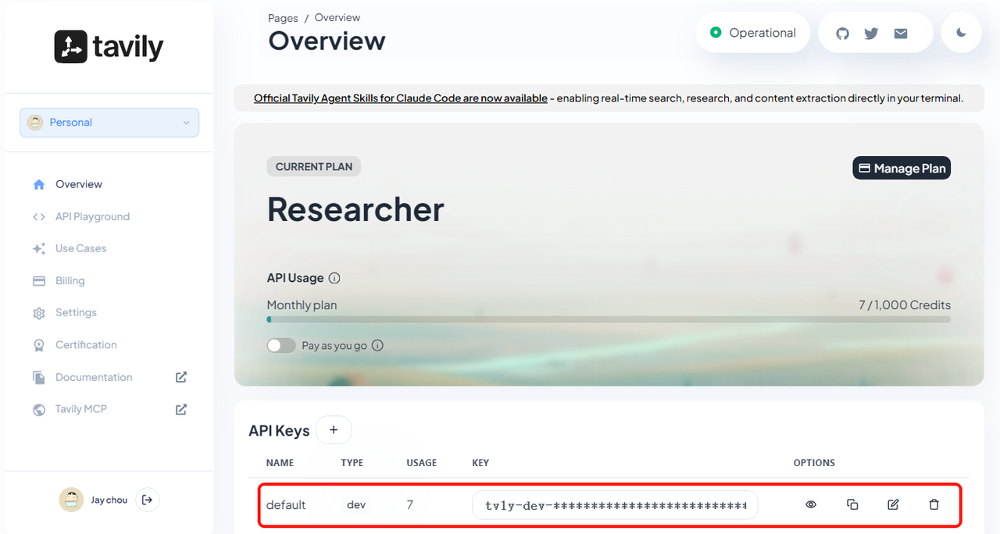

# LangChain 入门笔记 04：Tool 的定义与调用

前几篇里那个时钟工具只有几行：一个函数，一行 docstring，交给 `create_agent`，模型就知道什么时候该调用它、该传什么参数。函数没有写名字，也没有写 JSON Schema，这些信息是 LangChain 从函数本身读出来的。

读出来的方式不止一种。可以把工具名和用途直接写进装饰器，可以把说明写在 docstring 里，也可以用一个 Pydantic 模型把参数框起来。三种写法都能让模型用上工具，但写出来的说明并不一样，适合的场景也不一样。这一篇只谈工具这一件事：三种定义方式怎么选，现成的工具怎么用，以及怎么把真实的 API 包成工具。读完你会拿到五个能运行的小程序。

## 1. 三种定义方式：模型看到的工具说明从哪来

### 1.1 工具三要素与前面的铺垫

模型决定要不要调用工具时，看的是三样东西：工具叫什么、这个工具能干什么、参数怎么填。第 1 篇手写版本里，这三样是我们在字典里一项项写出来的；换成 `@tool` 之后，框架从函数定义里提取它们，再转成模型能理解的格式。第 2 篇已经讲过 `ToolMessage` 怎么把执行结果回填，第 3 篇用 `stream_mode="updates"` 看过工具执行的那一步，这里不再重复。

三种写法的区别，就在于这三样东西从哪里来。底层用到的都是 `@tool`，没有第三种全新 API。

### 1.2 方式一：装饰器属性覆盖名称和用途

最直接的做法是把名字和用途当作参数交给装饰器。下面的函数名是 `tool1`，但模型看到的名称是 `square_root`，用途也被 `description` 直接指定了。

从零搭建项目时，把下面的代码保存到章节目录，文件名为 `01-tool-decorator-args.py`。配套仓库已提供 [01-tool-decorator-args.py](./01-tool-decorator-args.py)。在项目根目录运行：

```bash
uv run "LangChain入门笔记/04-LangChain-Tool调用/01-tool-decorator-args.py"
```

```python
from langchain.tools import tool


@tool("square_root", description="Calculate the square root of a number")
def tool1(x: float) -> float:
    return x ** 0.5


print("工具名：", tool1.name)
print("用途：", tool1.description)
print("参数：", tool1.args)
print("直接调用：", tool1.invoke({"x": 467}))
```

输出里工具名是 `square_root`，不是 `tool1`。参数信息仍然来自函数签名：`x: float` 被读成 `{"x": {"title": "X", "type": "number"}}`。装饰器改的是名称和用途这两项，参数那一项还是框架自己读的。

### 1.3 方式二：docstring 描述（推荐）

装饰器不传参数时，工具名取函数名，用途取 docstring。参数和用途写在同一处，改函数时顺手就能改说明，这是最省事、也最不容易写漏的写法。第 1 篇的时钟工具就是这么写的。

下面的例子把用途写在 docstring 开头，把每个参数的含义写在 `Args:` 下面。前半句是给模型判断"什么时候用这个工具"的，后半句是给它填参数用的。

从零搭建项目时，把下面的代码保存到章节目录，文件名为 `02-tool-docstring.py`。配套仓库已提供 [02-tool-docstring.py](./02-tool-docstring.py)。在项目根目录运行：

```bash
uv run "LangChain入门笔记/04-LangChain-Tool调用/02-tool-docstring.py"
```

```python
from langchain.agents import create_agent
from langchain.chat_models import init_chat_model
from langchain.messages import HumanMessage, ToolMessage
from langchain.tools import tool


@tool
def get_weather(location: str, units: str = "celsius", include_forecast: bool = False) -> str:
    """查询指定城市的当前天气，也可以附带未来几天的预报。

    Args:
        location: 城市名，例如"杭州"
        units: 温度单位，celsius 或 fahrenheit
        include_forecast: 是否需要未来五天的预报
    """
    temp = 22 if units == "celsius" else 72
    result = f"{location} 当前温度：{temp} {units}"
    if include_forecast:
        result += "\n未来五天：晴"
    return result


print("工具名：", get_weather.name)
print("用途：", get_weather.description)
print("参数：", get_weather.args)
print("直接调用：", get_weather.invoke({"location": "杭州", "include_forecast": True}))

model = init_chat_model(
    model="deepseek-flash",
    extra_body={"thinking": {"type": "disabled"}},
)
agent = create_agent(model=model, tools=[get_weather])

for step in agent.stream(
    {"messages": [HumanMessage("杭州现在冷不冷？顺便说说未来几天的天气。")]},
    stream_mode="updates",
):
    for messages in step.values():
        for message in messages:
            if isinstance(message, ToolMessage):
                print("工具返回：", message.content[:200])
```

先看打印出来的 `description`，docstring 的 `Args:` 会原样跟在用途后面，模型读到的就是这一整段。再看 Agent 部分：问句里没有出现 `celsius` 这样的词，模型仍能按 `Args:` 里的说明决定要不要带 `include_forecast`。观察工具执行用的还是第 3 篇的 `stream_mode="updates"`，这里只是拿它验证参数填得对不对。

### 1.4 方式三：args_schema=BaseModel 约束参数

参数一多，光靠 docstring 就容易漏掉取值范围。比如温度单位只允许 `celsius` 和 `fahrenheit`，写进 docstring 只是"建议"，模型仍可能传 `kelvin`。用 Pydantic 模型描述参数，可以把枚举、范围、默认值这些约束明确交给模型，并在调用时做校验。

从零搭建项目时，把下面的代码保存到章节目录，文件名为 `03-tool-args-schema.py`。配套仓库已提供 [03-tool-args-schema.py](./03-tool-args-schema.py)。在项目根目录运行：

```bash
uv run "LangChain入门笔记/04-LangChain-Tool调用/03-tool-args-schema.py"
```

```python
from typing import Literal

from langchain.tools import tool
from pydantic import BaseModel, Field


class WeatherInput(BaseModel):
    """查询天气需要的参数。"""

    location: str = Field(description="城市名或经纬度")
    units: Literal["celsius", "fahrenheit"] = Field(
        default="celsius",
        description="温度单位，只能是 celsius 或 fahrenheit",
    )
    include_forecast: bool = Field(default=False, description="是否返回五天预报")


@tool(args_schema=WeatherInput)
def get_weather(location: str, units: str = "celsius", include_forecast: bool = False) -> str:
    """查询天气。"""
    temp = 22 if units == "celsius" else 72
    result = f"{location} 当前温度：{temp} {units}"
    if include_forecast:
        result += "\n未来五天：晴"
    return result


print("工具名：", get_weather.name)
print("用途：", get_weather.description)
print("参数：", get_weather.args)
print("合法参数调用：", get_weather.invoke({"location": "杭州", "units": "celsius"}))

try:
    get_weather.invoke({"location": "杭州", "units": "kelvin"})
except Exception as exc:
    print("非法参数被拦下：", type(exc).__name__)
```

`tool.args` 里会出现 `units` 的枚举和每个字段的 `description`，这些就是模型填参时看到的约束。最后那段故意传了 `kelvin`，Pydantic 会在函数执行前把它拦下。要注意 `description` 和 `args_schema` 管的是两件事：前者说明"这个工具什么时候用"，后者说明"每个参数怎么填"。用了 `args_schema` 之后，函数自身的 docstring 仍会作为工具用途，不会自动消失。

### 1.5 三类信息的来源与优先级

同一个要素有多种来源时，覆盖关系是这样的：

| 要素 | 优先来源 | 后备来源 |
| --- | --- | --- |
| 工具名 | `@tool("name")` 的位置参数 | 函数名 |
| 用途描述 | `@tool(description=...)` | 函数 docstring |
| 参数结构 | `args_schema=BaseModel` | 签名类型注解 + docstring 的 `Args:` |

方式一和方式三都不是独立的工具类型，它们是在覆盖 `@tool` 默认读取的信息。三种写法可以叠着用，比如 `@tool("name", description=...)` 再加 `args_schema`，只是多数时候没必要写满。

### 1.6 怎么选：场景对照表

原文那句"大多数情况下推荐第二种"仍然成立，但要补一句：参数复杂时，docstring 也可以配合类型注解承载约束，不是非得建一个 BaseModel。

| 场景 | 推荐写法 | 理由 |
| --- | --- | --- |
| 无参或一两个简单参数 | 方式二：docstring | 说明和实现写在一起，改动同步 |
| 参数有枚举、范围、必填/可选 | 方式三：`args_schema` | 约束明确，调用前就能校验 |
| 只想改工具名或临时覆盖用途 | 方式一：装饰器属性 | 一行改完，不用动函数体 |
| 既要清晰用途又要严格参数 | 方式二 + 类型注解，或方式三 + docstring | 两者分工不同，可以并用 |

后面的第 3 部分全部用方式二定义。那里要接的是真实 HTTP API，重点是把"什么时候该调用它"讲给模型听，参数约束用普通类型注解就够了。 [LangChain 工具定义文档](https://docs.langchain.com/oss/python/langchain/tools)

## 2. 运行准备

### 2.1 沿用前三篇的项目与配置

已经跟着前面几篇建好项目的，继续用原来的目录。依赖、锁文件和 `.env` 都在那里，本篇只需要往同一个章节目录里加脚本。第一次尝试的话，回到第 1 篇从 `uv init` 开始，装好 `langchain`、`langchain-deepseek` 和 `python-dotenv`，并在 `.env` 里写入 `DEEPSEEK_API_KEY`。

如果你拿到的是配套仓库，在仓库根目录运行 `uv sync --locked` 安装锁定的依赖，再创建本地 `.env`。示例统一用 `deepseek-flash` 并关闭思考模式，命令都从项目根目录执行。

### 2.2 新增依赖、.env 与两个配套 notebook

第 2 部分用到 Tavily，需要把 `TAVILY_API_KEY` 加进 `.env`，并安装对应集成：

```bash
uv add langchain-tavily
```

第 3 部分用 `requests` 调 HTTP API。它在当前环境里已安装，但项目依赖文件没有显式声明，新环境里补一句：

```bash
uv add requests
```

章节目录里还保留着两个 notebook，可以对照看：[预定义工具 Tavily](./notebooks/01-LangChain-预定义Tool.ipynb) 和 [DeepSeek 自定义搜索工具](./notebooks/02-Deepseek-自定义Tool.ipynb)。第二个 notebook 里的搜索工具用的是 `args_schema=DeepSeekSearchInput`，属于方式三；本篇按方式二改写，把用途放进 docstring，参数只用类型注解。两边调用的是同一个 API，差别只在工具说明怎么来。notebook 里出现的 `deepseek-v4-flash` 与本篇的 `deepseek-flash` 也只是名称差异。

### 2.3 五个脚本的落点与运行命令

五个脚本都放在 `LangChain入门笔记/04-LangChain-Tool调用/` 下，从项目根目录用完整相对路径运行。第 3 部分的脚本会真的发起搜索和 OCR 请求，需要有效的 `DEEPSEEK_API_KEY`；它还在系统临时目录里做文件读写删和命令演示，不会碰项目里的文件。

## 3. 预定义工具：以 TavilySearch 为主

### 3.1 直接用现成的工具

自己写工具之前，先看生态里有没有现成的。搜索、网页抓取、论文检索、文件操作这些都有人封装好了，装一个集成包就能交给 `create_agent`。本节只把一个讲透：TavilySearch，用来做实时网页搜索。

### 3.2 Tavily 账号、密钥与环境变量

到 [Tavily](https://www.tavily.com/) 注册账号，在控制台拿到 API Key。




把密钥写进项目根目录的 `.env`：

```dotenv
TAVILY_API_KEY=你的实际密钥
```


### 3.3 TavilySearch 直接调用

预定义工具也是一个工具对象，可以直接 `invoke`，不必先接进 Agent。下面的 `max_results` 控制返回条数，`topic="general"` 表示通用网页搜索，其他参数暂时用默认值。

从零搭建项目时，把下面的代码保存到章节目录，文件名为 `04-tavily-search.py`。配套仓库已提供 [04-tavily-search.py](./04-tavily-search.py)。在项目根目录运行：

```bash
uv run "LangChain入门笔记/04-LangChain-Tool调用/04-tavily-search.py"
```

```python
from dotenv import load_dotenv
from langchain.agents import create_agent
from langchain.chat_models import init_chat_model
from langchain.messages import HumanMessage, ToolMessage
from langchain_tavily import TavilySearch

load_dotenv()

tavily = TavilySearch(max_results=5, topic="general")

result = tavily.invoke({"query": "杭州今天天气如何？"})
if isinstance(result, dict):
    for item in result.get("results", []):
        print(item["title"])
        print(item["url"])
        print(item.get("content", "")[:200])
else:
    print(result)

model = init_chat_model(
    model="deepseek-flash",
    extra_body={"thinking": {"type": "disabled"}},
)
agent = create_agent(
    model=model,
    tools=[tavily],
    system_prompt="涉及实时信息时先使用网页搜索，并在回答中注明来源。",
)

for step in agent.stream(
    {"messages": [HumanMessage("请搜索北京未来五天的天气预报。")]},
    stream_mode="updates",
):
    for messages in step.values():
        for message in messages:
            if isinstance(message, ToolMessage):
                print("工具返回：", message.content[:300])
```

前半段打印的是搜索结果，每条有标题、链接和正文片段。返回内容里还带 `answer`、`images`、`response_time` 等字段，这里只取需要的三项。 [Tavily 集成文档](https://docs.langchain.com/oss/python/integrations/tools/tavily_search) · [Tavily API 参考](https://docs.tavily.com/documentation/api-reference/endpoint/search)

### 3.4 TavilySearch 接入 Agent

同一段代码的后半部分把 `tavily` 交给 `create_agent`，并加了一句系统提示词：涉及实时信息先搜索，回答里注明来源。`system_prompt` 在这里只负责表达偏好，真正决定参数的是工具对象自己带的说明，这与第 1 章讲的是同一套机制。

`stream_mode="updates"` 会逐步给出每一步的状态更新，遍历时挑出 `ToolMessage` 打印，就能看到模型填的搜索词和搜索结果。第 3 篇还介绍过 `stream.tool_calls`，那种写法能直接看到工具调用的开始和结束，两种观察方式选一个用即可。

### 3.5 其他预定义工具清单

下面这些工具都能在 LangChain 生态里找到，列出来是为了知道有什么可用，不逐个展开：

| 工具 | 用途 | 依赖 |
| --- | --- | --- |
| `TavilySearch` | 实时网页搜索，返回标题、链接和摘要 | `langchain-tavily` |
| `DuckDuckGoSearchRun` | 不需要密钥的网页搜索 | `langchain-community` + `duckduckgo_search` |
| `WikipediaQueryRun` | 维基百科检索 | `langchain-community` + `wikipedia` |
| `ArxivQueryRun` | arXiv 论文检索 | `langchain-community` + `arxiv` |
| `RequestsGetTool` / `RequestsPostTool` | 指定域名内的 HTTP 请求 | `langchain-community` |
| `ReadFileTool` / `WriteFileTool` / `DeleteFileTool` | 文件读写与删除 | `langchain-community` |
| `ShellTool` | 执行 shell 命令，风险较高 | `langchain-community` |

`langchain-community` 已进入 sunset 阶段，新项目优先选独立维护的集成包。表格里的工具名称用来认识生态，照搬前要确认维护状态和权限边界。

### 3.6 什么时候自己包装一层

TavilySearch 功能全，也意味着参数多、说明长。如果你的 Agent 只需要一个搜索词，可以用第 1 章的方式二包一层：

```python
tavily = TavilySearch(max_results=5, topic="general")


@tool
def web_search(query: str) -> str:
    """搜索网页，用于核实实时信息。

    Args:
        query: 搜索关键词
    """
    return tavily.invoke(query)
```

这样模型只看得到 `query` 一个参数，其他配置写死在函数里。第 4 部分的搜索工具走的是同一条路：把第三方 API 包成函数，用 docstring 告诉模型什么时候调用。原文还给过让回答附带来源链接的结构化输出写法，那属于输出格式的话题，这里不展开。

## 4. 用 docstring 定义具体工具

下面五个工具都放在同一个脚本里，共用一个 `tools` 列表。它们分别对接 DeepSeek 搜索、DeepSeek OCR、文件读写删改和命令执行，写法都是 `@tool` 加 docstring。

从零搭建项目时，把下面的代码保存到章节目录，文件名为 `05-custom-tools.py`。配套仓库已提供 [05-custom-tools.py](./05-custom-tools.py)。在项目根目录运行：

```bash
uv run "LangChain入门笔记/04-LangChain-Tool调用/05-custom-tools.py"
```

```python
import os
import subprocess
import tempfile
from pathlib import Path

import requests
from dotenv import load_dotenv
from langchain.agents import create_agent
from langchain.chat_models import init_chat_model
from langchain.messages import HumanMessage
from langchain.tools import tool
from langchain_core.tools import ToolException
from pprint import pprint

load_dotenv()

WORKDIR = Path(tempfile.mkdtemp(prefix="langchain-tool-demo-"))
PDF_PATH = Path("LangChain入门笔记/02-LangChain模型初始化/files/太平洋小蜜蜂6号综合意外险条款.pdf")


@tool
def deepseek_web_search(query: str, count: int = 5) -> dict:
    """用 DeepSeek 搜索网页，适合查询实时信息、核实时效性事实。

    Args:
        query: 搜索关键词，支持 site: 等搜索语法
        count: 返回的结果条数，最多 50 条
    """
    api_key = os.getenv("DEEPSEEK_API_KEY")
    if not api_key:
        raise ToolException("请先在 .env 中配置 DEEPSEEK_API_KEY。")

    try:
        response = requests.post(
            "https://api.deepseek.com/v1/tools/search",
            headers={"Authorization": f"Bearer {api_key}"},
            json={"query": query, "count": count, "need_content": False},
            timeout=60,
        )
        response.raise_for_status()
        results = response.json()["results"]
    except (requests.RequestException, ValueError, KeyError) as exc:
        raise ToolException(f"搜索失败：{exc}") from exc

    return {
        "results": [
            {
                "title": item["title"],
                "url": item["url"],
                "summary": item["summary"],
                "date": item["date"],
            }
            for item in results
        ]
    }


@tool
def deepseek_ocr(file_path: str, purpose: str = "text_recognition") -> dict:
    """识别 PDF、Word、PPT 或图片中的文字，按页返回结果。

    Args:
        file_path: 要识别的文件路径，相对项目根目录
        purpose: text_recognition 或 rich_layout_recognition
    """
    api_key = os.getenv("DEEPSEEK_API_KEY")
    if not api_key:
        raise ToolException("请先在 .env 中配置 DEEPSEEK_API_KEY。")

    path = Path(file_path)
    if not path.is_file():
        raise ToolException(f"文件不存在：{file_path}")

    try:
        with path.open("rb") as file_obj:
            response = requests.post(
                "https://api.deepseek.com/v1/tools/ocr",
                headers={"Authorization": f"Bearer {api_key}"},
                files={"file": (path.name, file_obj)},
                data={"purpose": purpose},
                timeout=180,
            )
        response.raise_for_status()
        result = response.json()
    except (requests.RequestException, ValueError) as exc:
        raise ToolException(f"OCR 请求失败：{exc}") from exc

    if "error" in result:
        raise ToolException(f"OCR 识别失败：{result['error']}")

    return {
        "page_count": result["page_count"],
        "pages": [
            {
                "index": page["index"],
                "text": page["text"][:500],
                "finish_reason": page["finish_reason"],
            }
            for page in result["pages"]
        ],
    }


@tool
def read_file(path: str) -> str:
    """读取临时工作目录中的文本文件。

    Args:
        path: 文件名，例如 note.txt
    """
    return (WORKDIR / path).read_text(encoding="utf-8")


@tool
def write_file(path: str, content: str) -> str:
    """把文本写入临时工作目录，文件不存在时创建。

    Args:
        path: 文件名，例如 note.txt
        content: 要写入的文本
    """
    target = WORKDIR / path
    target.write_text(content, encoding="utf-8")
    return f"已写入 {path}"


@tool
def edit_file(path: str, old: str, new: str) -> str:
    """把文件里的一段文本替换成另一段文本。

    Args:
        path: 文件名
        old: 原文本
        new: 新文本
    """
    target = WORKDIR / path
    text = target.read_text(encoding="utf-8")
    target.write_text(text.replace(old, new), encoding="utf-8")
    return f"已修改 {path}"


@tool
def delete_file(path: str) -> str:
    """删除临时工作目录中的文件。

    Args:
        path: 文件名
    """
    (WORKDIR / path).unlink()
    return f"已删除 {path}"


@tool
def run_command(command: list[str]) -> dict:
    """在临时工作目录里执行一条命令，返回退出码和输出。

    Args:
        command: 命令及参数组成的列表，例如 ["echo", "hello"]
    """
    completed = subprocess.run(
        command,
        cwd=WORKDIR,
        capture_output=True,
        text=True,
        timeout=10,
        shell=False,
    )
    return {
        "returncode": completed.returncode,
        "stdout": completed.stdout[:4000],
        "stderr": completed.stderr[:4000],
    }


tools = [
    deepseek_web_search,
    deepseek_ocr,
    read_file,
    write_file,
    edit_file,
    delete_file,
    run_command,
]
for tool_obj in tools:
    tool_obj.handle_tool_error = True


print("搜索结果：")
pprint(deepseek_web_search.invoke({"query": "DeepSeek API 文档 site:api-docs.deepseek.com", "count": 3}))

print("OCR 结果：")
pprint(deepseek_ocr.invoke({"file_path": str(PDF_PATH)}))

print("文件工具：")
print(write_file.invoke({"path": "note.txt", "content": "你好，LangChain"}))
print(read_file.invoke({"path": "note.txt"}))
print(edit_file.invoke({"path": "note.txt", "old": "LangChain", "new": "Tool"}))
print(read_file.invoke({"path": "note.txt"}))
print(delete_file.invoke({"path": "note.txt"}))

print("命令执行：")
pprint(run_command.invoke({"command": ["echo", "hello"]}))

model = init_chat_model(
    model="deepseek-flash",
    extra_body={"thinking": {"type": "disabled"}},
)
agent = create_agent(
    model=model,
    tools=tools,
    system_prompt="需要使用工具时直接调用，完成后用中文简要说明结果。",
)
response = agent.invoke({
    "messages": [HumanMessage("在临时目录里写一个 hello.txt，内容写‘你好’，然后读出来。")]
})
print("Agent 回复：", response["messages"][-1].content)
```

脚本里有个重复动作：每个工具都可能抛 `ToolException`，最后统一设 `handle_tool_error = True`。这样出错时，错误文本会作为一条工具消息回到 Agent，模型可以据此说明失败原因，而不是让整次运行崩掉。

### 4.1 DeepSeek 网页搜索工具

搜索工具对接 `POST https://api.deepseek.com/v1/tools/search`，请求体里 `query` 是搜索词，`count` 控制条数，`need_content=False` 表示不要网页正文。docstring 交代了适用场景，参数只用普通类型注解，第 1 篇讲过的 `Annotated` 还能用来加约束，这里从简。返回值里只留 `title`、`url`、`summary` 和 `date` 四项，够模型写带来源的回答。

配套 notebook 用的写法是 `@tool(args_schema=DeepSeekSearchInput)`，那是第 1 章的方式三。改成方式二之后，工具名和用途来自函数与 docstring，参数约束不再由 BaseModel 提供。两种写法都能跑通，差别只在说明信息怎么组织。 [DeepSeek 网页搜索 API](https://api-docs.deepseek.com/zh-cn/api/search.md)

### 4.2 DeepSeek OCR 工具

OCR 工具对接 `POST https://api.deepseek.com/v1/tools/ocr`，请求是 `multipart/form-data`：一个带文件名的 `file`，一个 `purpose`。`purpose` 取 `text_recognition` 或 `rich_layout_recognition`，前者对不含图片的 Word、PPT 直接提取文字，后者对所有文件逐页识别。

示例文件用的是第 2 篇的 PDF，路径相对项目根目录。返回按页组织，`page_count` 是页数，`pages[].text` 是识别文本。`finish_reason` 为 `length` 时说明该页输出被截断，代码里把每页文本截到 500 字只是为了打印时不刷屏。HTTP 200 也可能在响应体里带 `error`，所以代码额外检查了一次。

第 2 篇的 Files API 也用过 `purpose="text_recognition"`，那是把文件交给模型、随后围绕文档问答的路子。这里是直接调用 OCR 端点拿识别文本，两者不要混在一起。 [DeepSeek OCR API](https://api-docs.deepseek.com/zh-cn/api/ocr) · [OCR 指南](https://api-docs.deepseek.com/zh-cn/guides/ocr)

### 4.3 文件读取、写入、修改与删除工具

四个工具共用脚本开头创建的临时目录 `WORKDIR`，参数里只写文件名。`write_file` 负责新建或覆盖，`read_file` 读回内容，`edit_file` 做整段字符串替换，`delete_file` 删除文件。演示按写、读、改、读、删的顺序跑一遍，每一步都会把返回值打印出来。

这一段重点看工具定义的写法：docstring 第一句告诉模型这个工具能干什么，`Args:` 逐项说明参数，函数体只做最简单的事。真正的工程实现还要考虑路径校验、权限和备份，这里不展开；记住教学示例里的文件操作只在临时目录里做，别把路径换成真实目录。

### 4.4 命令执行工具

`run_command` 接收的是命令及参数组成的列表，不是一整条字符串。脚本里用 `subprocess.run` 的 `shell=False` 形式执行，把工作目录锁在临时目录，并给输出设了长度上限。演示只跑 `echo`，重点仍然是工具说明怎么写：docstring 里给出参数形式和一个具体例子，模型就知道该传什么。

命令执行比文件操作风险更高，真实项目里要考虑超时、权限和环境隔离。这里只保留最小实现，用来说明"把本地能力包成工具"这件事本身。

### 4.5 接进 Agent 看一次完整流程

脚本最后把七个工具一起交给 `create_agent`，提了一个"写文件再读出来"的要求。模型先决定用哪个工具、填什么参数，LangChain 执行函数并把结果回填，模型再根据结果决定下一步。这条链路在第 1 篇已经拆开讲过，这里只是换成一组更接近真实用途的工具。

如果某一步出错了，`handle_tool_error` 会让错误文本流回 Agent，终端里能看到模型如何解释失败，而不是只看到一条异常堆栈。

## 5. 小结

1. 三种写法的差别在于工具三要素从哪里来：装饰器属性可以覆盖名称和用途，docstring 提供默认用途与参数说明，`args_schema` 提供字段级约束。
2. docstring 是默认推荐写法，说明和实现待在一起；参数有枚举或范围时，配合类型注解或改用 `args_schema`。
3. 预定义工具省去自己封装的功夫，TavilySearch 适合实时搜索；参数太多时，可以用 `@tool` 包一层只暴露需要的参数。
4. 把第三方 API 包成工具时，docstring 写清楚"什么时候用"，异常转成 `ToolException`，错误才能作为消息回到 Agent。
5. 文件和命令类工具在本文只是最小实现，只用于讲清定义方式；真实环境需要自己做隔离与权限控制。

下一篇会把本篇的搜索工具接进 AI 私厨，做出能推荐菜谱、支持追问的应用。[LangChain 入门笔记 05 - AI私厨项目实战](../05-AI私厨项目实战/05-AI私厨项目实战.md)
