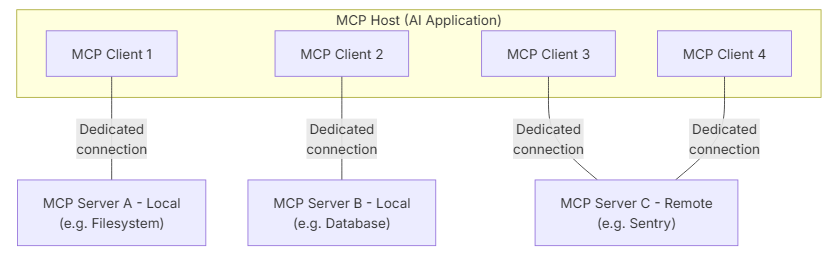
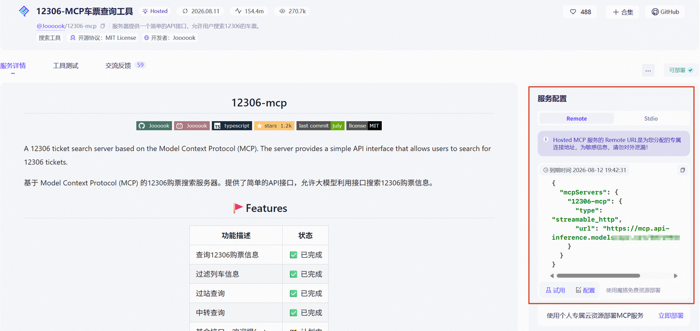

# 6. MCP

**MCP&#x20;**(**M**odel **C**ontext **P**rotocol) 是由 Anthropic 推出的开放标准，用于便捷的将AI应用连接外部系统。


在没有MCP的时候，必须手动定义工具，用工具实现文件操作、web搜索、查询航班、查询天气等功能，从而让AI连接外部系统。


这就存在两个问题：

* 不同Agent可能有同样的tool需求，每次都重复定义，复用性差

* 全世界有各种不同的服务，不同服务接口不同，定义Tool非常麻烦


MCP就像是AI世界的USB接口协议：

* 所有外部服务（工具）提供者都可以遵循MCP协议提供Tool，分享自己的Tool服务

* AI应用基于MCP协议对接任意遵循MCP的外部服务，无需自己定义Tool


这样一来就解决了重复定义工具的复用性问题、以及对接全世界各种公共服务的问题。


## 6.1 MCP核心概念

在MCP中有三个核心概念：

| 概念           | 说明                                                       |
| -------------- | ---------------------------------------------------------- |
| **MCP Server** | 提供MCP服务的应用，可以是远程服务，也可以是本地服务        |
| **MCP Client** | 连接到MCP服务器，读取MCP信息（特别是Tool信息），供Host使用 |
| **MCP Host**   | 协调和管理多个MCP Client的AI应用，比如LangChain的Agent     |


例如，一个AI应用，也就是MCP Host，它需要三个功能：

* 文件操作

* 数据库操作

* Sentry远程服务

此时，它可以定义3个不通的MCP Client，分别对接3个MCP Server，包含一个操作本地文件的MCP、一个访问数据库的MCP、一个访问Sentry服务的MCP




MCP Client 与 MCP Server之间有两种通信协议：

* stdio

* streamable\_http


stdio就是标准输入输出，MCP Client运行时，分两种情况：

* 外部服务：Client会把这个MCP服务的脚本下载到本地，然后作为一个子进程运行。

* 本地服务：Client会把本地脚本直接加载，作为一个子进程运行

也就是说，stdio模式中，MCP Client 和 MCP Server之间的通信就是进程通信，没有网络延迟。


streamable\_http其实就是可以用event stream来发送数据的http模式，本质还是Server Event Stream，也就是SSE。也就是说MCP client通过发送http请求与MCP server交互。因此存在一定的网络延迟。


详细的MCP说明可以参考Anthropic公司的MCP官方文档：

https://modelcontextprotocol.io/docs/getting-started/intro

有关通信协议可以查看：

https://modelcontextprotocol.io/specification/2025-11-25/basic/transports


LangChain本身实现了对MCP的支持，本节我们就来学习如何在LangChain中使用MCP


## 6.2 连接外部MCP服务

很多提供云服务的公司都提供了MCP服务，例如：

* Amap Maps : 高德地图提供的MCP

* Filesystem : 可以操作文件系统的MCP

* Time : 查询当前时间的MCP服务

* Kiwi : 查询航班、预定航班的MCP服务

* ...


大家可以在

搜索各种MCP服务：

https://modelscope.cn/mcp


找好自己想要使用的MCP服务后，就可以用LangChain来对接了。


首先，我们需要安装LangChain的MCP依赖库:

```plain&#x20;text
uv add langchain-mcp-adapters
```


接下来，就可以用LangChain对接MCP服务，获取其提供的工具，创建Agent了。


接下来，我们以两个MCP服务为例来介绍LangChain对接MCP服务的方式：

* Time MCP ：基于stdio通信

* 12306 MCP : 基于http通信


### 6.2.1 Time MCP服务

Time是一个提供时间和时区转换功能的MCP服务。此服务使LLM能够获取当前时间信息，并使用 IANA 时区名称执行时区转换，同时具备自动检测系统时区的功能。


查看Time MCP的介绍页面，可以看到其介绍，以及集成方式：


需要注意的是，Time MCP是基于**stdio**的通信方式，也就是把这个MCP服务的脚本下载到本地，然后作为一个子进程运行。

其中，MCP脚本下载的方式取决于配置中的`command`，常见的有两种：

* `npx` : 基于node.js的包管理工具

* `uvx` : 基于uv(python的uv工具)的包管理工具

因此，你的本地环境必须支持npx、uvx命令


另外，在LangChain中除了基本的服务器配置，还必须设置一个`transport`参数，指定MCP服务的通信方式，有两个可选值：

* `stdio`

* `http`或者`streamable_http`


与标准的mcp参数相比，LangChain的配置存在一些差异：

```json
{
  "mcpServers": {
    "time-mcp": {
      "args": [
        "-y",
        "time-mcp"
      ],
      "command": "npx"
    }
  }
}

```

```json
client = MultiServerMCPClient(
    {
        "time-mcp": {
            "transport": "stdio",
            "args": [
                "-y",
                "time-mcp"
            ],
            "command": "npx"
        }
    }
)
```


**注意**：如果是在**Notebook**运行，可能出现事件循环错误，需要加一段判断逻辑：

```python
import sys
import asyncio

# Fix for Windows issues in Jupyter notebooks
if sys.platform == "win32":
    # 1. Use ProactorEventLoop for subprocess support
    if not isinstance(asyncio.get_event_loop_policy(), asyncio.WindowsProactorEventLoopPolicy):
        asyncio.set_event_loop_policy(asyncio.WindowsProactorEventLoopPolicy())

    # 2. Redirect stderr to avoid fileno() error when launching MCP servers
    if "ipykernel" in sys.modules:
        sys.stderr = sys.__stderr__
```

示例代码（**以下代码必须在Notebook中运行**）：

```python
# 1.加载环境变量
from dotenv import load_dotenv
from langchain.agents import create_agent
from langchain.chat_models import init_chat_model
from langchain.messages import HumanMessage
from langchain_mcp_adapters.client import MultiServerMCPClient

load_dotenv()

# 2.初始化模型
model = init_chat_model(
    model="deepseek-v4-flash",
    extra_body={"thinking": {"type": "disabled"}}
)

# 3.定义工具，用MCP获取工具

# 3.1.定义mcp client
client = MultiServerMCPClient(
    {
        "time-mcp": {
            "transport": "stdio",
            "args": [
                "-y",
                "time-mcp"
            ],
            "command": "npx"
        }
    }
)
# 3.2.用client拉取tool
tools = await client.get_tools()


# 4.创建Agent，绑定模型和工具
agent = create_agent(
    model=model,
    tools=tools
)

# 5.由于MCP的Tool是异步的，所以必须用ainvoke调用Agent，是异步调用
response = await agent.ainvoke(
    {"messages": [HumanMessage("现在是什么时间")]}
)
print(response)
```


### 6.2.2 12306 MCP服务

12306MCP，顾名思义，就是12306火车票的MCP服务，提供了简单的API接口，允许大模型利用接口搜索12306购票信息。


魔塔提供了12306 MCP免费的试用机会：


魔塔提供的12306MCP支持两种接入方式：stdio和http




我们以http为例，示例代码：

```python
# 1.加载环境变量
from dotenv import load_dotenv
from langchain.agents import create_agent
from langchain.chat_models import init_chat_model
from langchain.messages import HumanMessage
from langchain_mcp_adapters.client import MultiServerMCPClient

load_dotenv()

# 2.初始化模型
model = init_chat_model(
    model="deepseek-v4-flash",
    extra_body={"thinking": {"type": "disabled"}}
)

# 3.定义工具，用MCP获取工具

# 3.1.定义mcp client
client = MultiServerMCPClient(
    {
        "time-mcp": {
            "transport": "stdio",
            "args": [
                "-y",
                "time-mcp"
            ],
            "command": "npx"
        },
        "12306-mcp": {
          "transport": "streamable_http",
          "url": "https://mcp.api-inference.modelscope.net/50719920b4f24d/mcp"
        }
    }
)
# 3.2.用client拉取tool
tools = await client.get_tools()

# 4.创建Agent，绑定模型和工具
agent = create_agent(
    model=model,
    tools=tools
)

# 5.invoke调用Agent， 传入的Dict，里面有messages
response = await agent.ainvoke(
    {"messages": [HumanMessage("帮我查一下下周四从北京到杭州的高铁")]}
)
print(response)
```


## 6.3 总结


1. **MCP是什么**

   * 开放协议，标准化LLM应用获取工具、调用工具的方式

   * 客户端-服务器架构

2. **连接方式**

   * STDIO: 本地MCP服务器

   * HTTP: 远程MCP服务器

3) **使用流程**

   * 配置MultiServerMCPClient

   * 调用get\_tools()获取工具

   * 创建Agent并调用

