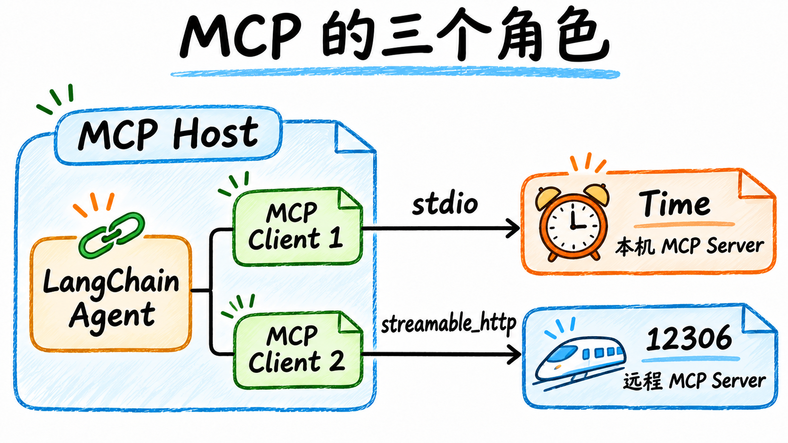
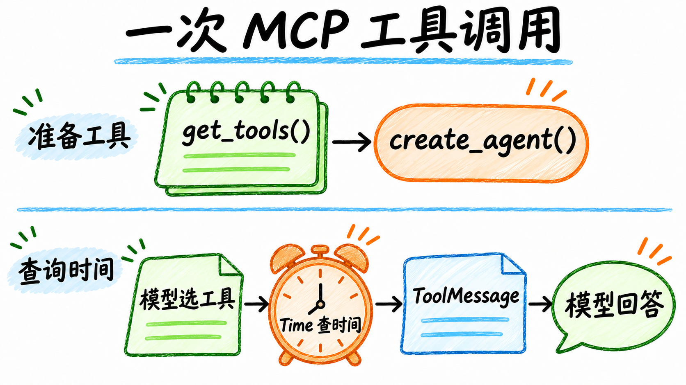
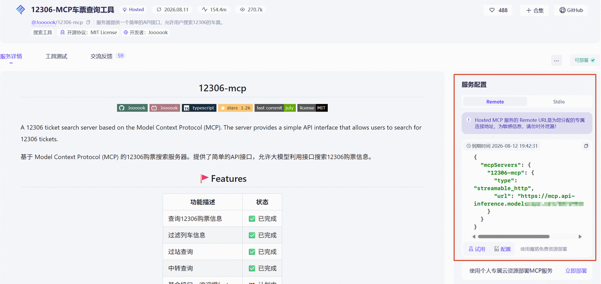

# LangChain 入门笔记 06：MCP 与 LangChain 接入 MCP

第 04 篇写过一个时钟工具，是把 Python 函数直接交给 `create_agent()`。这次用现成的 Time 服务。要把它接进来，先得拿到它的工具清单。

## 1. MCP 是什么

### 1.1 MCP 统一了什么

应用连上 Time 服务，得先问清楚「你这里有哪些工具？查时间要传什么参数？」等它真的去查时间，还要把结果拿回来。这几步怎么交换消息，就是 MCP（Model Context Protocol）约定的事。别的应用也可以照这个约定来用 Time。MCP 还支持读取资源和获取提示模板，这一篇先看工具调用。 [MCP 官方介绍](https://modelcontextprotocol.io/docs/getting-started/intro)

### 1.2 三个角色：Host、Client、Server

看后面的查票例子。运行 Agent 的 Python 应用是 **Host**，本机的 Time 和魔塔上的 12306 各是一个 **Server**。应用分别通过两个 **Client** 跟它们通信。代码里只创建一个 `MultiServerMCPClient` 对象，两份服务配置都写在里面。



### 1.3 一次工具调用是怎么走完的

`await client.get_tools()` 先拿回工具的名字、用途和参数结构。这时候还没查时间。把清单交给 `create_agent()` 之后，模型看到「现在是什么时间」，才有机会选中时间工具、给出参数。Client 把这次调用发给 Time 服务，查到的时间以 `ToolMessage` 回到消息列表。脚本末尾打印消息时，这一条在模型的工具请求和最后的回答之间。



### 1.4 stdio 与 streamable_http：两种通信方式

Time 这个例子里，Client 根据 `command` 和 `args` 执行 `npx -y time-mcp`，然后往子进程的标准输入写请求，从标准输出读响应。这种接法叫 **stdio**。如果本机还没缓存这个包，由 `npx` 负责下载。

12306 服务已经在魔塔上跑着，配置里填 `url`，Client 就会用 HTTP 请求与它通信。这种接法叫 **Streamable HTTP**，配置里写 `streamable_http`。服务可以直接回一份 JSON，也可以用 SSE 分段返回。这种接法也能用于本机运行的 HTTP 服务。 [MCP 传输规范](https://modelcontextprotocol.io/specification/2025-11-25/basic/transports)

### 1.5 什么时候值得用 MCP

一个工具几行 Python 就能写完，而且只有这一个 Agent 用，直接写在项目里就行。查车票可以先找现成的，像车站查询、车次筛选，12306 MCP 已经提供了这些工具。接这类第三方服务时，留意工具调用会把哪些参数发过去。 [魔塔 MCP 广场](https://modelscope.cn/mcp)

## 2. 运行准备

### 2.1 项目与依赖

本篇沿用第 1 篇建立的项目，在项目根目录执行：

```bash
uv sync
```

项目已声明本节需要的依赖。如果拿到的是配套仓库，直接用上面的命令装锁定版本，再创建本地 `.env`。如果是在别的项目里复现，先装 LangChain 的 MCP 依赖库：

```bash
uv add langchain-mcp-adapters
```

`langchain-mcp-adapters` 负责 MCP 协议与 LangChain 工具之间的转换。新项目里若还没有模型相关依赖，按第 1 篇的方式补上 `langchain`、`langchain-deepseek` 和 `python-dotenv`。

在项目根目录的 `.env` 中配置自己的密钥：

```dotenv
DEEPSEEK_API_KEY=你的密钥
```

stdio 方式还会拉起外部脚本，本地环境必须支持 `npx`、`uvx` 命令。其中 `npx` 基于 Node.js 的包管理工具，`uvx` 基于 uv（Python 的 uv 工具）。可以先用 `npx --version` 确认是否可用。

完成本篇后，项目里的相关文件如下：

```text
LangChainAgent/
├── .env                  # API 密钥，自己创建
├── .gitignore            # 已加入 /.env
├── pyproject.toml        # 声明依赖
├── uv.lock               # 锁定版本
└── LangChain入门笔记/      # 系列笔记，按篇分目录
    └── 06-LangChain-MCP调用/       # 本篇
        ├── LangChain-MCP调用.md
        ├── 01-mcp-stdio.py         # 方式一：stdio 接入
        ├── 02-mcp-streamable-http.py  # 方式二：streamable_http 接入
        └── images/
            ├── mcp-concepts.png
            └── image-7.png
```

### 2.2 运行脚本

两个示例都是独立的 `.py` 文件。在项目根目录执行第 3 节给出的 `uv run` 命令。脚本入口通过 `asyncio.run()` 启动事件循环。

## 3. 实战：两种接入方式

### 3.1 方式一：stdio 接入 Time MCP

Time 是一个提供时间和时区转换功能的 MCP 服务。此服务使 LLM 能够获取当前时间信息，并使用 IANA 时区名称执行时区转换，同时具备自动检测系统时区的功能。它基于 stdio 通信，也就是把 MCP 服务的脚本下载到本地，作为一个子进程运行。

#### 3.1.1 知识点与适用场景

stdio 方式下，配置里要写清楚怎么把进程拉起来：`command` 是启动命令，`args` 是传给它的参数。

标准 MCP 客户端配置长这样：

```json
{
  "mcpServers": {
    "time-mcp": {
      "args": [
        "-y",
        "time-mcp"
      ],
      "command": "npx"
    }
  }
}
```

在 LangChain 中除了基本的服务器配置，还必须设置一个 `transport` 参数，指定 MCP 服务的通信方式，有两个可选值：

* `stdio`

* `http` 或者 `streamable_http`

同时，配置对象的外层不再包 `mcpServers`，直接把服务器名称作为键：

```python
client = MultiServerMCPClient(
    {
        "time-mcp": {
            "transport": "stdio",
            "args": [
                "-y",
                "time-mcp"
            ],
            "command": "npx"
        }
    }
)
```

`"time-mcp"` 是这个 Client 的标识，`npx -y time-mcp` 负责把 Time MCP 脚本下载到本地并启动。这种方式适合本地文件操作、数据库访问，以及任何以脚本形式发布、希望低延迟或离线可用的服务。

#### 3.1.2 优缺点与注意事项

优点是通信走进程管道，没有网络延迟；配置只有命令和参数，不依赖远端服务是否在线；本地数据不必出机器。

缺点是每台机器都要装对应的运行时（`npx`、`uvx` 等）；一个 Client 对应一个子进程，服务多了进程也多；脚本版本由本地命令决定，升级和统一分发要靠别的方式解决。

找不到 `command` 指定的命令时，stdio 服务会启动失败。MCP 工具是异步的，示例用 `await agent.ainvoke()` 调用 Agent。

#### 3.1.3 实战代码

查看 Time MCP 的介绍页面，可以看到它的介绍以及集成方式。从零搭建项目时，把下面的代码保存到章节目录，文件名为 `01-mcp-stdio.py`。配套仓库已提供 [01-mcp-stdio.py](./01-mcp-stdio.py)。在项目根目录运行：

```bash
uv run "LangChain入门笔记/06-LangChain-MCP调用/01-mcp-stdio.py"
```

```python
import asyncio

from dotenv import load_dotenv
from langchain.agents import create_agent
from langchain.chat_models import init_chat_model
from langchain.messages import HumanMessage
from langchain_mcp_adapters.client import MultiServerMCPClient

load_dotenv()

model = init_chat_model(
    model="deepseek-v4-flash",
    extra_body={"thinking": {"type": "disabled"}}
)


async def run():
    # 1.用 MCP 获取工具：command + args 启动本地子进程
    client = MultiServerMCPClient(
        {
            "time-mcp": {
                "transport": "stdio",
                "args": [
                    "-y",
                    "time-mcp"
                ],
                "command": "npx"
            }
        }
    )
    tools = await client.get_tools()

    # 2.创建 Agent，绑定模型和工具
    agent = create_agent(model=model, tools=tools)

    # 3.MCP 工具是异步的，这里必须用 ainvoke
    return await agent.ainvoke(
        {"messages": [HumanMessage("现在是什么时间")]}
    )


response = asyncio.run(run())
for message in response["messages"]:
    message.pretty_print()
```

#### 3.1.4 主要步骤

脚本先加载环境变量、初始化模型，再用 `asyncio.run()` 启动事件循环。真正的调用写在 `run()` 里。

`MultiServerMCPClient` 的配置里，`transport` 设为 `stdio`，`command` 和 `args` 描述怎么启动服务进程；随后 `await client.get_tools()` 连上子进程、读取工具清单，得到的 `tools` 直接传给 `create_agent`。对照 1.3 的流程，这一步完成了“拉取工具说明”，不需要手写工具函数。

`await agent.ainvoke()` 发起异步调用：模型看到工具说明后请求时间工具，Client 转发给子进程执行，结果回到消息列表，模型再回答“现在是什么时间”。工具异步，所以 `get_tools()` 和 `ainvoke()` 都要 `await`。

脚本末尾遍历 `response["messages"]` 逐条打印，能看到模型发出的工具请求和返回的 ToolMessage。输出里提问、工具请求、ToolMessage 和最终回答依次排列，时间来自运行脚本的机器。

### 3.2 方式二：streamable_http 接入 12306 MCP

12306 MCP，顾名思义，就是 12306 火车票的 MCP 服务，提供了简单的 API 接口，允许大模型利用接口搜索 12306 购票信息。魔塔提供了 12306 MCP 免费的试用机会，也支持 stdio 和 http 两种接入方式。



截图右侧是平台给出的 Remote 配置。远程服务和本地脚本的配置差别落在一个字段上。

#### 3.2.1 知识点与适用场景

streamable_http 方式不需要在本地启动服务脚本，配置里给一个 `url`，Client 通过 HTTP 请求与之交互。在 LangChain 中把 `transport` 设为 `streamable_http`（写 `http` 也可以），其余配置就是服务地址：

```python
"12306-mcp": {
  "transport": "streamable_http",
  "url": "https://mcp.api-inference.modelscope.net/50719920b4f24d/mcp"
}
```

一个 `MultiServerMCPClient` 可以管理多个服务，每个服务有自己的 `transport`。这意味着本地子进程和远程 HTTP 服务能写在同一份配置里，Agent 同时拿到两边的工具。这种方式适合地图、天气、票务等公共服务，也适合团队集中部署、需要统一更新和鉴权的内部服务。

#### 3.2.2 优缺点与注意事项

优点是不要求本地安装 Node.js 或 uv 运行时，服务集中部署、更新一次全体接入方生效，也更容易跨机器共享。

缺点是每次工具调用都有网络往返，延迟高于 stdio；服务不可用会直接导致工具调用失败；URL 和访问凭证需要单独管理，有些平台还会限流或收费。

写配置时留意三点：`transport` 要写 `streamable_http` 或 `http`，不是 `stdio`；平台给出的 URL 通常带专属标识，示例里的地址可能失效，使用时要从平台复制自己的地址；调用方式仍是 `await agent.ainvoke()`，异步这一点不因传输方式改变。

#### 3.2.3 实战代码

下面以 http 为例。配置里同时保留了方式一的 `time-mcp`，用来说明同一份配置可以给不同服务指定不同 `transport`；如果只需要远程服务，把这一段删掉即可。把下面的代码保存到章节目录，文件名为 `02-mcp-streamable-http.py`。配套仓库已提供 [02-mcp-streamable-http.py](./02-mcp-streamable-http.py)。在项目根目录运行：

```bash
uv run "LangChain入门笔记/06-LangChain-MCP调用/02-mcp-streamable-http.py"
```

```python
import asyncio

from dotenv import load_dotenv
from langchain.agents import create_agent
from langchain.chat_models import init_chat_model
from langchain.messages import HumanMessage
from langchain_mcp_adapters.client import MultiServerMCPClient

load_dotenv()

model = init_chat_model(
    model="deepseek-v4-flash",
    extra_body={"thinking": {"type": "disabled"}}
)


async def run():
    # 1.同一份配置里混用两种 transport
    client = MultiServerMCPClient(
        {
            "time-mcp": {
                "transport": "stdio",
                "args": [
                    "-y",
                    "time-mcp"
                ],
                "command": "npx"
            },
            "12306-mcp": {
                "transport": "streamable_http",
                "url": "https://mcp.api-inference.modelscope.net/50719920b4f24d/mcp"
            }
        }
    )
    tools = await client.get_tools()

    # 2.创建 Agent，绑定模型和工具
    agent = create_agent(model=model, tools=tools)

    # 3.MCP 工具是异步的，这里必须用 ainvoke
    return await agent.ainvoke(
        {"messages": [HumanMessage("帮我查一下下周四从北京到杭州的高铁")]}
    )


response = asyncio.run(run())
for message in response["messages"]:
    message.pretty_print()
```

#### 3.2.4 主要步骤

脚本的结构和上一个一样：先加载环境变量、初始化模型，再用 `asyncio.run()` 进入异步流程。

配置里有两个服务：`time-mcp` 用 `command` + `args` 启动本地子进程，`12306-mcp` 用 `url` 连远程服务。`await client.get_tools()` 会分别连上两边，把两份工具清单合并成一个 `tools` 列表——这正是 1.2 中“一个 Host 通过多个 Client 使用多种能力”在代码里的样子。

合并后的工具交给 `create_agent`。提问“帮我查一下下周四从北京到杭州的高铁”后，模型从清单里选中 12306 的查询工具，请求经 HTTP 发到远程 Server，结果回到消息列表后再生成回答。这里仍用 `ainvoke`：传输方式换了，工具调用的异步性质没换。

末尾逐条打印消息，能看到请求发给了哪个服务。车次和余票随实时数据变化，示例只展示调用链路。

## 4. 小结

1. MCP 是开放协议，标准化 LLM 应用获取工具、调用工具的方式，采用客户端-服务器架构：Host 管理多个 Client，每个 Client 对接一个 Server。

2. 传输方式有两种：STDIO 对接本地 MCP 服务器，走进程通信；HTTP 对接远程 MCP 服务器，走网络请求。同一份配置可以混用两种传输。

3. 使用流程就三步：配置 `MultiServerMCPClient`，调用 `get_tools()` 获取工具，创建 Agent 并调用。工具是异步的，记得用 `ainvoke`。

4. MCP 把工具实现从应用代码里搬了出去。换来复用和解耦的同时，也要自己把好数据范围、密钥和服务可用性这几关。

下一篇讲 Skill：工具解决了“能做什么”，Skill 解决“这类任务应该怎么做”。 [LangChain 入门笔记 07：Skill 调用](../07-LangChain-Skill调用/LangChain-Skill调用.md)
