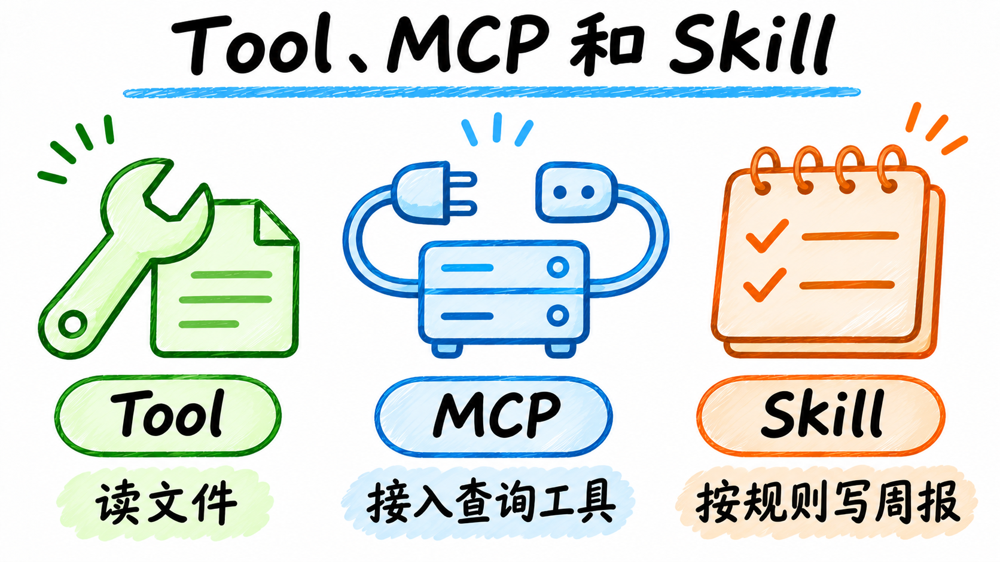
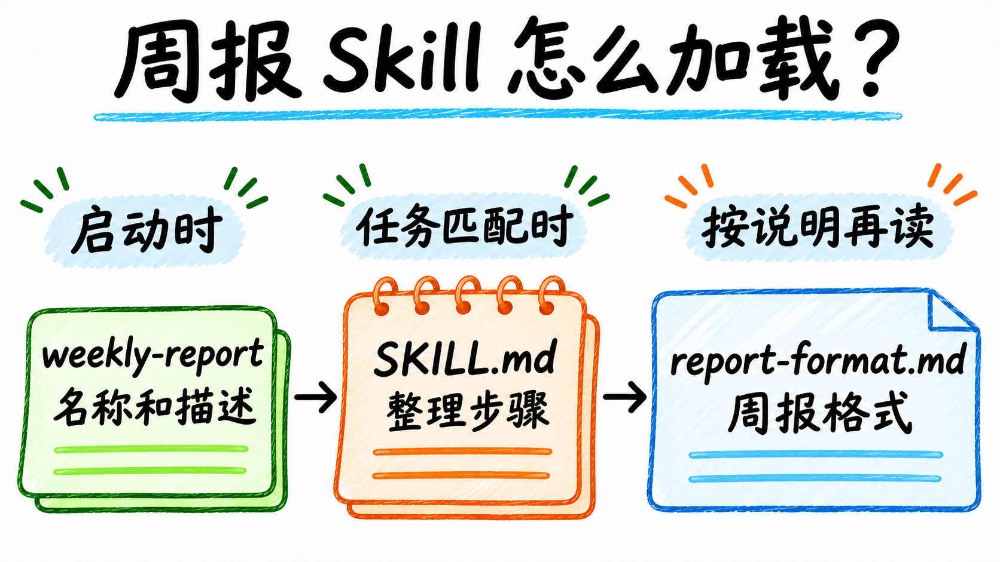

# LangChain 入门笔记 07：Skill 调用

一条工作记录写着「测试环境偶发超时，正在等待运维排查，问题尚未解决」。写周报时，这条应该放进「问题风险」。已经完成的登录接口联调，则放在「本周完成」。这些每周都要用的规则，可以写进一份 `weekly-report` 技能，让 Agent 写周报时去读。

## 1. Skill 是什么

### 1.1 Tool、MCP 和 Skill 各解决什么

读文件靠 Tool。工作记录在项目管理系统里时，可以通过 MCP 接入它的查询工具。拿到记录之后，怎么判断一件事算不算完成、周报分哪几栏，就看 Skill 里写的规则。



这篇直接把工作记录交给 Agent。三个例子都由各自的程序提供读取工具，Agent 用它们读技能说明和周报格式，再照着写。如果要让 Agent 跑技能里的脚本，宿主还得提供执行工具并检查权限。

### 1.2 一个 Skill 长什么样

拿 `weekly-report` 举例。照下面的目录放好三份 Python 脚本和两个技能文件。

```text
项目根目录/
├── pyproject.toml
├── .env
└── LangChain入门笔记/
    └── 07-LangChain-Skill调用/
        ├── 01-skill-manual.py
        ├── 02-skill-middleware.py
        ├── 03-skill-deepagents.py
        └── skills/
            └── weekly-report/
                ├── SKILL.md
                └── references/
                    └── report-format.md
```

一个技能目录至少要有一份 `SKILL.md`。本例把周报格式单独放在 `references/` 里。有脚本或其他资源时，也可以放在 `scripts/` 或 `assets/`。 [Agent Skills 格式规范](https://agentskills.io/specification)

先看 `SKILL.md`。最上面两条是 YAML，下面才是模型要读的整理步骤。

```markdown
---
name: weekly-report
description: 将零散工作记录整理为中文周报。当用户要求写周报、汇总本周工作或整理下周计划时使用。
---

# 周报整理

## 执行步骤

1. 阅读用户提供的工作记录，区分已完成、进行中、问题风险和下周计划。
2. 生成周报前，先读取本技能目录内的 `references/report-format.md`，遵循其中的格式和归类规则。
3. 按模板整理周报，合并重复事项，保留输入中的数量、状态和明确依赖。
4. 只使用用户提供的事实，不编造完成情况、指标、负责人或截止日期。
5. 缺少的信息标记为“待补充”；进行中的事项不能写成已经完成。
6. 直接在回复中输出 Markdown 周报，无需写入文件，也无需调用其他智能体。

## 读取参考文件

- 手动实现：调用 `read_skill_file`，传入本技能名称和相对路径。
- nb-langchain-agentskills：调用 `skill__read_content`，传入本技能名称和相对路径。
- Deep Agents：调用 `read_file`，路径为当前 SKILL.md 所在目录下的 `references/report-format.md`。

工具名称由宿主提供。以上是本教程三种宿主的对应关系；Skill 文件本身不会注册或执行工具。
```

技能目录就叫 `weekly-report`，所以 `name` 也写 `weekly-report`。名称最多 64 个字符，用小写字母、数字和连字符。连字符只能放在中间，也不能挨着用。`description` 最多 1024 个字符，要让模型看得出这份技能是做什么的，什么时候该读。

三个脚本共用这份说明，所以正文把三种读文件的工具名都写了进去。周报的标题和归类规则放在 `references/report-format.md`，由技能正文指给模型。

```markdown
# 周报格式与归类规则

输出必须包含以下三个二级标题：

## 本周完成

- 只列出明确已完成的事项，保留原始数量，不把计划或进行中工作列为已完成。
- 没有明确成果时写“待补充”。

## 问题风险

- 记录阻塞、依赖和未完成事项，并注明当前状态。
- 只有输入明确写了风险已解决，才能标记为已解决。
- 没有相关信息时写“待补充”，不要自行断言“无风险”。

## 下周计划

- 只列出输入中明确提出的后续安排。
- 可以整理表达，但不能补造负责人、日期、数量或额外任务。
- 没有相关信息时写“待补充”。

每一项使用简短的项目符号，不要添加绩效评价、寒暄或没有依据的总结。
```

### 1.3 渐进式披露：用到哪一层，读哪一层

模型一开始看到的是 `weekly-report` 的名字和用途。收到整理周报的请求后，它可以选中这个技能，调用工具读取 `SKILL.md`。读到「生成周报前先看格式」，它才有理由再去读 `references/report-format.md`。用到哪份说明，就把哪份说明发给模型，这叫**渐进式披露**。 [LangChain Skills 文档](https://docs.langchain.com/oss/python/langchain/multi-agent/skills)



手动示例生成技能清单时，Python 会先读一遍 `SKILL.md` 来解析 YAML。模型这时只收到名称和描述，等它调用工具，正文才会作为 `ToolMessage` 进入消息历史。参考文件也一样。

## 2. 运行准备

打开一个空目录，用 uv 创建 Python 3.14 项目并安装本篇的依赖。

```bash
uv init --bare --python 3.14
uv add langchain==1.5.0 langchain-deepseek==1.1.1 python-dotenv==1.2.4
uv add pyyaml==6.0.3 nb-langchain-agentskills==0.9.2 deepagents==0.7.38
```

在 `pyproject.toml` 同级创建 `.env`，填入自己的 DeepSeek API 密钥。

```dotenv
DEEPSEEK_API_KEY=你的密钥
```

按上一节的目录保存 `SKILL.md` 和 `report-format.md`，再把想运行的实战代码保存为对应的 `.py` 文件。保留 `LangChain入门笔记` 这一层，脚本用它来找到项目根目录。

## 3. LangChain接入Skill的三种方式

### 3.1 方式一：手动实现

先用前面学过的 `create_agent` 和 `@tool`。从扫描文件到把正文送进模型，每一步都能在代码里找到。哪些文件能读、元数据怎么校验，也可以按项目的要求来定。

想看懂 Skill 的加载过程，或者手头只有几个技能，这种写法就够用。代价是 YAML 解析、技能清单和读取工具都得自己维护。以后要加多目录扫描或自动刷新，还要接着写。

需要完成三件事：

1. 扫描技能文件，从 YAML 中提取名称与描述，生成技能目录。
2. 提供 `load_skill` 和 `read_skill_file`，让模型读取正文和参考资料。
3. 把技能目录放入系统提示词，再把读取工具绑定到 Agent。

将下面的代码保存为 `01-skill-manual.py`，在项目根目录运行。

```bash
uv run "LangChain入门笔记/07-LangChain-Skill调用/01-skill-manual.py"
```

```python
# 1.定位项目和本节目录，加载项目根目录的 .env
from pathlib import Path
from dotenv import load_dotenv
from langchain.chat_models import init_chat_model
from langchain.messages import HumanMessage

# 脚本使用 __file__ 定位，不依赖当前工作目录。
SCRIPT_PATH = Path(__file__).resolve()
PROJECT_ROOT = next(
    (path for path in (SCRIPT_PATH.parent, *SCRIPT_PATH.parents)
     if (path / "pyproject.toml").is_file()
     and (path / "LangChain入门笔记").is_dir()),
    None,
)
if PROJECT_ROOT is None:
    raise RuntimeError("请在本项目的 LangChain入门笔记 目录中运行脚本。")

CHAPTER_DIR = SCRIPT_PATH.parent
SKILLS_DIR = CHAPTER_DIR / "skills"
load_dotenv(PROJECT_ROOT / ".env")

# 2.沿用前文的 DeepSeek 模型；超时和重试次数用于限制演示等待时间。
model = init_chat_model(
    model="deepseek-v4-flash",
    extra_body={"thinking": {"type": "disabled"}},
    timeout=60,
    max_retries=0,
)

# 3.发现本地技能：仅将名称、描述和路径留在索引中
import re
import yaml
from langchain.agents import create_agent
from langchain.tools import tool


def parse_skill(path: Path) -> tuple[dict, str]:
    """拆分 YAML 元数据和 Markdown 正文。"""
    text = path.read_text(encoding="utf-8")
    parts = text.split("---", 2)
    if len(parts) != 3 or parts[0].strip():
        raise ValueError(f"{path.name} 必须以 YAML frontmatter 开头。")
    metadata = yaml.safe_load(parts[1])
    if not isinstance(metadata, dict):
        raise ValueError("Skill 元数据必须是 YAML 映射。")
    name = metadata.get("name")
    description = metadata.get("description")
    if (not isinstance(name, str) or len(name) > 64
        or re.fullmatch(r"[a-z0-9]+(?:-[a-z0-9]+)*", name) is None
        or name != path.parent.name):
        raise ValueError("name 必须与目录同名，使用小写字母、数字和单个内部连字符，最长 64 字符。")
    if not isinstance(description, str) or not 1 <= len(description.strip()) <= 1024:
        raise ValueError("description 必须是 1～1024 字符的非空字符串。")
    body = parts[2].strip()
    if not body:
        raise ValueError("Skill 正文不能为空。")
    return metadata, body


skill_index = {}
# 入门示例只扫描 skills 的直接子目录，不实现递归发现或热刷新。
for skill_file in sorted(SKILLS_DIR.glob("*/SKILL.md")):
    root = skill_file.parent.resolve()
    if not root.is_relative_to(SKILLS_DIR.resolve()):
        raise ValueError("技能目录不能指向 skills 目录以外。")
    metadata, _ = parse_skill(skill_file)
    name = metadata["name"]
    if name in skill_index:
        raise ValueError(f"技能名称重复：{name}")
    skill_index[name] = {
        "description": metadata["description"],
        "root": root,
    }

if not skill_index:
    raise RuntimeError("没有发现技能，请检查 skills 目录。")


# 4.定义工具：模型通过工具把正文、参考资料加入消息上下文
@tool
def load_skill(skill_name: str) -> str:
    """按技能名称加载完整 SKILL.md 正文；使用技能前必须先调用。"""
    entry = skill_index.get(skill_name)
    if entry is None:
        return f"错误：未知技能 {skill_name}。可用技能：{', '.join(skill_index)}"
    try:
        skill_file = (entry["root"] / "SKILL.md").resolve()
        if not skill_file.is_relative_to(entry["root"]):
            return "错误：技能文件不能超出技能目录。"
        _, body = parse_skill(skill_file)
        return body
    except (OSError, ValueError, yaml.YAMLError) as exc:
        return f"错误：无法加载技能（{type(exc).__name__}）。"


@tool
def read_skill_file(skill_name: str, file_path: str) -> str:
    """读取指定技能内的 UTF-8 参考文件，file_path 必须是相对技能目录的路径。"""
    entry = skill_index.get(skill_name)
    if entry is None:
        return f"错误：未知技能 {skill_name}。"
    relative = Path(file_path)
    if relative.is_absolute() or relative.drive or relative.root:
        return "错误：请使用技能目录内的相对路径。"
    try:
        target = (entry["root"] / relative).resolve()
        if not target.is_relative_to(entry["root"]):
            return "错误：文件路径不能超出技能目录。"
        if not target.is_file():
            return "错误：参考文件不存在。"
        return target.read_text(encoding="utf-8")
    except (OSError, ValueError, UnicodeError) as exc:
        return f"错误：无法读取参考文件（{type(exc).__name__}）。"


# 5.初始提示词只有技能目录，没有正文或模板
catalog = "\n".join(
    f"- {name}: {entry['description']}" for name, entry in skill_index.items()
)
system_prompt = (
    "你是一个中文工作助手。以下是可用技能的名称和描述：\n"
    + catalog
    + "\n任务匹配技能时，先用 load_skill 加载说明，再按说明使用工具读取所需资料。"
    "仅依据用户提供的事实回答。"
)
agent = create_agent(
    model=model,
    tools=[load_skill, read_skill_file],
    system_prompt=system_prompt,
)

# 6.使用相同的虚构记录调用 Agent，打印完整消息观察加载过程
work_notes = """请把下面的工作记录整理为本周周报。
- 本周完成登录接口联调，修复了 2 个参数校验问题。
- 完成 MCP 调用笔记的初稿。
- Skill 调用示例仍在编写，尚未完成。
- 测试环境偶发超时，正在等待运维排查，问题尚未解决。
- 下周计划完成 Skill 示例，并补充登录接口的异常场景测试。
"""
response = agent.invoke(
    {"messages": [HumanMessage(work_notes)]},
    config={"recursion_limit": 30},
)
for message in response["messages"]:
    message.pretty_print()
print(response["messages"][-1].content)
```

脚本先打印完整消息序列，最后再单独打印一次最终周报。打印全部消息，是为了看到模型的 `tool_calls` 和对应的 `ToolMessage`。重点检查模型是否调用了：

```text
load_skill(skill_name="weekly-report")
read_skill_file(skill_name="weekly-report", file_path="references/report-format.md")
```

以上是**预期调用示意**，不是硬编码的执行顺序。是否调用以及具体参数由模型决定；若没有加载，先检查工具调用支持、技能描述以及系统提示词。

关键代码说明：

- `yaml.safe_load`：解析 YAML 元数据，不把 YAML 当作任意 Python 对象执行。
- `skill_index`：保存名称、描述和本地路径；正文没有拼入初始提示词。
- `load_skill`：接收技能名称，返回 Markdown 正文。工具返回值会进入 Agent 的消息历史。
- `read_skill_file`：读取技能内的参考资料。通过 `resolve()` 和 `is_relative_to()` 检查最终路径，拒绝通过 `../` 或符号链接读取目录外文件。
- `create_agent(tools=...)`：注册的是两个读取工具，Skill 的步骤本身由模型理解和执行。

该实现只支持本例使用的简单 frontmatter 格式和一级技能目录，是为了讲清原理而写的教学版本，不是完整的 Agent Skills 规范实现。新增技能后需要重新运行脚本。

### 3.2 方式二：第三方 SkillsMiddleware

如果现有项目已经用 `create_agent`，可以直接加一个第三方中间件。这个包会扫描目录、把技能清单交给模型，并提供读取工具。它也支持多目录和自动刷新，适合在同一个 Agent 里管理多份技能。 [nb-langchain-agentskills](https://pypi.org/project/nb-langchain-agentskills/0.9.2/)

代价是多维护一个依赖。更新版本时要核对配置和工具参数，接入时也要看清中间件默认给模型开放了哪些工具。

将下面的代码保存为 `02-skill-middleware.py`，在项目根目录运行。

```bash
uv run "LangChain入门笔记/07-LangChain-Skill调用/02-skill-middleware.py"
```

```python
# 1.定位项目和本节目录，加载项目根目录的 .env
from pathlib import Path
from dotenv import load_dotenv
from langchain.chat_models import init_chat_model
from langchain.messages import HumanMessage

# 脚本使用 __file__ 定位，不依赖当前工作目录。
SCRIPT_PATH = Path(__file__).resolve()
PROJECT_ROOT = next(
    (path for path in (SCRIPT_PATH.parent, *SCRIPT_PATH.parents)
     if (path / "pyproject.toml").is_file()
     and (path / "LangChain入门笔记").is_dir()),
    None,
)
if PROJECT_ROOT is None:
    raise RuntimeError("请在本项目的 LangChain入门笔记 目录中运行脚本。")

CHAPTER_DIR = SCRIPT_PATH.parent
SKILLS_DIR = CHAPTER_DIR / "skills"
load_dotenv(PROJECT_ROOT / ".env")

# 2.沿用前文的 DeepSeek 模型；超时和重试次数用于限制演示等待时间。
model = init_chat_model(
    model="deepseek-v4-flash",
    extra_body={"thinking": {"type": "disabled"}},
    timeout=60,
    max_retries=0,
)

# 3.用第三方包发现技能，并向 Agent 注入目录和读取工具
from langchain.agents import create_agent
from nb_langchain_agentskills import DirectorySkillLoader, SkillsMiddleware

loader = DirectorySkillLoader(SKILLS_DIR)
skills_middleware = SkillsMiddleware(
    loader=loader,
    # 本例只需要读取说明和模板，不需要执行 shell 命令。
    exclude_tools={"skill__execute_script"},
)
print("可用技能：", [skill.name for skill in loader.list_skills()])
print("中间件提供的工具：", [tool.name for tool in skills_middleware.tools])

agent = create_agent(
    model=model,
    middleware=[skills_middleware],
    system_prompt="你是一个中文工作助手。任务匹配技能时先加载技能，按技能说明读取参考资料，仅依据用户事实回答。",
)

# 6.使用相同的虚构记录调用 Agent，打印完整消息观察加载过程
work_notes = """请把下面的工作记录整理为本周周报。
- 本周完成登录接口联调，修复了 2 个参数校验问题。
- 完成 MCP 调用笔记的初稿。
- Skill 调用示例仍在编写，尚未完成。
- 测试环境偶发超时，正在等待运维排查，问题尚未解决。
- 下周计划完成 Skill 示例，并补充登录接口的异常场景测试。
"""
response = agent.invoke(
    {"messages": [HumanMessage(work_notes)]},
    config={"recursion_limit": 30},
)
for message in response["messages"]:
    message.pretty_print()
print(response["messages"][-1].content)
```

脚本开头会打印两行诊断信息，列出发现的技能和中间件提供的工具。随后打印消息序列，检查 `skill__load_skill` 是否加载了 `weekly-report`，以及 `skill__read_content` 是否读取了 `references/report-format.md`。

我们没有手写技能目录和读取工具，因为中间件完成了这些工作：

- `DirectorySkillLoader`：扫描本地目录，发现并读取技能。
- `SkillsMiddleware`：把技能清单注入模型请求，注册相关工具。
- `middleware=[skills_middleware]`：将中间件接入 `create_agent` 的执行过程。

该包默认提供四个工具：

| 工具名称 | 用途 |
| --- | --- |
| `skill__list_skills` | 查看可用技能 |
| `skill__load_skill` | 加载指定技能的说明和目录信息 |
| `skill__read_content` | 读取技能中的文件 |
| `skill__execute_script` | 执行 shell 命令 |

本例通过 `exclude_tools` 排除了脚本执行工具，最终只暴露三个读取相关工具。不要把“限制文件目录”理解为 shell 沙箱；如果启用该包的执行工具，需要单独考虑命令执行权限。

加载工具返回的内容比手动实现丰富，但核心过程相同：先知道有哪些技能，再读取相关说明，最后读取参考资料。

### 3.3 方式三：Deep Agents 内置支持

项目已经在用 Deep Agents 时，把技能目录传给 `create_deep_agent`，就可以用它内置的技能发现和加载。这种方式也适合要处理文件、做多步规划，或把部分工作交给子 Agent 的项目。 [Deep Agents 技能文档](https://docs.langchain.com/oss/python/deepagents/skills)

本例从本地目录读技能，还需要配好 Backend 的根目录、虚拟路径和文件权限。一个只需要读周报说明的 Agent，也要先把这些配置弄清楚。

将下面的代码保存为 `03-skill-deepagents.py`，在项目根目录运行。

```bash
uv run "LangChain入门笔记/07-LangChain-Skill调用/03-skill-deepagents.py"
```

```python
# 1.定位项目和本节目录，加载项目根目录的 .env
from pathlib import Path
from dotenv import load_dotenv
from langchain.chat_models import init_chat_model
from langchain.messages import HumanMessage

# 脚本使用 __file__ 定位，不依赖当前工作目录。
SCRIPT_PATH = Path(__file__).resolve()
PROJECT_ROOT = next(
    (path for path in (SCRIPT_PATH.parent, *SCRIPT_PATH.parents)
     if (path / "pyproject.toml").is_file()
     and (path / "LangChain入门笔记").is_dir()),
    None,
)
if PROJECT_ROOT is None:
    raise RuntimeError("请在本项目的 LangChain入门笔记 目录中运行脚本。")

CHAPTER_DIR = SCRIPT_PATH.parent
SKILLS_DIR = CHAPTER_DIR / "skills"
load_dotenv(PROJECT_ROOT / ".env")

# 2.沿用前文的 DeepSeek 模型；超时和重试次数用于限制演示等待时间。
model = init_chat_model(
    model="deepseek-v4-flash",
    extra_body={"thinking": {"type": "disabled"}},
    timeout=60,
    max_retries=0,
)

# 3.使用 Deep Agents 内置的技能发现和文件读取能力
from deepagents import create_deep_agent
from deepagents.backends import FilesystemBackend
from deepagents.middleware.filesystem import FilesystemPermission

# SKILLS_DIR 在上面统一初始化；Deep Agents 通过 Backend 的虚拟路径访问技能。
# 虚拟路径 / 对应本节目录，不使用 Windows 绝对路径作为 skills 参数。
backend = FilesystemBackend(root_dir=CHAPTER_DIR, virtual_mode=True)
agent = create_deep_agent(
    model=model,
    backend=backend,
    skills=["/skills/"],
    # 演示只读技能，最终周报直接回复；通过文件工具禁止写入本节文件。
    permissions=[FilesystemPermission(operations=["write"], paths=["/**"], mode="deny")],
    system_prompt=(
        "你是一个中文工作助手。任务匹配技能时先读取对应 SKILL.md，再读取说明要求的参考资料。"
        "仅依据用户事实回答，直接在回复中输出周报。请自行完成，不调用 task 委派任务。"
    ),
)

# 6.使用相同的虚构记录调用 Agent，打印完整消息观察加载过程
work_notes = """请把下面的工作记录整理为本周周报。
- 本周完成登录接口联调，修复了 2 个参数校验问题。
- 完成 MCP 调用笔记的初稿。
- Skill 调用示例仍在编写，尚未完成。
- 测试环境偶发超时，正在等待运维排查，问题尚未解决。
- 下周计划完成 Skill 示例，并补充登录接口的异常场景测试。
"""
response = agent.invoke(
    {"messages": [HumanMessage(work_notes)]},
    config={"recursion_limit": 30},
)
for message in response["messages"]:
    message.pretty_print()
print(response["messages"][-1].content)
```

打印消息时，重点查看 `read_file` 是否先读取：

```text
/skills/weekly-report/SKILL.md
```

然后读取：

```text
/skills/weekly-report/references/report-format.md
```

| 参数 | 本例中的作用 |
| --- | --- |
| `model` | 使用与前两种方式相同的模型对象 |
| `backend` | 通过 FilesystemBackend 读取本地技能文件 |
| `root_dir` | 让虚拟路径的根目录对应本节目录 |
| `virtual_mode=True` | 文件路径限制在 Backend 根目录内 |
| `skills=["/skills/"]` | 指向包含技能子目录的父目录 |
| `permissions` | 禁止文件工具执行写操作，周报直接在回复中输出 |

Windows 用户也使用 `/skills/` 这样的正斜杠虚拟路径。这里的 `/` 对应 `CHAPTER_DIR`，不是磁盘根目录。

不要把 `skills` 写成单个技能的 `/skills/weekly-report/`；该参数接收技能源目录，本例需要扫描它下面的技能子目录。

Deep Agents 内部会使用自己的 `SkillsMiddleware` 处理技能发现。这里不用自行导入或同时添加上一节的第三方中间件。

Deep Agents 还提供其他工具，但这次任务只需要读取说明、读取模板和生成回复，不需要创建文件或委派任务。不要把本例的 Backend 路径限制当作任意代码执行沙箱；更多能力见 [Deep Agents Skills](https://docs.langchain.com/oss/python/deepagents/skills)。

下一篇会给 Agent 加上短期记忆，看看它怎么在几轮对话之间保留信息。
