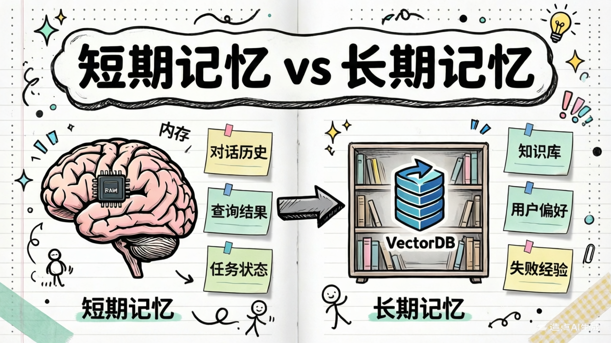
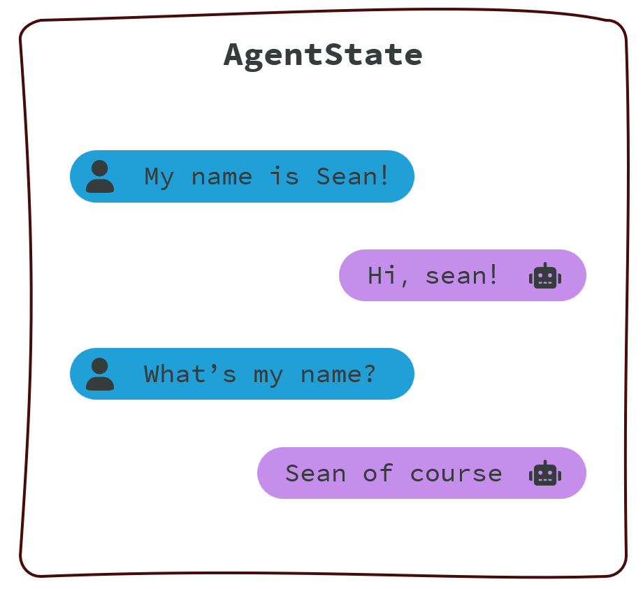
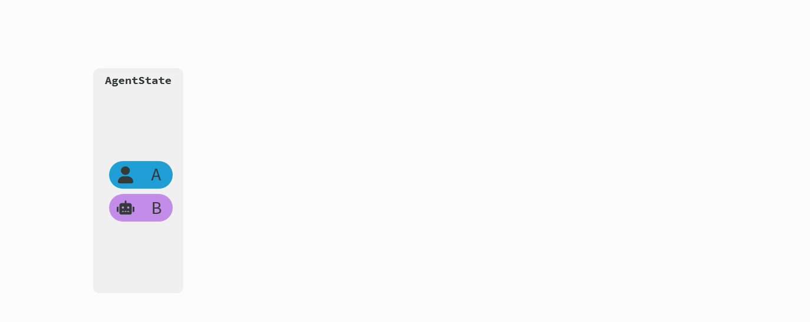
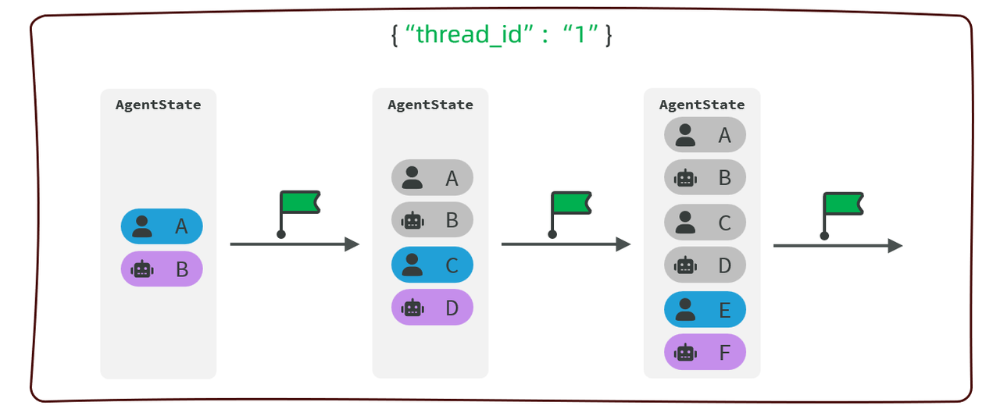

# 8. 记忆

## 8.1 记忆的分类

对于智能体而言，记忆分为了两类：

* 短期记忆（short-term memory）

* 长期记忆（long-term memory)


注意，大家不要被字面上的意思误导了，很多人看到名字就误以为：*短期记忆就是临时记忆，断电就没了；长期记忆就是永久记忆，持久保存*。


对于智能体而言，这是完全错误的理解！！！


简单用一句话概括的话：

* **短期记忆**：当前任务或会话的上下文（Working Memory 或 Session Memory）

* **长期记忆**：跨任务或会话的**经验与知识**（Persistent Memory）





比如，一个公司数据分析的Agent。

用户提出需求：

> “帮我写Q1的销售分析报告”

Agent：

***

短期记忆：

* 对话历史

* 查询到Q1的销售数据

* 任务目标及执行状态

***

长期记忆：

* 公司的KPI算法

* 用户偏好的报告形式


总结：

|            | **短期记忆**           | **长期记忆**           |
| ---------- | ---------------------- | ---------------------- |
| 生命周期   | 当前会话（短暂）       | 跨任务、跨会话（永久） |
| 内容       | 当前任务状态、会话历史 | 知识、经验、用户偏好   |
| 是否跨任务 | ❌                      | ✅                      |
| 存储       | Redis/内存/DB          | DB/Vector DB           |


接下来，我们先学习LangChain中的短期记忆管理。


## 8.2 短期记忆

由于**短期记忆**通常生命周期是当前会话，所以我们也可以称为**会话记忆**。Agent的会话记忆通常包含三部分：

* 对话历史

* 查询结果

* 任务状态

对于简单的Agent来说，只用考虑**会话历史**就可以了。后续我们会学习如何自定义更复杂的Agent会话记忆。


LangChain提供了自动化的记忆管理方案：

* 首先，LangChain把会话记忆（也就是Messages列表）记录在**AgentState**中：


  

* 每一次与AI的交互都会生成一个快照，记录为一个`AgentStateSnapshot`，记录当前会话的状态。把同一会话的所有`AgentStateSnapshot`组合在一起，就是完整的会话历史了。

  

* 为了区分不同的会话记忆，不同会话需要设定各自的`thread_id`，相同会话则使用相同`thread_id`

* 向Agent发起会话时必须指定自己的`thread_id`以唤起对应的会话记忆




在LangChain中，所有的AgentStateSnapshot都是通过**Checkpointer**对象来保存的，`Checkpointer`有很多不同的实现：

* `InMemorySaver`：基于内存存储

* `SqliteSaver`：基于sqlite数据库存储

* `PostgreSaver`：基于PostgreSql数据存储


接下来，我们以LangChain提供的基于内存的`InMemorySaver`为例来演示会话记忆。


具体步骤是这样的：

1. 导入CheckPointer的内存版实现：

   ```python
   # langchain提供的checkpointer的默认实现，基于内存存储
   from langgraph.checkpoint.memory import InMemorySaver
   ```

2. 创建智能体，设置checkpointer：

   ```python
   from langchain.agents import create_agent

   # 创建智能体时指定checkpointer，LangChain会自动帮我们管理历史会话记忆
   agent = create_agent(
       model = "deepseek-v4-flash",
       checkpointer=InMemorySaver()
   )
   ```

3. 发起调用时，指定thread\_id

   1. 第一次调用，告知AI一些信息

   ```python
   from langchain.messages import HumanMessage

   # 设定thread_id，作为会话标识
   config = {"configurable": {"thread_id": "thread_1"}}

   # 第一次调用，告知AI我的信息
   response = agent.invoke(
       {"messages": [HumanMessage(content="你好，我叫虎哥，我最喜欢猫猫。")]},
       config # 调用时添加thread_id，区分不同会话
   )

   print(response)
   ```

   2. 第二次调用，询问AI

   ```python
   # 第二次调用，询问我的信息，这次带上thread_id，唤起记忆
   response = agent.invoke(
       {"messages": [HumanMessage(content="我最喜欢的动物是什么？")]},
       config # 调用时添加thread_id
   )

   print(response)
   ```

由于两次调用使用了相同的thread\_id，被认定为是同一次对话，所以LangChain会在请求模型时携带历史对话的Messages，模型就能根据历史消息来正确回答了：


完整代码：

```python
from langchain.messages import HumanMessage
from dotenv import load_dotenv
from langchain.agents import create_agent
from langchain.chat_models import init_chat_model
from langgraph.checkpoint.memory import InMemorySaver

# 1.准备和加载环境变量
load_dotenv()

# 2.初始化模型
model = init_chat_model(
        "deepseek-v4-flash",
        extra_body={"thinking": {"type": "disabled"}}
    )

# 3.准备tools
tools = []

# 4.创建Agent，绑定model、tools、checkpointer
agent = create_agent(
    model=model,
    tools=tools, # 可省略
    checkpointer=InMemorySaver(),
)

# 5.调用
config = {"configurable": {"thread_id": "t1"}}

# 第一次调用，告知AI我的信息
response = agent.invoke(
    {"messages": [HumanMessage(content="你好，我叫虎哥，我最喜欢猫猫。")]},
    config # 调用时添加thread_id，区分不同会话
)

# 第二次调用，询问我的信息，这次带上thread_id，唤起记忆
response = agent.invoke(
    {"messages": [HumanMessage(content="我最喜欢的动物是什么？")]},
    config # 调用时添加thread_id
)

print(response)
```


> **注意**：
>
> 目前我们使用的checkpointer是基于内存的InMemorySaver，LangChain也提供了很多持久化存储的checkpointer，例如：
>
> * SqlLiteSaver ：基于sqlite存储
>
> * PostgresSaver ：基于Postgres存储
>
> * CosmosDBSaver ：使用Azure Cosmos DB的实现
>
>
>
> 具体可以查看文档：
>
> https://docs.langchain.com/oss/python/langgraph/persistence#checkpointer-libraries
>
>
