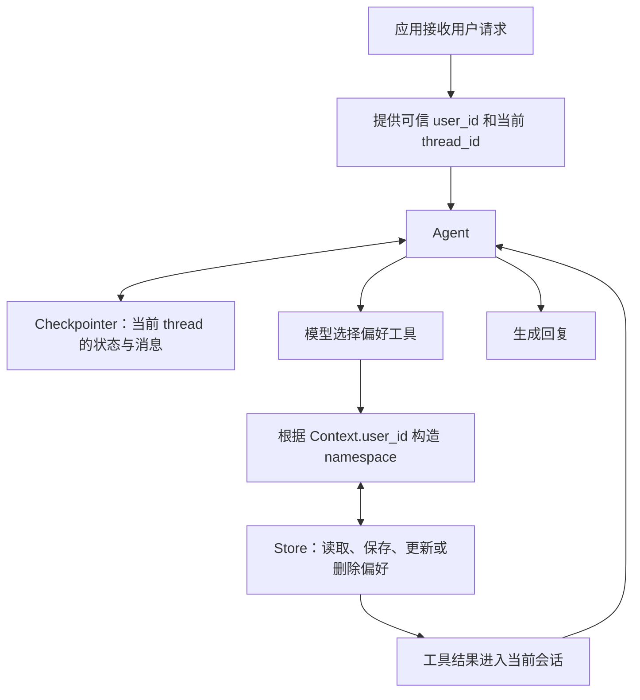

# 9. LangChain 长期记忆管理

上一章，我们通过 Checkpointer 保存了会话历史。同一个 `thread_id` 下，Agent 可以看到之前的消息；如果使用数据库保存，还能在程序重启后继续原来的会话。

但用户开启新会话后，仍希望 Agent 记住自己的偏好。例如：

> 会话一：“请记住，我最喜欢的动物是猫，回答问题时尽量简洁。”
>
> 会话二：“我最喜欢什么动物？”

如果只保存会话一的消息，会话二并不会自动继承这些消息。我们需要把值得复用的信息单独保存，再在新会话中读取，这就是本章要学习的长期记忆。

本章以用户偏好为例，依次学习 Store 基础操作、Agent 跨会话读写，以及 SQLite 持久化。实现依据是 [LangChain 长期记忆文档](https://docs.langchain.com/oss/python/langchain/long-term-memory)，使用当前项目中的 `create_agent`、`ToolRuntime` 和 LangGraph Store 接口。

## 9.1 长期记忆与短期记忆有什么区别

两者主要按**使用范围**区分，而不是按“保存多久”区分。

| 比较项 | 短期记忆 | 长期记忆 |
| --- | --- | --- |
| 主要用途 | 继续当前会话、恢复任务状态 | 跨会话复用用户偏好、事实和经验 |
| 典型内容 | messages、工具结果、任务执行状态 | 喜欢的动物、回答风格、已确认的业务知识 |
| 管理接口 | Checkpointer | Store |
| 组织方式 | 按 `thread_id` 保存状态检查点 | 按自定义 `namespace` 和 `key` 保存 JSON 文档 |
| 内存实现 | `InMemorySaver` | `InMemoryStore` |
| SQLite 实现 | `SqliteSaver` | `SqliteStore` |
| 能否持久化 | 可以，取决于后端 | 可以，取决于后端 |

所以，不能把“短期记忆”理解为断电就丢失，也不能把“长期记忆”理解为永远保存。`InMemoryStore` 支持跨会话共享数据，但它依然只保存在当前进程的内存中。

还要注意，长期记忆不会让模型参数发生变化。模型能使用这些信息，是因为应用先从 Store 读取，再通过工具结果或提示词把内容放进当前请求的上下文。



绑定 Store 只提供存储能力，不会自动把所有对话写成长期记忆，也不会自动把全部记忆注入提示词。本章通过工具明确完成读写。

## 9.2 运行准备与示例目录

在项目根目录执行 `uv sync`，然后在 Jupyter 中选择项目 `.venv` 对应的 Python 内核。本章使用项目已有依赖，无需安装 PostgreSQL，也无需升级依赖。

```text
09-LangChain-长期记忆管理/
├── LangChain-长期记忆管理.md
├── notebooks/
│   ├── 01-长期记忆-InMemoryStore基础.ipynb
│   ├── 02-长期记忆-Agent跨会话共享.ipynb
│   └── 03-长期记忆-SqliteStore持久化.ipynb
└── data/                              # 运行时生成，数据库已加入忽略规则
```

| 示例 | 是否需要模型 | 主要观察结果 |
| --- | --- | --- |
| [01：Store 基础](./notebooks/01-长期记忆-InMemoryStore基础.ipynb) | 否 | 增删改查、覆盖与合并、用户空间隔离 |
| [02：Agent 跨会话共享](./notebooks/02-长期记忆-Agent跨会话共享.ipynb) | 是 | 同用户换会话可读取，不同用户查不到，更新和遗忘生效 |
| [03：SQLite 持久化](./notebooks/03-长期记忆-SqliteStore持久化.ipynb) | 前两部分不需要，Agent 部分需要 | 关闭连接后数据仍在，新 Agent 可读取 |

真实 Agent 示例沿用前文模型。在项目根目录的 `.env` 中配置自己的密钥：

```dotenv
DEEPSEEK_API_KEY=你的密钥
```

```python
from langchain.chat_models import init_chat_model

model = init_chat_model(
    "deepseek-v4-flash",
    model_provider="deepseek",
    extra_body={"thinking": {"type": "disabled"}},
)
```

实际模型权限以账号为准。如果该模型不可用，请换成账号可用、支持工具调用的模型。真实调用会产生 API 费用；Notebook 不会打印密钥。运行 Notebook 时，请将内核工作目录设置为本章 `notebooks/`。所有路径都相对于该目录：使用 `../../../.env` 加载环境变量，使用 `../data/` 保存数据库，不计算项目绝对路径。路径初始化单元会检查工作目录，避免误将数据库写入其他位置。

## 9.3 用 Store 组织长期记忆

### 9.3.1 namespace、key 和 value

把 Store 理解为一个按目录组织的文档库：

- `namespace`：目录路径，使用字符串元组；本章为 `("users", user_id, "preferences")`。
- `key`：当前目录中的文档名，例如 `favorite_animal`。
- `value`：JSON 对象，例如 `{"value": "猫"}`。

```text
users/
├── alice/preferences/
│   ├── favorite_animal → {"value": "猫"}
│   └── response_style → {"value": "简洁"}
└── bob/preferences/
    └── favorite_animal → {"value": "狗"}
```

同一个 namespace 和 key 确定一条记忆。Alice 和 Bob 可以使用相同的 key，因为用户目录不同。每个偏好独立保存，也便于只修改或删除其中一项。

### 9.3.2 新增、读取和更新

```python
from langgraph.store.memory import InMemoryStore

store = InMemoryStore()
namespace = ("users", "alice", "preferences")

store.put(namespace, "favorite_animal", {"value": "猫"})
item = store.get(namespace, "favorite_animal")
if item is not None:
    print(item.value)  # {'value': '猫'}

store.put(namespace, "favorite_animal", {"value": "兔子"})
assert store.get(namespace, "favorite_animal").value == {"value": "兔子"}
```

`get()` 返回的是 Item，内容通过 `.value` 访问；找不到时返回 `None`，要先判断再读取。

**`put()` 在相同 namespace、相同 key 下会替换整个 value，不会自动合并字段。** 如果把用户资料放在一个文档中，只写新名字会丢掉原来的语言字段：

```python
profile_ns = ("users", "alice", "profile")
store.put(profile_ns, "basic", {"name": "小林", "language": "中文"})
store.put(profile_ns, "basic", {"name": "小林同学"})
# 此时 basic 仅有 name，language 已被覆盖。
```

需要保留其他字段时，先读再合并：

```python
old_item = store.get(profile_ns, "basic")
old_value = dict(old_item.value) if old_item else {}
store.put(profile_ns, "basic", {**old_value, "language": "中文"})
```

这种读后写适合单线程教学；多个请求同时修改同一文档时可能覆盖彼此的更新，实际系统需要事务或相应的并发控制。

### 9.3.3 列举、过滤和删除

```python
items = store.search(namespace, limit=10)
for item in items:
    print(item.key, item.value)

matched = store.search(namespace, filter={"value": "兔子"}, limit=10)

store.delete(namespace, "favorite_animal")
assert store.get(namespace, "favorite_animal") is None
```

`search()` 的第一个参数是 namespace **前缀**。传入 `("users",)` 可能查询多个用户的记录；面向单用户的工具应使用该用户的完整偏好路径，并保持相应的目录约定。namespace 是组织约定，不是权限系统。

返回数量受 `limit` 限制；数据多时要配合 `offset` 分页。本例数据很少，`limit=10` 足够。

本章没有配置 Embedding 索引，所以这里是列举和字段过滤，不能把 `search()` 的名称理解为已经具备语义相似度检索。语义检索需要额外配置嵌入模型和索引。

## 9.4 让 Agent 读写长期记忆

本节的关键是：**应用注入用户身份，工具根据身份读写 Store，模型选择何时调用工具。**

### 9.4.1 应用传入 Context

```python
from dataclasses import dataclass
from langchain.tools import ToolRuntime, tool
from typing import Literal

@dataclass(frozen=True)
class Context:
    user_id: str

PreferenceKey = Literal["favorite_animal", "response_style"]
```

`Context` 保存本次运行的应用上下文，不是聊天消息。Notebook 中手动指定用户只是为了演示；真实服务应从登录态中获取 user_id，不能直接相信用户消息里声称的身份。

### 9.4.2 工具访问 runtime.store

下面展示读取工具的核心代码，完整版本还包括缺失 Store 检查、保存和删除工具，见 Notebook 02。

```python
@tool
def get_preference(key: PreferenceKey, runtime: ToolRuntime[Context]) -> dict:
    """读取当前用户的一项偏好，不存在时不得猜测。"""
    namespace = ("users", runtime.context.user_id, "preferences")
    item = runtime.store.get(namespace, key)
    return {
        "key": key,
        "found": item is not None,
        "value": item.value["value"] if item else None,
    }
```

其中 `runtime.context` 提供当前用户，`runtime.store` 提供创建 Agent 时传入的 Store。`runtime` 不会作为参数暴露给模型，因此工具不接受模型填写 user_id。

三个工具的行为是：

| 工具 | 触发意图 | 对 Store 的操作 |
| --- | --- | --- |
| `get_preference` | 查询已保存偏好 | `get(namespace, key)` |
| `save_preference` | 明确要求记住或修改 | `put(namespace, key, {"value": value})` |
| `delete_preference` | 明确要求忘记 | `delete(namespace, key)` |

工具只允许 `favorite_animal` 和 `response_style` 两种键，避免示例扩展成任意资料写入系统。保存前还会检查值不能是空字符串。

### 9.4.3 同时绑定 Store 和 Checkpointer

Notebook 定义 `TOOLS` 和 `SYSTEM_PROMPT` 后创建 Agent：

```python
from langchain.agents import create_agent
from langgraph.checkpoint.memory import InMemorySaver

agent = create_agent(
    model=model,
    tools=TOOLS,
    system_prompt=SYSTEM_PROMPT,
    context_schema=Context,
    store=store,
    checkpointer=InMemorySaver(),
)

result = agent.invoke(
    {"messages": [{"role": "user", "content": "请记住，我最喜欢的动物是猫。"}]},
    config={"configurable": {"thread_id": "alice-1"}},
    context=Context(user_id="alice"),
)
```

本章提示词要求：只有用户明确要求记住或修改时才保存；查询时必须先读取；未保存时说明缺失；遗忘时删除。工具结果作为数据使用，不能把其中的文字当作新的系统指令。

这些提示词用于引导模型，并不能强制保证业务授权。高要求系统应在应用层增加确定性的意图确认、字段校验与访问控制。

## 9.5 验证跨会话共享与用户隔离

Notebook 02 按以下顺序运行，保存值分别固定为“猫”和“兔子”，方便核对断言：

| 步骤 | user_id | thread_id | 操作与预期 |
| --- | --- | --- | --- |
| 保存 | alice | alice-1 | 调用 save_preference，存入“猫” |
| 跨会话读取 | alice | alice-2 | 调用 get_preference，读到“猫”，该会话没有上一会话消息 |
| 用户隔离 | bob | bob-1 | 调用 get_preference，返回 found=False |
| 修改 | alice | alice-2 | 调用 save_preference，将值改为“兔子” |
| 遗忘 | alice | alice-2 | 调用 delete_preference，Store 中记录不存在 |
| 遗忘后读取 | alice | alice-3 | 新会话调用 get_preference，返回 found=False |

记住这两个标识的职责：

- `thread_id` 决定本次加载哪一份会话状态。
- `user_id` 由应用决定，并用于构造长期记忆 namespace。

同一用户可以有多个 thread，它们仍访问同一份偏好。不同用户必须使用各自的 thread，服务端还必须验证 thread 的归属；只隔离 Store 不能阻止错误复用 thread 导致历史消息泄露。

### 如何判断代码真的生效

不能只观察最后一句“已记住”。Notebook 的 `ask()` 会检查**本次调用**产生的成功 ToolMessage；之后再检查 Store 的实际值。读取时还会解析工具返回的 JSON，检查 `found` 和 `value`。

同一个 thread 会累积历史工具消息，所以检查时必须排除前几轮的 ToolMessage，否则之前保存成功的结果可能掩盖本次没有调用工具的问题。

真实模型的工具选择存在不确定性。如果断言失败，先观察本次工具结果、模型是否支持工具调用、是否返回了不同的偏好值，再定位原因。不要简单删除断言，把模型的口头承诺当作成功。

## 9.6 用 SQLite 持久化长期记忆

`InMemoryStore` 在进程退出后不会保留数据。要验证重启恢复，需要换成数据库后端。本项目已有的 `langgraph-checkpoint-sqlite` 提供 `SqliteStore`，无需额外数据库服务。

```python
from pathlib import Path
from langgraph.store.sqlite import SqliteStore

# 从本章 notebooks/ 目录运行，数据库保存在同级的 data/ 目录中。
data_dir = Path("../data")
data_dir.mkdir(parents=True, exist_ok=True)
db_path = data_dir / "preferences.sqlite"
namespace = ("users", "alice", "preferences")
print("数据库路径：", db_path)

with SqliteStore.from_conn_string(str(db_path)) as store:
    store.setup()
    store.put(namespace, "favorite_animal", {"value": "猫"})

# 此时旧连接已经关闭。
with SqliteStore.from_conn_string(str(db_path)) as restored_store:
    restored_store.setup()
    item = restored_store.get(namespace, "favorite_animal")
    assert item is not None and item.value == {"value": "猫"}
```

注意以下几点：

1. `setup()` 初始化存储表；示例显式调用，便于理解连接和初始化流程。
2. 使用实际文件路径，不能用 `:memory:` 验证关闭连接后的持久化。
3. `from_conn_string()` 返回上下文管理器，退出 `with` 后连接关闭，所有 Store 操作及相关 Agent 调用都要在块内完成。
4. 恢复时必须使用相同数据库路径、namespace 和 key。换 thread 不影响 Store 查找。

Notebook 03 使用相对目录 `../data/`，把数据库保存在本章 `data/` 下，并打印相对路径：

- `store_basics.sqlite`：不调用模型，验证关闭连接后的恢复，以及更新、删除和用户隔离。
- `agent_preferences.sqlite`：第一次连接中创建 Agent，通过工具保存；第二次连接中重新创建 Agent，使用新会话读取。

第二个 Agent 有全新的 `InMemorySaver`，没有第一次的会话历史，因此读取依赖 SQLite 中的长期记忆。还可以重启内核，按照 Notebook 标注只运行初始化与恢复部分；不要先重跑写入，否则无法证明原数据被恢复。

### SqliteStore 与 SqliteSaver 不要混用

虽然来自同一个依赖包，但它们负责不同的数据：

```python
from langgraph.store.sqlite import SqliteStore          # 传给 store=
from langgraph.checkpoint.sqlite import SqliteSaver     # 传给 checkpointer=
```

本章只把长期记忆持久化，Checkpointer 仍使用内存实现。如果希望原会话历史也在重启后恢复，需要另行配置 `SqliteSaver`。SQLite 适合本地学习和轻量应用，生产选型还要考虑并发、部署方式和备份要求。

## 9.7 如何管理记忆，以及常见误区

### 保存什么、什么时候保存

优先保存明确、有复用价值的信息，例如用户确认的语言偏好、输出格式和长期约束。本章只在明确要求时写入，不把所有聊天、模型猜测或临时任务要求自动存成用户事实。

随着应用复杂度增加，可增加来源、更新时间、有效期等信息；发生冲突时，应根据明确的用户修正更新旧值。并不是“保存得越多，效果越好”，过时和错误的记忆也会干扰回答。

### 删除后为什么还可能回答出来

`store.delete()` 只删除 Store 中对应的一条记录。原会话的消息仍可能包含“我喜欢猫”，模型仍能从历史中看到。Notebook 使用新 thread 检查遗忘后的读取结果，但这不等于清除了历史。

如果产品要求彻底删除用户资料，需要同时处理会话历史、日志及其他副本，并制定相应的数据保留策略。

### 查不到记忆时怎么处理

先检查 `get()` 是否返回 `None`，工具返回明确的 `found=False`，模型说明“没有保存过”，而不是猜测。排查顺序是：是否写入成功、是否使用同一个 Store 或数据库文件、用户 namespace 和 key 是否一致。

### 为什么新建 Agent 后记忆消失

如果同时新建了一个 `InMemoryStore()`，就创建了新的空存储。多个 Agent 只有使用同一实例，或者连接同一持久化后端并遵守相同 namespace 约定，才能共享数据。

### 后续可以扩展哪些能力

[LangChain 记忆概念指南](https://docs.langchain.com/oss/python/concepts/memory)按内容区分三类长期记忆：语义记忆保存事实，情景记忆保存经历，程序记忆保存处理规则。例如用户偏好、过去某次任务的成功经验和整理报告的步骤。

这里的“语义记忆”不等于“语义检索”。前者描述记忆内容，后者是按含义寻找相关内容的技术，需要 Embedding 等配置。

写入也可以发生在当前请求流程中，或者由后台任务提取。本章使用前者，便于观察工具读写；后台提取可以降低当前请求的等待时间，但还需要处理提取延迟、重复、冲突和失败重试。本章不引入这些额外组件。

## 9.8 本章验证记录

路径调整后，已从本章 `notebooks/` 工作目录验证相对路径加载与 SQLite 关闭重连恢复。

本次在项目 Python 3.14 环境中验证，实际安装版本为 `langchain 1.5.0`、`langgraph 1.2.21`、`langgraph-checkpoint-sqlite 3.1.3`。这些是验证环境记录，不要求读者升级为完全相同的版本。

- 三个 Notebook 的代码语法、基本结构和文章本地链接检查通过；交付文件不包含执行输出或执行计数。
- Store 基础断言、用户空间隔离、SQLite 关闭重连后的恢复、更新和删除通过。
- 使用两个独立 Python 进程分别写入和读取临时 SQLite 文件，验证进程退出后数据仍可恢复。
- 使用可控的模拟模型执行全部代码单元，验证工具运行时注入和 Agent 执行流程通过。
- 使用项目配置的真实 DeepSeek 模型执行 Notebook 02、03 的全部 Agent 场景通过；同时验证本次成功工具消息、工具返回值和 Store 数据。验证使用临时数据库，没有向交付文件写入真实运行输出。

模型调用结果受账号权限、服务可用性和模型行为影响；上述结果是本次运行记录，运行失败时请按前文的排查步骤检查。
