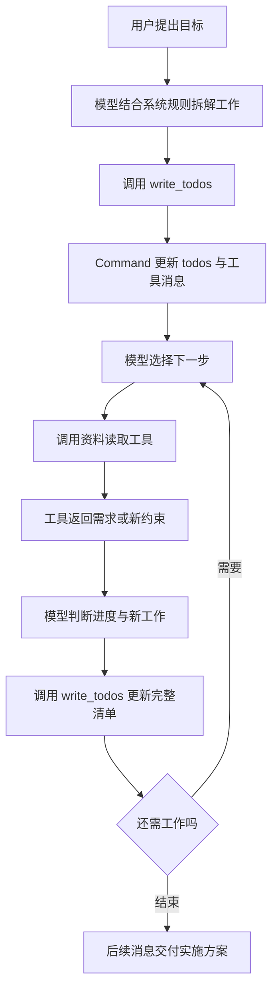

# 11. LangChain 任务规划

第 10 篇讨论了上下文管理：历史越来越长时，应该给模型看哪些信息？本篇接着讨论另一个问题：**知道了目标和约束，Agent 接下来应该做什么，又怎样知道工作进行到了哪里？**

本章继续使用“登录功能开发助手”，但这次实际完成的工作是**分析资料并编写实施方案**。不开发页面、不发送短信、不部署服务。这样可以把注意力放在任务拆解、工具执行、进度更新和计划调整上。

我们以 `TodoListMiddleware` 为主线，先观察真实 Agent 的行为，再解释中间件源码，最后在 Deep Agents 中使用相同能力。

## 11.1 为什么需要任务规划

假设用户提出：

> 请读取登录需求和补充约束，完成登录功能实施方案。

Agent 需要阅读资料、辨认范围、补充异常处理、整理方案，再核对是否遗漏。当补充资料增加验证码发送限流、过期和错误次数限制时，最初的工作安排可能也需要调整。

只让 Agent 在一大段回答里说“我会先阅读，再分析”，不容易区分哪些工作已经执行、哪些还没开始。结构化待办列表可以把这些信息单独记录，便于展示进度和继续任务。

这里有两种不同的“计划”：

- **Agent 本次工作的待办**：读取需求、分析验证码约束、编写并检查方案。这些是本次可以完成的工作。
- **最终方案里的未来开发步骤**：实现验证码接口、开发登录页面、接入会话管理。这些属于交付给用户的建议，Agent 本次没有执行。

不能因为“方案已经写完”，就把“登录功能开发”标成已完成。后面的 Notebook 会一直保持这一区分。

## 11.2 三种任务规划方式

| 方式 | 计划如何表示 | 谁决定下一步 | 适用情况 |
| --- | --- | --- | --- |
| 普通 Agent | 模型根据目标、消息和工具结果逐轮决策，不要求结构化计划 | 模型选择工具或回答 | 简单任务，或不需要单独展示进度的多步任务 |
| Agent + 待办清单 | 模型调用 `write_todos`，把任务描述和状态写入 State | 仍由模型选择业务工具 | 多步分析、动态修改任务、展示进度 |
| Plan-and-Execute | 独立 Planner 生成计划，Executor 执行，Replanner 根据结果调整 | 应用定义的节点与路由配合模型决策 | 需要更明确控制执行、依赖或验收的工作流 |

普通 Agent 也可以完成多步骤任务。`create_agent()` 的基本循环是：调用模型 → 如果有工具调用就执行 → 工具结果加入消息 → 再调用模型。不能把“没有待办列表”理解为“没有规划能力”。参见 [Agent 官方文档](https://docs.langchain.com/oss/python/langchain/agents)。

本篇给这个循环加上显式待办跟踪，不另外实现 Planner、Executor、Replanner。官方的 [Plan-and-Execute 架构说明](https://www.langchain.com/blog/planning-agents) 可以作为后续学习入口，其中展示了规划和执行分离的设计。

## 11.3 运行准备

### 11.3.1 环境与目录

沿用项目已有 `.venv` 和依赖，无需升级。本文机制以本地 LangChain 1.5.0、Deep Agents 0.7.38 源码为依据；实际验证版本另见本章末尾。

```text
11-LangChain-任务规划/
├── LangChain-任务规划.md
├── notebooks/
│   ├── 01-任务规划-TodoListMiddleware基础.ipynb
│   ├── 02-任务规划-动态调整与状态恢复.ipynb
│   ├── 03-任务规划-DeepAgents接入.ipynb
│   ├── planning_lab.py
│   └── verify_chapter.py
└── data/                         # 本地验证生成，已忽略
```

- [Notebook 01：基础规划](./notebooks/01-任务规划-TodoListMiddleware基础.ipynb)：接入中间件，观察工具调用和待办增量。
- [Notebook 02：调整与恢复](./notebooks/02-任务规划-动态调整与状态恢复.ipynb)：补充约束、第二轮用户要求、同 saver 同 thread 的状态继续。
- [Notebook 03：Deep Agents](./notebooks/03-任务规划-DeepAgents接入.ipynb)：复用相同模型、资料和任务，对照规划机制。

三个 Notebook 都可独立运行，内核工作目录固定为本章 `notebooks/`，使用 `../../../.env` 加载环境配置。不依赖其他章节产生的数据或其他 Notebook 的内核变量。

[planning_lab.py](./notebooks/planning_lab.py) 只提供固定资料、模型初始化、读取工具和输出辅助函数。Agent 的创建、中间件配置、流式循环和状态读取都直接展示在 Notebook 中。

### 11.3.2 真实模型实验

在项目根目录 `.env` 配置 `DEEPSEEK_API_KEY`。真实模型沿用前文：

```python
from langchain.chat_models import init_chat_model

model = init_chat_model(
    "deepseek-v4-flash",
    model_provider="deepseek",
    extra_body={"thinking": {"type": "disabled"}},
    max_tokens=2600,
    timeout=60,
    max_retries=0,
)
```

模型权限以账号为准，需要支持工具调用。每个 Notebook 初始设置 `RUN_LIVE = False`：可以检查导入、资料读取和工具 schema，但**不会运行 Agent，也不会展示模拟规划结果**。主动改为 `True` 后从头运行，才会调用真实模型并产生费用。没有密钥时明确报错，不切换模型或伪造结果。

### 11.3.3 本章资料

本章所有资料都是虚构教学数据。基础需求沿用手机号验证码登录、密码登录暂缓和 SQLite 原型背景；补充约束是本章新增设定，包括发送冷却、手机号与 IP 限流、验证码过期、成功后失效、错误次数上限及发送失败处理。

具体阈值待业务确认。示例不会擅自把“需要限流”写成已经确认的数值，也不把 SQLite 教学原型描述成生产架构结论。

工具只有 `read_requirements()` 与 `read_constraints()`，读取 Python 中固定的本地资料，不访问网络、真实数据库或短信系统。

## 11.4 为 Agent 添加待办规划

### 11.4.1 最小接入

以下代码在本章 `notebooks/` 中使用：

```python
from langchain.agents import create_agent
from langchain.agents.middleware import TodoListMiddleware
from planning_lab import live_model, TOOLS, SYSTEM_PROMPT

agent = create_agent(
    model=live_model(),
    tools=TOOLS,
    system_prompt=SYSTEM_PROMPT,
    middleware=[TodoListMiddleware()],
)
```

`write_todos` 由中间件自动提供，不需要再手工加入 `tools`。官方将这个中间件用于复杂任务的规划和进度跟踪，参见 [To-do list 文档](https://docs.langchain.com/oss/python/langchain/middleware/built-in#to-do-list)。

一项待办只包含两个字段：

```python
{
    "content": "读取登录需求并确认本次方案范围",
    "status": "in_progress",
}
```

`pending` 表示未开始，`in_progress` 表示进行中，`completed` 表示已完成。模型可以一次提交多项，但没有内置任务 ID、依赖关系、执行函数或验收条件。

### 11.4.2 观察真实执行

Notebook 中保留了完整循环：

```python
from planning_lab import REQUEST, observe_update, final_answer

trace = {"messages": [], "snapshots": [], "todos": []}
for update in agent.stream(
    {"messages": [{"role": "user", "content": REQUEST}]},
    {"recursion_limit": 60},
    stream_mode="updates",
):
    observe_update(update, trace)

print(trace["todos"])
print(final_answer(trace))
```

`updates` 返回各节点的增量更新。辅助函数打印真实的工具名称、参数、结果和待办变化，并在本地 `trace` 收集观察信息。`trace` 不写回 Agent，也不充当 Checkpointer。本例没有配置 Checkpointer，最终待办通过本轮收到的更新取得。

`recursion_limit` 是图执行步数上限，不是待办条数，也不是严格的费用预算。超过限制会停止并报错，不会自动把剩余待办完成。

下面是我们希望观察的流程；实际是否发生，要看真实调用轨迹：



图中没有“从 Todo 自动执行函数”的箭头：**模型还需要另外调用真正的业务工具。**

## 11.5 中间件内部如何工作

本节根据本地 `.venv/Lib/site-packages/langchain/agents/middleware/todo.py` 解释。片段只保留核心逻辑，不是另一套手动实现。API 入口见 [TodoListMiddleware Reference](https://reference.langchain.com/python/langchain/agents/middleware/todo/TodoListMiddleware)。

### 11.5.1 扩展 Agent State

```python
class Todo(TypedDict):
    content: str
    status: Literal["pending", "in_progress", "completed"]

class PlanningState(AgentState[ResponseT]):
    todos: Annotated[NotRequired[list[Todo]], OmitFromInput]
```

中间件把 `state_schema` 设为 `PlanningState`，`create_agent()` 会合并中间件的状态字段。`todos` 是可选字段；模型第一次写入前，它可能不存在。

`OmitFromInput` 表示它不作为普通调用输入字段暴露。本章通过工具更新它，不把 `todos` 塞进用户输入来冒充模型计划。

### 11.5.2 注册工具并注入规则

构造函数使用 `StructuredTool.from_function()` 注册名为 `write_todos` 的工具，其入参 schema 包含完整的 `todos` 列表。

`wrap_model_call()` 在模型调用前，将规划规则追加到系统消息。主要规则是：复杂任务用待办、简单任务直接处理、开始时标记进行中、完成后及时更新、允许按新信息修改后续工作，以及最后更新清单后继续交付实际答案。

**这是提示词引导。** 是否先规划、如何拆解、何时完成以及是否保留旧条目，并没有因此全部变成程序保证。本章系统提示词额外要求先读需求、再读约束，目的也是引导实验行为，不是编码了一个强制顺序。

### 11.5.3 用 Command 更新状态

中间件注册的同步工具实现可概括为：

```python
return Command(
    update={
        "todos": todos,
        "messages": [
            ToolMessage(
                f"Updated todo list to {todos}",
                tool_call_id=runtime.tool_call_id,
            )
        ],
    }
)
```

`todos` 更新当前结构化计划；`ToolMessage` 与发起调用的 ID 配对，向模型反馈写入结果。工具并不负责阅读需求、实现接口或检查方案。

`todos` 没有列表追加 reducer，所以每次更新是**整表替换**。只提交一个修改过的任务，会把其他任务从当前列表移除。消息则按 Agent 的消息状态规则合并，不能据此推断 `todos` 也会自动追加。

同时，当前列表不是完整审计记录。需要回看先前版本，可以检查本轮观察轨迹或已配置的检查点，不能只看最终 `todos`。

### 11.5.4 同轮多次写入检查

`after_model()` 检查同一个模型输出中的 `write_todos` 调用数量。如果多于一次，会为这些调用返回错误工具消息，避免多个完整列表并行覆盖产生歧义。

这项检查针对同轮多个写清单调用，不是禁止所有业务工具并行，也不提供多个客户端同时操作同一 thread 的并发控制。

中间件能限制写入形式，却不会验证“已经完成”的任务是否真的达到了业务标准。

## 11.6 执行过程中调整计划

### 11.6.1 工具结果带来新约束

Notebook 01、02 的提示词要求先建立工作待办，读取基础需求，再单独读取补充约束。后者加入验证码异常和限制规则后，模型应检查是否需要增加或细化尚未完成的工作。

例如，“整理登录流程”可能需要细化为“核对验证码生命周期与失败处理”。这是可能的教学示意，不是预先保存的模型输出。运行时应比较读取约束前后的真实待办内容。

如果只是把同一条目的状态从 `pending` 改为 `completed`，只能说明进度变化，不能据此声称发生了重新拆解。验证脚本分别记录待办内容是否变化、读取约束之后是否出现内容变化；语义上是否合理仍需人工检查。

### 11.6.2 用户追加要求

Notebook 02 第二轮只提交新的用户消息：

> 请在刚才的方案中增加验证码登录验收清单，覆盖正常登录、发送限流、错误、过期及尝试超限；保留已有范围与待确认事项。

模型可以增加后续分析待办，然后交付更新后的方案。这里验收清单描述的是**未来开发完成后需要检查什么**，不是本次已经完成了登录测试。

本篇不会在后台修补模型漏写的计划。如果模型没有使用待办工具、没有读取资料或没有交付结果，验证会明确失败；如果没有观察到期望的待办调整，会单独报告，不把状态变化包装成内容调整。

### 11.6.3 三种数据不要混淆

- **状态流**：`updates` 是节点增量；要取得完整状态，可使用配置了 Checkpointer 的 Agent 的 `get_state()`。
- **消息历史**：包含用户输入、模型工具调用和工具返回；待办写入结果也通过工具消息反馈给模型。
- **本轮模型输入**：框架和中间件实际组装的系统消息、所选历史、工具定义等。State 有字段，不代表字段就会自动作为独立提示词注入模型。

本地 `TodoListMiddleware.wrap_model_call()` 追加的是使用规则，没有自动将整个 `state['todos']` 另行渲染一遍。本章历史较短，工具反馈仍在消息中；如果后续裁剪历史，要同时考虑当前计划怎样继续提供给模型。这就接回第 10 篇的上下文管理。

## 11.7 保存和继续任务

Notebook 02 使用 `InMemorySaver`，通过同一个 saver 实例和 `thread_id` 保留状态：

```python
from langgraph.checkpoint.memory import InMemorySaver

saver = InMemorySaver()
config = {"configurable": {"thread_id": "login-plan"}, "recursion_limit": 60}

agent = create_agent(
    model=model,
    tools=TOOLS,
    system_prompt=SYSTEM_PROMPT,
    middleware=[TodoListMiddleware()],
    checkpointer=saver,
)
# 首轮调用结束后：
snapshot = agent.get_state(config)
print(snapshot.values.get("todos"))
```

接下来重新构建相同配置的 Agent，但复用 `checkpointer=saver`。在提交第二轮之前，先验证重建后的 `get_state(config).values` 与首轮结束状态一致。然后只传新增消息，避免把旧消息重复追加。

换一个 `thread_id`，读取到的状态没有旧消息与待办。这个检查不额外调用模型。

本实验明确验证的是：**同进程、同 saver、同 thread 下，已完成一轮调用后的状态读取与会话继续**。进程关闭后内存数据丢失；换成新 saver 也不会恢复。本篇不引入 SQLite。

本实验也没有在执行中插入 interrupt 或恢复挂起节点。把检查点重新读出来，不意味着短信、数据库写入等外部操作能自动回滚或安全重放。参见 [LangGraph Persistence 文档](https://docs.langchain.com/oss/python/langgraph/persistence)。

## 11.8 Deep Agents 中的任务规划

本地 Deep Agents 0.7.38 需要显式添加待办中间件；官方说明从 v0.7 开始，任务规划改为按需启用，早期版本默认包含该能力。参见 [Deep Agents Task planning](https://docs.langchain.com/oss/python/deepagents/overview#task-planning)。

接入代码仍然很短：

```python
from deepagents import create_deep_agent

agent = create_deep_agent(
    model=model,
    tools=TOOLS,
    system_prompt=SYSTEM_PROMPT,
    middleware=[TodoListMiddleware()],
)
```

这段是一般接入示例。Deep Agents 默认还有文件工具和通用子 Agent 委派工具；即使传 `subagents=[]`，也不能据此推断默认通用子 Agent 已禁用。

为了把对照实验集中在任务规划，Notebook 03 额外加入工具选择中间件：

```python
from langchain.agents.middleware import wrap_model_call

ALLOWED_TOOLS = {"write_todos", "read_requirements", "read_constraints"}

@wrap_model_call
def only_chapter_tools(request, handler):
    selected = [tool for tool in request.tools if tool.name in ALLOWED_TOOLS]
    assert {tool.name for tool in selected} == ALLOWED_TOOLS
    return handler(request.override(tools=selected))
```

实际 Notebook 使用 `middleware=[TodoListMiddleware(), only_chapter_tools]`。过滤的是本次模型可选择的工具，不是删除 Deep Agents 的底层能力，也不是创建一个生产权限系统。本篇没有配置子 Agent，且不向模型开放委派工具；验证还会检查实际调用名称。

对照 Notebook 01 与 03：`write_todos` 的数据结构、状态更新和业务调用关系相同。Deep Agents 可以组装更多能力，但 Todo 不会因此变成自动执行图。

## 11.9 适用边界与常见问题

### 11.9.1 怎样验证本章

从本章 `notebooks/` 目录运行：

```powershell
# 不调用模型：检查语法、链接、清空输出、资料与工具 schema。
../../../.venv/Scripts/python.exe verify_chapter.py

# 显式启用真实模型：三个 Notebook，共四轮用户任务调用。
../../../.venv/Scripts/python.exe verify_chapter.py --live
```

[verify_chapter.py](./notebooks/verify_chapter.py) 在独立命名空间执行每个 Notebook，不修改原文件。真实模式只在执行时打开 `RUN_LIVE`。报告保存在忽略目录 `data/`，真实轨迹另存本机文本文件，交付 Notebook 始终保持空输出。

真实验证检查实际工具调用及结果配对、待办结构、最终成果、第二轮追加要求，以及同 saver 恢复与新 thread 隔离。它不要求固定条目数或逐字文案，也不要求完整调用顺序与某次运行完全一样。

关键主题词检查仅用于发现明显遗漏，不能判断“密码暂缓”有没有被错误改成“实现密码登录”，也不能证明方案完整。需要进一步人工检查约束含义、待确认阈值和交付边界。

报告 `complete` 表示验证流程执行完毕；`expected_observations_met` 表示是否观察到预期的计划调整与完成状态。未满足预期会打印提示并返回非零退出码，不能当作所有行为通过。

### 11.9.2 本次验证记录

验证日期：2026 年 11 月 15 日。环境为 Python 3.14，LangChain 1.5.0、LangGraph 1.2.21、Deep Agents 0.7.38、langchain-deepseek 1.1.1。以下是本次真实运行记录，不保证每次生成相同轨迹。

- **静态检查通过**：三个 Notebook 共 11 个代码单元可在关闭真实调用时执行；Python 语法、文章相对链接、空输出、固定资料读取与工具 schema 检查通过。
- **真实调用与成果检查通过**：三个 Notebook、四轮用户任务均执行完成。首轮均实际读取两份资料并使用 `write_todos`；工具结果配对、待办结构、最终回答检查通过，没有调用允许集合以外的工具。
- **计划调整观察**：三个首轮均观察到读取补充约束之后的待办内容变化，各有 5 次待办状态更新。不能仅靠次数判断调整是否合理，原始参数与最终成果另存本地供复核。
- **追加要求与状态验证通过**：Notebook 02 重建 Agent 后读取到相同检查点，第二轮增加了验收清单；新 thread 没有旧消息与待办。第二轮仅写入了一次包含已完成新增任务的待办列表，没有展示新增任务从进行中到完成的全部过程，不能把它描述成完整的逐步进度演示。
- **一个预期未满足**：Notebook 01 输出了实施方案，但最后的“核对方案并交付成果”条目仍为 `in_progress`；Notebook 02 的两轮和 Notebook 03 最终待办均已完成。验证脚本保留此差异，真实报告 `complete=true`、`expected_observations_met=false`，并返回非零退出码。没有手工修正模型状态，也没有把本轮说成全部行为通过。
- **人工内容复核**：四轮最终成果保留了手机号验证码、密码暂缓和 SQLite 背景，包含限流、过期、错误与超限处理，未宣称已经完成开发或部署；第二轮覆盖了用户要求的验收场景，阈值仍列为待确认。
- **语义局限**：模型有时把“本次不开发页面、不接真实短信”也列到未来方案的范围外，第二轮验收条目还出现“未依赖真实短信与部署”的描述；这会混淆本次分析边界与未来产品验收边界。此外，模型增加了资料未确认的设计建议。使用成果时应把这些内容改为“本次未执行；未来按已确认需求与测试环境验收”，并逐项确认新增建议，不能照抄为业务结论。

以上差异正说明：工具调用成功、状态保存成功、计划内容变化、待办收尾和方案质量，是需要分别观察的几个维度。默认提示词不能保证它们同时正确。本篇没有为取得全绿结果而补写轨迹或自动标记完成。

### 11.9.3 常见问题

**加了中间件，为什么模型没有创建计划？**

中间件提供工具和规则，没有强制模型每次先规划。简单问题可以跳过；复杂任务没有按要求使用时，应先检查工具定义、模型工具调用支持和实际消息。本章用明确任务和提示词提高可观察性，但不把提示词当作强制路由。

**任务已经标为 completed，是不是就验证成功了？**

不是。写入状态与业务验收是两件事。本篇需要检查最终方案；真正开发任务还需要代码、测试和实际运行等证据。

**所有待办完成后，会自动返回答案吗？**

没有基于“所有 Todo 完成”的自动答案生成器。默认规则要求模型在最后一次更新之后继续输出实际成果；模型仍可能遗漏，因此要观察最终回答。

**可以只更新其中一个任务吗？**

默认工具接收完整列表，每次整表替换。若需要按 ID 局部更新、任务依赖或并发写入控制，应另行设计工具和状态规则。

**可以规定只能有一个任务进行中吗？**

本地工具说明允许互不相关的任务同时进行中，没有内置“至多一个”的业务校验。若产品有此要求，需要显式验证，不能只在界面上假设。

**什么时候需要独立 Plan-and-Execute？**

当应用需要程序明确选择下一项、检查依赖、执行后验收、失败分支或为规划和执行分配不同模型时，可以用 LangGraph 单独组织 Planner → Executor → Replanner。待办清单可以继续作为展示层，但不能代替这些执行规则。

本章示例保持单 Agent、自主工具选择和短上下文，不包含 DAG 调度、并发任务系统、生产鉴权、短信服务或跨进程恢复。
