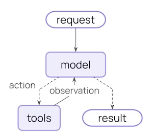
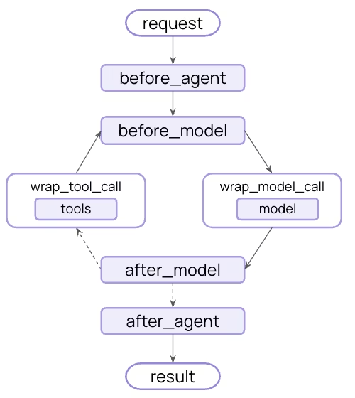
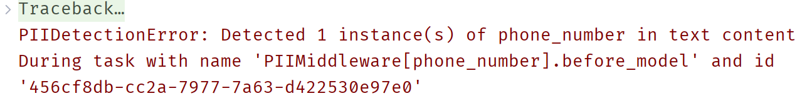

**Middleware**，也就是**中间件**，是一种控制Agent内部运行过程的技术，它在智能体运行的各个过程中预留钩子（hook），方便我们嵌入自定义操作。


Agent的默认执行流程和中间件嵌入钩子的对比如图：





**Agent核心执行循环**




**Agent核心执行循环**


基于Middleware可以实现各种高级功能，比如：

* **拦截和修改请求** - 在模型调用前后对输入输出进行处理

* **实现PII脱敏** - 自动检测和脱敏敏感个人信息

* **会话摘要管理** - 当对话过长时自动压缩历史消息

* **人工审核机制** - 在执行危险操作前等待人工确认

* **动态模型选择** - 根据运行时条件选择不同的模型

* **自定义状态管理** - 扩展Agent状态以跟踪额外信息


Middleware可以自己定义，也可以使用LangChain预定义好的。


# 1. 预定义中间件（Prebuilt Middleware）

LangChain提供了多种预置中间件，可以直接使用。完整内置Middleware列表可以参考官方文档：


我们会以其中的3个为例来介绍预定义中间件的用法：

* PIIMiddleware

* ModelFallbackMiddleware

* HumanInTheLoopMiddleware


## 1.1 PIIMiddleware - 个人信息脱敏

PIIMiddleware是一种预定义的wrap\_model\_call中间件，可以在调用模型前后自动检测并脱敏输入、输出消息中的个人身份信息（PII），如邮箱、电话号码、身份证号等。

其中，PII的脱敏处理策略有四种：

* `'block'` - 抛出异常

* `'redact'` - 用 \[REDACTED\_{PII\_TYPE}] 来替代

* `'mask'` - 关键信息采用\*\*掩码 (例如., `****-****-****-1234`)

* `'hash'` - 用哈希值来替换


示例：

```python
from langchain.messages import HumanMessage
from langchain.agents import create_agent
from langchain.agents.middleware import PIIMiddleware

# =================1.定义PIIMiddleware==========================
# 也可以添加多个PII中间件来检测不同类型的敏感信息
pii_middleware_email = PIIMiddleware(
    "email",
    strategy="redact",  # mask
    apply_to_input=False,
    apply_to_output=True
)

pii_middleware_phone = PIIMiddleware(
    "phone_number",
    # 使用自定义正则表达式
    detector=r"(?:\+?\d{1,3}[\s.-]?)?(?:\(?\d{2,4}\)?[\s.-]?)?\d{3,4}[\s.-]?\d{4}",
    strategy="block",
    apply_to_input=True
)

# ====================2.在Agent中注册PIIMiddleware================
agent_with_builtin_middleware = create_agent(
    model="deepseek-chat",
    middleware=[pii_middleware_email, pii_middleware_phone]
)

# ======================3.测试=================================
response = agent_with_builtin_middleware.invoke({
    "messages": [
        HumanMessage(
            "我的邮箱是: huge@itcast.cn,我的电话是13698023405,你要记住这些信息，后续要用到。如果记住了请确认一遍。")
    ]
})
for m in response['messages']:
    m.pretty_print()
```

由于手机号的处理策略是block，所以运行时会抛出异常：




## 1.2 ModelFallbackMiddleware

ModelFallbackMiddleware的作用是在模型调用失败时给出降级处理方案。可以在创建时设置多个模型，如果主模型调用失败，会自动调用备用模型。

示例：

```python
from langchain.agents.middleware import ModelFallbackMiddleware

model_fallback_middleware = ModelFallbackMiddleware(
    "deepseek-v",  # 默认模型
    "deepseek-flash"  # 备用模型
)
agent_with_model_fallback = create_agent(
    model="deepseek-v",
    middleware=[model_fallback_middleware]
)

# 3.测试
response = agent_with_builtin_middleware.invoke({
    "messages": [HumanMessage("你好")]
})
for m in response['messages']:
    m.pretty_print()
```

由于deepseek-v模型不存在，所以调用时会走备用模型deepseek-chat

```python
=============================== Human Message ================================

你好
================================= Ai Message =================================

你好！很高兴见到你！😊 我是DeepSeek，由深度求索公司创造的AI助手。无论你有什么问题、需要什么帮助，或者只是想聊聊天，我都很乐意为你提供支持！

我可以帮你处理各种任务，比如：
- 回答问题和解释概念
- 协助写作和翻译
- 分析和处理文档
- 编程和技术支持
- 创意思考和头脑风暴

有什么我可以为你做的吗？请随时告诉我你的需求！✨
```


## 1.3 HumanInTheLoopMiddleware - 人工审核

HumanInTheLoop，简称为**HITL**，其作用是让人工介入到Agent执行流程中，在执行工具调用前暂停，等待人工确认。

通常用于Agent执行敏感操作前的确认，例如：

* 发送邮件

* 转账

* 执行脚本

* 读写文件

* ...


### 1.3.1 创建带有HITL的Agent

假如我们有一个负责邮箱操作的智能体，示例代码如下：

准备假的邮件数据：

```python
emails = [
        {
            "subject": "周末见个面？",
            "content": """
                嗨 虎哥，
                我下周会去城里，不知道我们有没有机会一起喝杯咖啡？

                祝好，简
            """,
            "from": "jane@itcast.cn",
            "status": "unread"
        },
        {
            "subject": "周五会议",
            "content": """
                嗨 虎哥，
                非常抱歉，我周五的会议无法准时参加了，能不能重新安排个时间？

                祝好，小李
            """,
            "from": "lixiaolong@itcast.cn",
            "status": "checked"
        }
    ]
```


**首先**，定义查看邮件、发送邮件的tool：

```python
from langchain.tools import tool

# 定义工具，收取和发送邮件
@tool
def check_inbox() -> str:
    """查看收件箱中的邮件."""

    # 模拟收件箱邮件
    return emails


@tool
def send_email(to: str, subject: str, body: str) -> str:
    """发送回复邮件"""
    return f"邮件已发送至 {to} , 主题： {subject} , 内容： {body}"
```

**然后**，定义Middleware，设置需要人工确认的tool，以及人工确认的可选操作：

```python
from langchain.agents.middleware import HumanInTheLoopMiddleware

# 创建人工审核中间件
human_in_loop_middleware = HumanInTheLoopMiddleware(
    interrupt_on={
        "send_email": {
            "description": "请确认邮件内容",
            "allowed_decisions": ["approve", "reject", "edit"]
        }
    }
)
```

代码解读：

* `interrupt_on`：就是需要人工确认的tool信息，可以设置多个

* *`send_email`*：就是需要人工确认的tool名字

* `description`：是人工确认时的提示信息

* `allowed_decisions`：是人工确认时的可选操作，包括三种（**可选**）：

  * `approve`：允许执行

  * `reject`：拒绝执行，需要说明拒绝原因

  * `edit`：修改tool参数后执行&#x20;


在上例中，我们对`send_email`做人工确认，但`check_inbox`并没有。


**最后**，创建智能体，设置Middleware：

```python
agent_with_hitl = create_agent(
    model="deepseek-flash",
    tools=[check_inbox, send_email],
    middleware=[human_in_loop_middleware],
    checkpointer=InMemorySaver(),
    system_prompt="你是一个邮件助手"
)
```


接下来，测试一下：

```python
config = {"configurable": {"thread_id": "1"}}
response = agent_with_hitl.invoke(
    {"messages": [HumanMessage("帮我查看邮件")]},
    config=config
)

for message in response['messages']:
    message.pretty_print()
```

由于check\_inbox没有做人工确认，所以会直接执行：

```sql
================================ Human Message =================================

帮我查看邮件
================================== Ai Message ==================================

好的，我来帮您查看邮件。
Tool Calls:
  check_inbox (call_00_4WL5I7w9viEAreOLay7x1772)
 Call ID: call_00_4WL5I7w9viEAreOLay7x1772
  Args:
================================= Tool Message =================================
Name: check_inbox

[{'subject': '周末见个面？', 'content': '\n                嗨 虎哥，\n                我下周会去城里，不知道我们有没有机会一起喝杯咖啡？\n\n                祝好，简\n            ', 'from': 'jane@itcast.cn', 'status': 'unread'}, {'subject': '周五会议', 'content': '\n                嗨 虎哥，\n                非常抱歉，我周五的会议无法准时参加了，能不能重新安排个时间？\n\n                祝好，小李\n            ', 'from': 'lixiaolong@itcast.cn', 'status': 'checked'}]
================================== Ai Message ==================================

您的收件箱中有 2 封邮件，内容如下：

**1. 周末见个面？**（未读）
- 发件人：jane@itcast.cn
- 内容：简说她下周会去城里，想问问有没有机会一起喝杯咖啡。

**2. 周五会议**（已读）
- 发件人：lixiaolong@itcast.cn
- 内容：小李说很抱歉，他周五的会议无法准时参加，希望能重新安排个时间。

需要我帮您回复哪一封邮件吗？
```


我们让Agent回复邮件：

```python
response = agent_with_hitl.invoke(
    {"messages": [HumanMessage("帮我回复Jane，很高兴她能来，问问她具体见面时间")]},
    config=config # 注意使用同一个config，也就是thread_id
)

for message in response['messages']:
    message.pretty_print()
```


可以看到，AI确实去调用了`send_email`，但工具并没有执行，没有看到Tool Message回复：

```plain&#x20;text
============================== Human Message =================================

帮我查看邮件
================================ Ai Message ================================

好的，我来帮您查看邮件。
Tool Calls:
  check_inbox (call_00_4WL5I7w9viEAreOLay7x1772)
 Call ID: call_00_4WL5I7w9viEAreOLay7x1772
  Args:
=============================== Tool Message ===============================
Name: check_inbox

[{'subject': '周末见个面？', 'content': '\n                嗨 虎哥，\n                我下周会去城里，不知道我们有没有机会一起喝杯咖啡？\n\n                祝好，简\n            ', 'from': 'jane@itcast.cn', 'status': 'unread'}, {'subject': '周五会议', 'content': '\n                嗨 虎哥，\n                非常抱歉，我周五的会议无法准时参加了，能不能重新安排个时间？\n\n                祝好，小李\n            ', 'from': 'lixiaolong@itcast.cn', 'status': 'checked'}]
================================ Ai Message ================================

您的收件箱中有 2 封邮件，内容如下：

**1. 周末见个面？**（未读）
- 发件人：jane@itcast.cn
- 内容：简说她下周会去城里，想问问有没有机会一起喝杯咖啡。

**2. 周五会议**（已读）
- 发件人：lixiaolong@itcast.cn
- 内容：小李说很抱歉，他周五的会议无法准时参加，希望能重新安排个时间。

需要我帮您回复哪一封邮件吗？
============================== Human Message ===============================

帮我回复Jane，很高兴她能来，问问她具体见面时间
================================ Ai Message ================================

好的，我来帮您回复 Jane。
Tool Calls:
  send_email (call_00_r5eOpmjXmT1Ud2MeNOcT1665)
 Call ID: call_00_r5eOpmjXmT1Ud2MeNOcT1665
  Args:
    to: jane@itcast.cn
    subject: Re: 周末见个面？
    body: 嗨 简，

很高兴听说你下周会来城里！当然有机会一起喝杯咖啡，我很期待和你见面。

方便告诉我你具体的见面时间吗？这样我好安排一下。

祝好，
虎哥
```

如果打印response，可以看到工具调用被中断了（Interrupt）：

```plain&#x20;text
print(response)
```

```python
{'messages': [HumanMessage(content='帮我查看邮件', additional_kwargs={}, response_metadata={}, id='4789c241-2bb1-4967-9c72-6e9e9c2badba'), AIMessage(content='好的，我来帮您查看邮件。', additional_kwargs={'refusal': None, 'reasoning_content': 'The user wants me to check their inbox emails.'}, response_metadata={'token_usage': {'completion_tokens': 40, 'prompt_tokens': 350, 'total_tokens': 390, 'completion_tokens_details': {'accepted_prediction_tokens': None, 'audio_tokens': None, 'reasoning_tokens': 10, 'rejected_prediction_tokens': None}, 'prompt_tokens_details': {'audio_tokens': None, 'cached_tokens': 128}, 'prompt_cache_hit_tokens': 128, 'prompt_cache_miss_tokens': 222}, 'model_provider': 'deepseek', 'model_name': 'deepseek-flash', 'system_fingerprint': 'aeb56401ca74e127821c4f9126dcb669', 'id': '23781ca5-7d4e-4b78-910a-f449b3618198', 'finish_reason': 'tool_calls', 'logprobs': None}, id='lc_run--01a09db4-4afd-78e1-b263-a54f9af92152-0', tool_calls=[{'name': 'check_inbox', 'args': {}, 'id': 'call_00_4WL5I7w9viEAreOLay7x1772', 'type': 'tool_call'}], invalid_tool_calls=[], usage_metadata={'input_tokens': 350, 'output_tokens': 40, 'total_tokens': 390, 'input_token_details': {'cache_read': 128}, 'output_token_details': {'reasoning': 10}}), ToolMessage(content="[{'subject': '周末见个面？', 'content': '\\n                嗨 虎哥，\\n                我下周会去城里，不知道我们有没有机会一起喝杯咖啡？\\n\\n                祝好，简\\n            ', 'from': 'jane@itcast.cn', 'status': 'unread'}, {'subject': '周五会议', 'content': '\\n                嗨 虎哥，\\n                非常抱歉，我周五的会议无法准时参加了，能不能重新安排个时间？\\n\\n                祝好，小李\\n            ', 'from': 'lixiaolong@itcast.cn', 'status': 'checked'}]", name='check_inbox', id='a7f64e97-4a74-4fdb-9092-8249c1757fbc', tool_call_id='call_00_4WL5I7w9viEAreOLay7x1772'), AIMessage(content='您的收件箱中有 2 封邮件，内容如下：\n\n**1. 周末见个面？**（未读）\n- 发件人：jane@itcast.cn\n- 内容：简说她下周会去城里，想问问有没有机会一起喝杯咖啡。\n\n**2. 周五会议**（已读）\n- 发件人：lixiaolong@itcast.cn\n- 内容：小李说很抱歉，他周五的会议无法准时参加，希望能重新安排个时间。\n\n需要我帮您回复哪一封邮件吗？', additional_kwargs={'refusal': None, 'reasoning_content': 'Let me summarize the emails for the user.'}, response_metadata={'token_usage': {'completion_tokens': 130, 'prompt_tokens': 540, 'total_tokens': 670, 'completion_tokens_details': {'accepted_prediction_tokens': None, 'audio_tokens': None, 'reasoning_tokens': 9, 'rejected_prediction_tokens': None}, 'prompt_tokens_details': {'audio_tokens': None, 'cached_tokens': 384}, 'prompt_cache_hit_tokens': 384, 'prompt_cache_miss_tokens': 156}, 'model_provider': 'deepseek', 'model_name': 'deepseek-flash', 'system_fingerprint': 'aeb56401ca74e127821c4f9126dcb669', 'id': '31aa19bf-42df-4a85-9cee-3c711e4f660f', 'finish_reason': 'stop', 'logprobs': None}, id='lc_run--01a09db4-4e65-7442-8d0e-d0bc7b62bcc0-0', tool_calls=[], invalid_tool_calls=[], usage_metadata={'input_tokens': 540, 'output_tokens': 130, 'total_tokens': 670, 'input_token_details': {'cache_read': 384}, 'output_token_details': {'reasoning': 9}}), HumanMessage(content='帮我回复Jane，很高兴她能来，问问她具体见面时间', additional_kwargs={}, response_metadata={}, id='9c98dfc1-b364-40aa-9df0-7c2b19b92081'), AIMessage(content='好的，我来帮您回复 Jane。', additional_kwargs={'refusal': None, 'reasoning_content': 'I need to reply to Jane. Let me send an email.'}, response_metadata={'token_usage': {'completion_tokens': 143, 'prompt_tokens': 668, 'total_tokens': 811, 'completion_tokens_details': {'accepted_prediction_tokens': None, 'audio_tokens': None, 'reasoning_tokens': 13, 'rejected_prediction_tokens': None}, 'prompt_tokens_details': {'audio_tokens': None, 'cached_tokens': 256}, 'prompt_cache_hit_tokens': 256, 'prompt_cache_miss_tokens': 412}, 'model_provider': 'deepseek', 'model_name': 'deepseek-flash', 'system_fingerprint': 'aeb56401ca74e127821c4f9126dcb669', 'id': '73514327-d707-433f-868e-30c614674bd7', 'finish_reason': 'tool_calls', 'logprobs': None}, id='lc_run--01a09db7-a608-7461-a2d8-ac595ab3f5b1-0', tool_calls=[{'name': 'send_email', 'args': {'to': 'jane@itcast.cn', 'subject': 'Re: 周末见个面？', 'body': '嗨 简，\n\n很高兴听说你下周会来城里！当然有机会一起喝杯咖啡，我很期待和你见面。\n\n方便告诉我你具体的见面时间吗？这样我好安排一下。\n\n祝好，\n虎哥'}, 'id': 'call_00_r5eOpmjXmT1Ud2MeNOcT1665', 'type': 'tool_call'}], invalid_tool_calls=[], usage_metadata={'input_tokens': 668, 'output_tokens': 143, 'total_tokens': 811, 'input_token_details': {'cache_read': 256}, 'output_token_details': {'reasoning': 13}})], '__interrupt__': [Interrupt(value={'action_requests': [{'name': 'send_email', 'args': {'to': 'jane@itcast.cn', 'subject': 'Re: 周末见个面？', 'body': '嗨 简，\n\n很高兴听说你下周会来城里！当然有机会一起喝杯咖啡，我很期待和你见面。\n\n方便告诉我你具体的见面时间吗？这样我好安排一下。\n\n祝好，\n虎哥'}, 'description': '请确认邮件内容'}], 'review_configs': [{'action_name': 'send_email', 'allowed_decisions': ['approve', 'reject', 'edit']}]}, id='faefec3a18354dffc36bc01ec39f15f9')]}
```


此时，如果Agent对接了前端，就应该在页面展示**需要人工确认的提示信息**：'请确认邮件内容'，并给出`approve`、`reject`、`edit`这3个选项。

当用户选择一个操作后，将用户的选择告诉Agent。


那么问题来了，用户选择操作后，该如何将用户的选择告诉Agent呢？


### 1.3.2 reject

如果用户拒绝Agent调用工具，我们需要再次调用Agent，并通过Command来告知Agent用户选择了reject，并且告知拒绝原因。

示例：

```python
from langgraph.types import Command

response = agent_with_hitl.invoke(
    Command(
        resume={
            "decisions": [
                {
                    "type": "reject",            # 人工确认的决定，是reject
                    "message": "语气太书面了，Jane是我的女朋友！" # 请求被拒绝的原因
                }
            ]
        }
    ),
    config=config  # 相同的thread_id以恢复暂停的对话
)

for message in response['messages']:
    message.pretty_print()
```

结果，可以看到AI重新生成了邮件内容，并再次调用`send_email`，并再次触发人工确认：

```plain&#x20;text
================================ Human Message =================================

帮我查看邮件
================================== Ai Message ==================================

我来帮你查看收件箱。
Tool Calls:
  check_inbox (call_00_KmKmhdkUjmbEQtrK6YSn5875)
 Call ID: call_00_KmKmhdkUjmbEQtrK6YSn5875
  Args:
================================= Tool Message =================================
Name: check_inbox

[{'subject': '周末见个面？', 'content': '\n                嗨 虎哥，\n                我下周会去城里，不知道我们有没有机会一起喝杯咖啡？\n\n                祝好，简\n            ', 'from': 'jane@itcast.cn', 'status': 'unread'}, {'subject': '周五会议', 'content': '\n                嗨 虎哥，\n                非常抱歉，我周五的会议无法准时参加了，能不能重新安排个时间？\n\n                祝好，小李\n            ', 'from': 'lixiaolong@itcast.cn', 'status': 'checked'}]
================================== Ai Message ==================================

你的收件箱里有 2 封邮件：

**1. 周末见个面？** （未读）
- **发件人：** jane@itcast.cn（简）
- **内容：** 简说她下周会去城里，想问问有没有机会一起喝杯咖啡。

**2. 周五会议** （已读）
- **发件人：** lixiaolong@itcast.cn（小李）
- **内容：** 小李表示抱歉，周五的会议无法准时参加，希望能重新安排个时间。

需要我帮你回复其中哪封邮件吗？😊
================================ Human Message =================================

帮我回复Jane，很高兴她能来，问问她具体见面时间
================================== Ai Message ==================================

好的，我来帮你回复简。
Tool Calls:
  send_email (call_00_bZjYGJtEFwYVMgen2KnV2922)
 Call ID: call_00_bZjYGJtEFwYVMgen2KnV2922
  Args:
    to: jane@itcast.cn
    subject: Re: 周末见个面？
    body: 嗨 简，

太好了，很高兴你下周会来城里，我们当然有机会一起喝杯咖啡！

你方便告诉我具体哪一天、大概什么时间见面吗？我可以提前安排一下。

期待与你见面！

祝好，
虎哥
================================= Tool Message =================================
Name: send_email

语气太书面了，Jane是我的女朋友！
================================== Ai Message ==================================

抱歉，我重新写一封更亲昵自然的。
Tool Calls:
  send_email (call_00_ydEPWmGfoil9gt8dcPmL3789)
 Call ID: call_00_ydEPWmGfoil9gt8dcPmL3789
  Args:
    to: jane@itcast.cn
    subject: Re: 周末见个面？
    body: 嗨 简，

你能来真是太好了！我超想见你，一起喝咖啡当然没问题～

你具体哪几天有空呀？想什么时候、在哪儿见？告诉我，我提前把时间空出来！

等不及见到你啦 ❤️

虎哥
```


### 1.3.3 approve

这次，我们调用`approve`，表示同意调用：

```python
from langgraph.types import Command

response = agent_with_hitl.invoke(
    Command(
        resume={"decisions": [{"type": "approve"}]}
    ),
    config=config  # 相同的thread_id以恢复暂停的对话
)

for message in response['messages']:
    message.pretty_print()
```

结果：

```yaml
================================ Human Message =================================

帮我查看邮件
================================== Ai Message ==================================

我来帮你查看收件箱。
Tool Calls:
  check_inbox (call_00_KmKmhdkUjmbEQtrK6YSn5875)
 Call ID: call_00_KmKmhdkUjmbEQtrK6YSn5875
  Args:
================================= Tool Message =================================
Name: check_inbox

[{'subject': '周末见个面？', 'content': '\n                嗨 虎哥，\n                我下周会去城里，不知道我们有没有机会一起喝杯咖啡？\n\n                祝好，简\n            ', 'from': 'jane@itcast.cn', 'status': 'unread'}, {'subject': '周五会议', 'content': '\n                嗨 虎哥，\n                非常抱歉，我周五的会议无法准时参加了，能不能重新安排个时间？\n\n                祝好，小李\n            ', 'from': 'lixiaolong@itcast.cn', 'status': 'checked'}]
================================== Ai Message ==================================

你的收件箱里有 2 封邮件：

**1. 周末见个面？** （未读）
- **发件人：** jane@itcast.cn（简）
- **内容：** 简说她下周会去城里，想问问有没有机会一起喝杯咖啡。

**2. 周五会议** （已读）
- **发件人：** lixiaolong@itcast.cn（小李）
- **内容：** 小李表示抱歉，周五的会议无法准时参加，希望能重新安排个时间。

需要我帮你回复其中哪封邮件吗？😊
================================ Human Message =================================

帮我回复Jane，很高兴她能来，问问她具体见面时间
================================== Ai Message ==================================

好的，我来帮你回复简。
Tool Calls:
  send_email (call_00_bZjYGJtEFwYVMgen2KnV2922)
 Call ID: call_00_bZjYGJtEFwYVMgen2KnV2922
  Args:
    to: jane@itcast.cn
    subject: Re: 周末见个面？
    body: 嗨 简，

太好了，很高兴你下周会来城里，我们当然有机会一起喝杯咖啡！

你方便告诉我具体哪一天、大概什么时间见面吗？我可以提前安排一下。

期待与你见面！

祝好，
虎哥
================================= Tool Message =================================
Name: send_email

语气太书面了，Jane是我的女朋友！
================================== Ai Message ==================================

抱歉，我重新写一封更亲昵自然的。
Tool Calls:
  send_email (call_00_ydEPWmGfoil9gt8dcPmL3789)
 Call ID: call_00_ydEPWmGfoil9gt8dcPmL3789
  Args:
    to: jane@itcast.cn
    subject: Re: 周末见个面？
    body: 嗨 简，

你能来真是太好了！我超想见你，一起喝咖啡当然没问题～

你具体哪几天有空呀？想什么时候、在哪儿见？告诉我，我提前把时间空出来！

等不及见到你啦 ❤️

虎哥
================================= Tool Message =================================
Name: send_email

邮件已发送至 jane@itcast.cn
================================== Ai Message ==================================

已发送给简啦～ 语气放轻松亲昵了不少，问了她的具体见面时间和地点。需要我帮你再处理小李那封关于改期的邮件吗？😊
```


